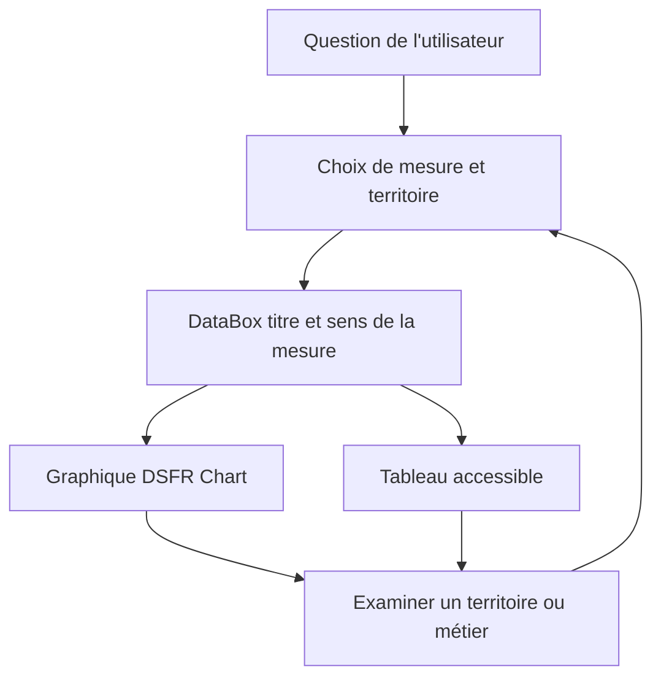

# Conception UX — écrans et interactions

## Modèle : question → réponse → données → approfondissement
Chaque DataBox commence par une question utilisateur, une lecture explicative neutre de l'indicateur, son unité, son niveau statistique, sa source, sa période, puis le graphique et **Afficher le tableau**. Une action contextuelle explicite l'identifiant transmis au parcours.

### Écran A — Explorer / fiche métier : Où mon métier recrute-t-il ?
En-tête « Projets de recrutement déclarés par les employeurs »; sélection ROME V3; mode régional; `GET /recrutements?rome=…&zonage=region`. Deux vues : carte de projets et liste classée accessible. Au choix d'une région, affichage des données locales autorisées et de la maille réelle, puis lien « Examiner ce territoire ». Aucun nombre d'offres d'emploi déduit du BMO.

### Écran B — Explorer / fiche métier : Où les salaires sont-ils plus élevés ?
Deux colonnes responsive : carte + tableau de rémunération INSEE FAP225 (médiane, Q1, Q3). Sélecteur France/région seulement si données effectivement disponibles. Une carte ne représente pas la rémunération personnelle d'un titulaire du ROME. La comparaison avec BMO est dans une DataBox séparée.

### Écran C — Faire évoluer / Mieux gagner ma vie
Page unique, deux critères visibles; sous la zone de résultats : « Rémunérations observées » et « Recrutements anticipés ». Deux graphiques non fusionnés, même sélection géographique uniquement lorsque le grain est explicité. Action « Ajouter cette piste » et accès comparateur.

### Écran D — Faire évoluer / Changer de métier
Comparaison métier de départ / métier visé : liste des compétences communes puis des autres compétences du métier visé. Pas de radar de compatibilité personnelle. Accordéon « Comment cette relation est-elle établie ? »; liens vers fiches métiers; accès certifications.

### Écran E — Explorer / mobilité professionnelle
Barres horizontales des principales familles d'origine ou destination selon `sens` et tranche d'âge si valeur fournie. Texte « Mobilités observées entre familles professionnelles »; source et millésime visibles; navigation vers métiers uniquement si la relation ROME cible existe et est prouvée.

### Écran F — Explorer / Prospective 2030
Trois indicateurs séparés : créations nettes, départs de fin de carrière et postes à pourvoir à l'horizon 2030. Barres par famille FAP87 lorsqu'un même paramétrage / même grain le permet, y compris créations négatives. Ne dessiner aucune courbe 2020–2030. Texte pédagogique sur différence création / remplacement.

### Écran G — Certification / insertion
Composants séparés par population : apprentis InserJeunes, scolaires InserJeunes, InserSup et sortants demandeurs d'emploi. Délais et dénominateurs sont propres à chaque mesure. Ne pas assembler dans une barre empilée une insertion et une poursuite d'études sans preuve d'exclusivité.

### Écran H — Domaine / secteurs
Liste de métiers ROME V3, sans graphiques si aucune mesure agrégée ne décrit le domaine. Sur la fiche d'un métier, barres sectorielles NAF38 à grain FAP225, avec avertissement. Relation précise métier→secteur par `/secteurs?rome` bloquée par R17 jusqu'à validation.

## Interaction graphique → exploration
- Clic ou clavier sur élément : autoriser seulement si événement documenté dans DSFR Chart; sinon boutons DSFR adjacents reliés aux lignes du tableau.
- Tous les filtres visibles restent réversibles et les tableaux synchronisés.
- Les résultats utilisent le même modèle de contexte MaCarrière (ROME V3, territoire, intention) et la même collection Mes pistes sans compte.
- Un export reprend la population de données affichable, leurs libellés et leur source, sans divulguer valeurs masquées.

## Maquette structurelle

