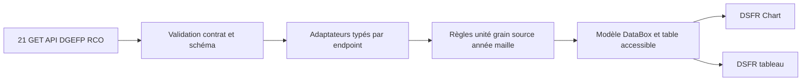

# Architecture commune — composants datavisualisation

## Décision transversale : composants natifs en priorité
Utiliser les web components officiels de DSFR Chart et leurs mécanismes existants (dont DataBox et ses alternatives lorsqu’elles sont disponibles dans la version installée). Les composants MaCarrière listés ci-dessous sont des **adaptateurs et compositions**, pas des réimplémentations de graphiques ni de l’accessibilité DSFR Chart. Ne développer un rendu propre que si une lacune concrète est démontrée et arbitrée.

## Contrats fonctionnels proposés (architecture, non code existant)
- `MaDataBox` : titre, description, valeur, note statistique, source, millésime, date, export, actions, tableau obligatoire si graphique.
- `MaIndicatorDescriptor` : `endpoint`, `params`, `source_libelle`, `grain`, `millesime`, `unite`, `population`, `maille_reelle`, `secret_stat`, `definition` et `preuve`; absence ≠ valeur nulle.
- `MaRegionMap` et `MaDepartmentMap` : adaptateurs de codes géographiques INSEE→DSFR Chart; fallback tableau si mauvaise correspondance.
- `MaBarRanking` : barres et table; unité et tri vérifiés.
- `MaQuantileSalary` : médiane, Q1, Q3; ne pas appeler « fourchette de salaire garanti ».
- `MaProjection2030` : barres de valeurs ponctuelles, négatifs conservés, horizon explicite.
- `MaPopulationIndicator` : indicateur d'insertion spécifique à sa population.
- `MaDataTable` : tableau HTML/DSFR accessible, tri explicite et description, source et date.
- `MaEvidenceNotice` : détail source, FAP, population, territoire, date, indicateurs d'indisponibilité.

## Pipeline de données

## Séparation stricte
Les adaptateurs normalisent les réponses et préservent l'objet statistique; ils n'ajoutent aucun indicateur. La couche visuelle ne connaît pas les URLs API; seul le service de données valide les requêtes, les erreurs et la signification. Chaque dataset a un ID de provenance. Les éléments absents ou masqués restent hors du graphique.

## Réutilisation / audit requis
- Explorer V2 : composants de fiches et comparateur prévus; vérifier existence et interfaces dans dépôt.
- Faire évoluer V3 : réutiliser tous les indicateurs et graphiques, seule hiérarchie change avec l'intention principale.
- Mes pistes : conserver identifiants métier ROME V3, pas des captures d'écran de graphiques ou statistiques figées.
- Autres parcours : consommer exactement les mêmes indicateurs et objets de provenance, sans recalcul.

## Décision de packaging
Audit Codex : framework réel, imports DSFR et version, ESM/SSR, effets web components, hydration, performance, code splitting, thème sombre. Documenter l'architecture présente avant d'intégrer; aucune présomption d'un React ou Vue déjà en place.
