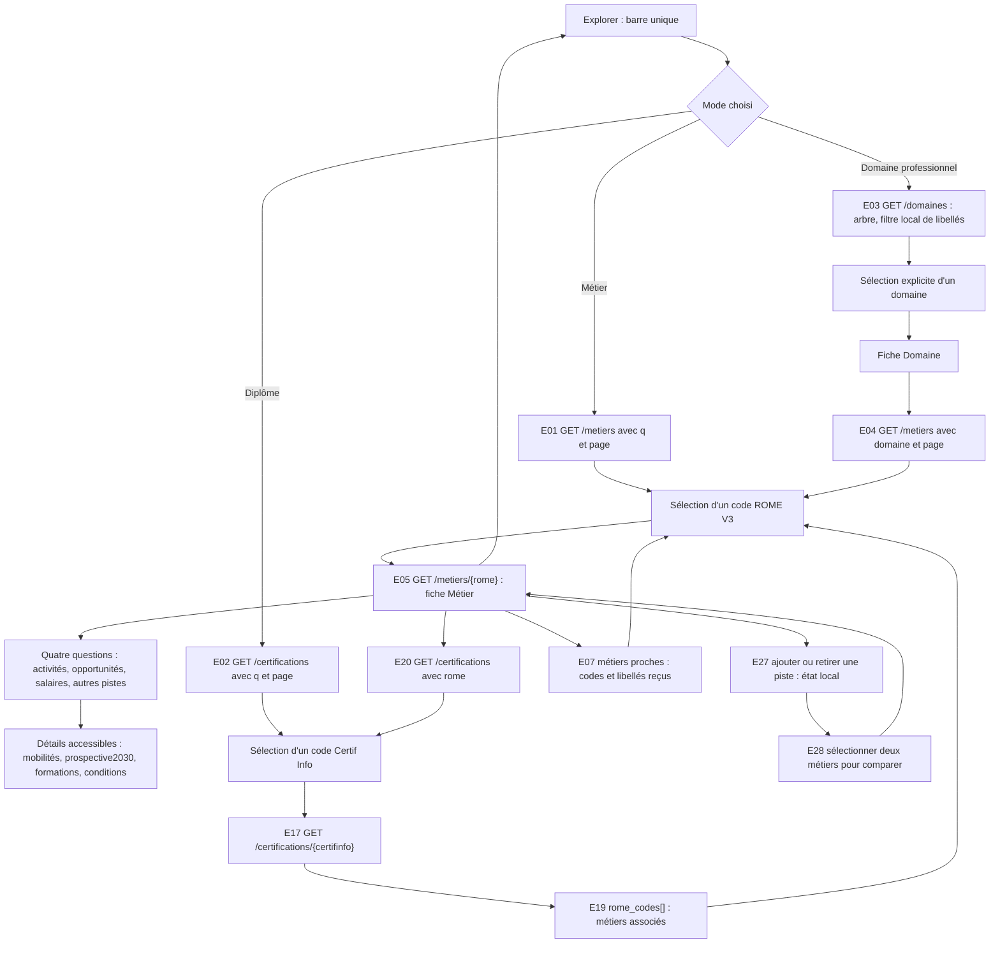
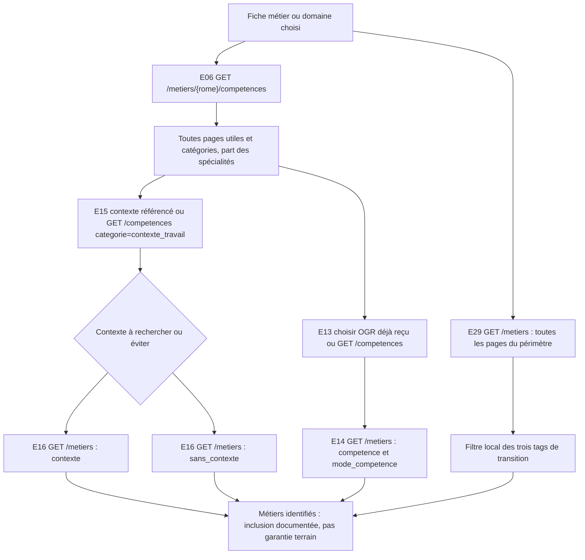
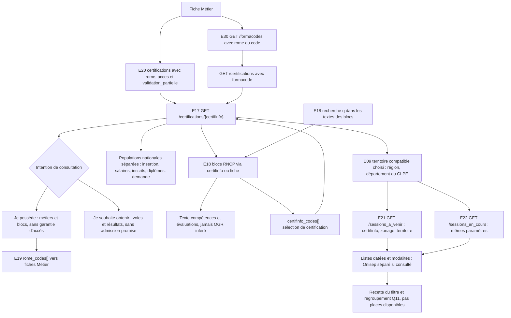
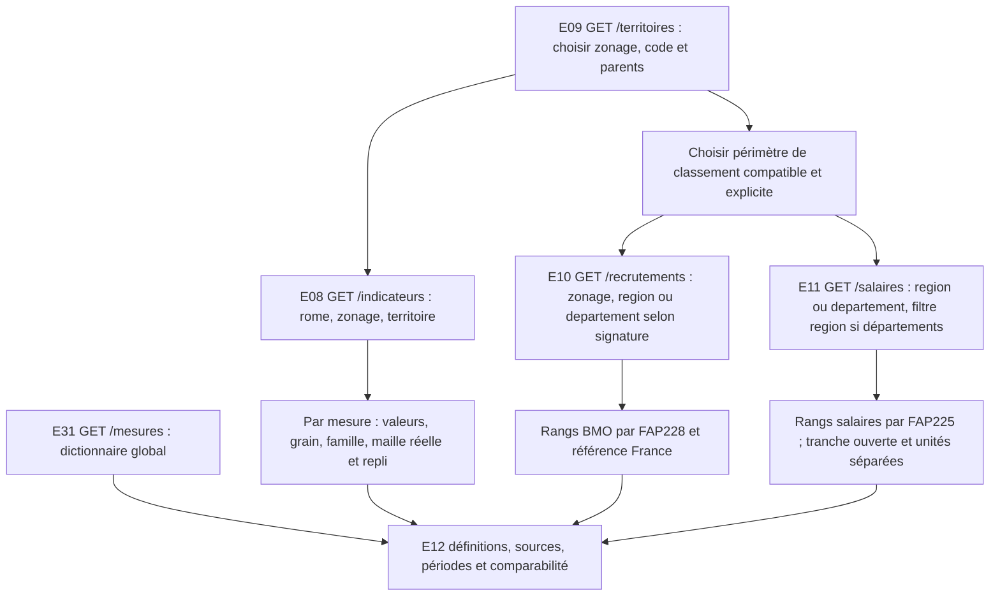
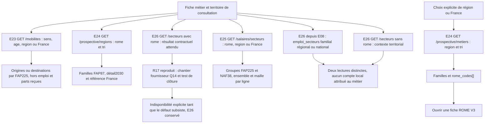
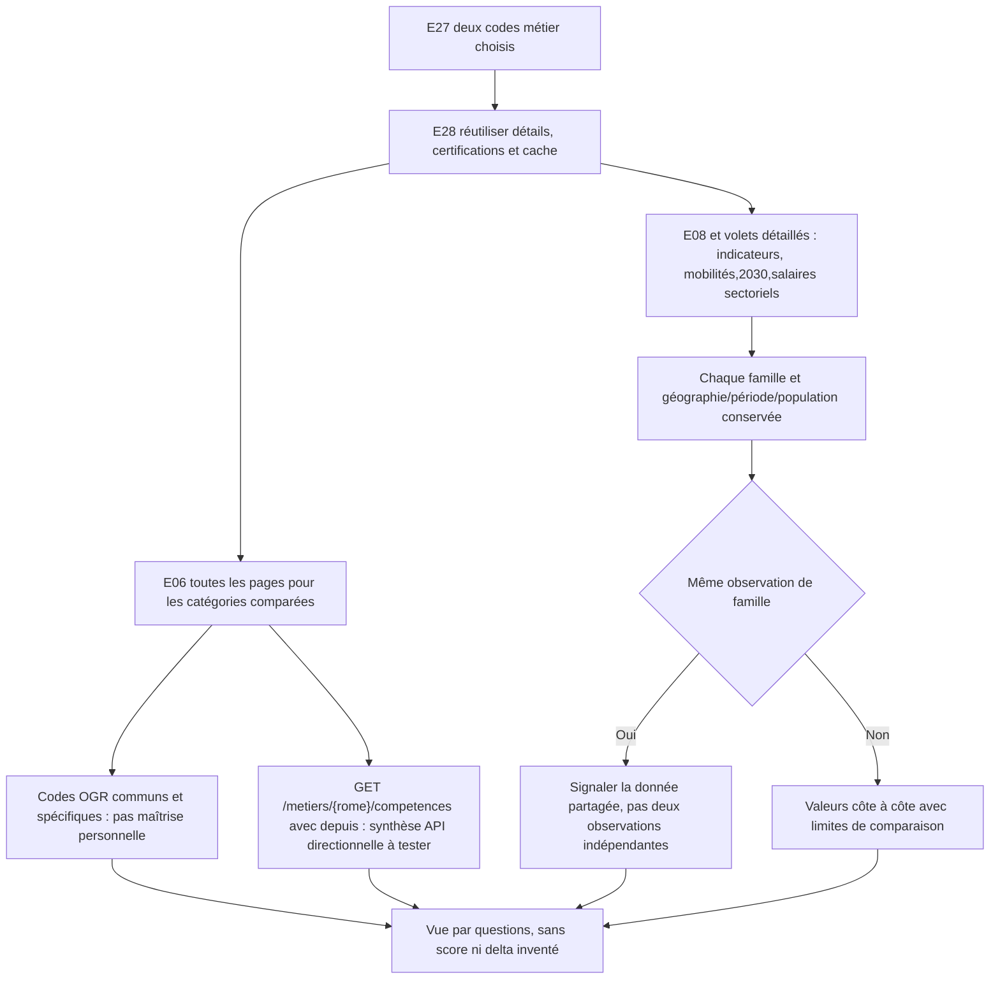
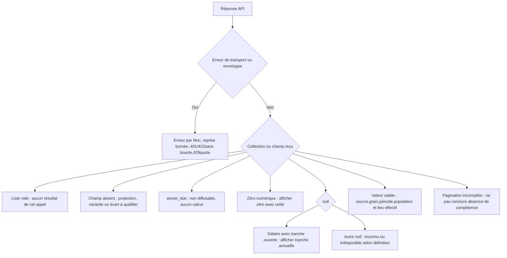

# Explorer V2 — diagrammes de parcours

## Évolution UX ciblée — 2 novembre 2026

La maquette existante est conservée comme socle de restitution des données. Son point d'entrée est désormais la recherche, qui reste disponible dans les fiches avec ses trois modes et sa saisie. La première lecture du métier suit quatre questions : activités, opportunités, salaires et autres pistes ; les contenus détaillés, dont mobilités et prospective2030, restent accessibles ensuite. Les filtres savoir-faire/contextes sont simultanés, sans étapes numérotées. Le comparateur porte sur les deux métiers effectivement choisis ; le lieu est sélectionné parmi les territoires observés, sans transposer les chiffres d'un autre lieu.

Mes pistes utilise une session d'onglet et un format de reprise portable dans la maquette. Il s'agit d'une préparation opérationnelle, pas d'un arbitrage définitif de stockage de production. L'utilisatrice a demandé d'avancer sans les deux autres parcours, à raccorder plus tard : aucune liaison vers un produit absent n'est simulée. D08/D10 restent ouverts sur les modalités de production. Aucune des31 fonctionnalités n'est retirée et aucun nouveau GET n'est ajouté.

Voir [l'évolution appliquée et ses limites](12_maquette_html/documentation/EVOLUTION_STRUCTURE_UX.md) et [les contrôles actuels](12_maquette_html/README.md). Les nombres de contrôles cités dans les sections historiques correspondent à leurs étapes respectives. La recherche reste alimentée par les JSON observés ; ces contrôles locaux ne prouvent pas une recherche HTTP réelle, un partage interapplications, ni une conformité RGAA.

**Mise à jour du 2 novembre 2026 — dossier rangé.** Le lot L0 est terminé. La présentation actuelle est la [maquette HTML citoyenne](12_maquette_html/index.html), dont les [sources et contrôles](12_maquette_html/README.md) sont rangés séparément. Voir le [guide du dossier](README.md). Les noms du projet, identifiants et référentiels employés dans les documents techniques ne doivent pas apparaître dans les écrans citoyens. Les 31 fonctionnalités restent conservées ; les captures locales ne valent pas des tests HTTP de l’API.

Alignement L0 — 1er novembre 2026. Les 31 fonctions sont incluses. Ces schémas décrivent les parcours, pas des tests HTTP ou jointures SQL. Les paramètres et chemins JSON exacts sont dans 02/03. Aucun UML de référence sous05_uml n'est modifié.

## Navigation principale — E01/E02/E03/E04/E05/E07/E17/E19/E20/E27/E28

La fiche Domaine précède sa liste de métiers ; elle n'est pas atteinte en requalifiant une sélection déjà métier. Diplôme inclut aussi titres/RS, avec type réel. E27 n'appelle pas un endpoint de sauvegarde.

## Compétences, contextes, transitions — E06/E13/E14/E15/E16/E29

Les filtres OGR compatibles peuvent se combiner au domaine choisi selon le contrat. Le paramètre domaine de /competences désigne1–6, pas un Domaine professionnel. MC page 1/2 ne prouve pas une liste complète. E29 ne crée pas un paramètre de filtre serveur transition.

## Certification, blocs, thèmes et sessions — E17/E18/E19/E20/E21/E22/E30

Les deux intentions changent l'ordre d'affichage, pas les données. Actives seulement ; ancien diplôme introuvable explicité. Onisep a une date conventionnelle ; ses modes sont exclure/inclure/seulement. Une liste courante n'a pas besoin d'une clé métier stable inventée. Les sessions non certifiantes par Formacode ne sont pas exposées.

## Indicateurs et comparaisons territoriales — E08/E09/E10/E11/E12/E31

/recrutements et /salaires n'acceptent pas territoire. Un périmètre de classement choisi n'est pas le repli automatique d'une mesure. Les 29 entrées de /mesures ne sont pas29valeurs disponibles pour le métier ; les 14 mesures d'indicateurs ont leurs formes propres. France est un choix spécifique aux routes compatibles, non un zonage de /territoires.

## Mobilités, prospective détaillée et secteurs — E23/E24/E25/E26

Mobilités : top 15 au plus et parts sous secret omises, pas normalisation à100. Prospective : créations/déséquilibres négatifs conservés, taux fournis, métropole/France et agrégats expliqués, pas de somme BMO. Salaires sectoriels : mensuel/annuel distincts et références tous secteurs, pas de score. Les lectures accessibles d'E26 ne valent pas clôture de R17.

## Comparateur complet — E28 avec E05/E06/E08–E12/E17/E20/E23–E25/E27/E31

## États et tests indispensables

## Couverture et lots techniques

| Diagramme | IDs couverts | Lots |
|---|---|---|
| Navigation principale | E01, E02, E03, E04, E05, E07, E17, E19, E20, E27, E28 | L2, L9 |
| Compétences/contextes/transitions | E06, E13, E14, E15, E16, E29 | L2, L3 |
| Certification/blocs/thèmes/sessions | E17, E18, E19, E20, E21, E22, E30 | L2, L3, L8 |
| Indicateurs/territoires/méthode | E08, E09, E10, E11, E12, E31 | L2, L4 |
| Mobilités/prospective/secteurs | E23, E24, E25, E26 | L5, L6, L7 |
| Comparateur | E28 et réutilisation des contenus référencés | L9 |
| États/accessibilité et recette intégrée | Tous E01–E31, T-E01–T-E31 et V01–V14 | L1, L10 |

L0 aligne les livrables et prépare les validations ; L1 fournit l'intégration partagée ; L2–L9 réalisent toute la cible ; L10 couvre sa recette. Une erreur ou un manque de preuve ne retire aucun ID.
