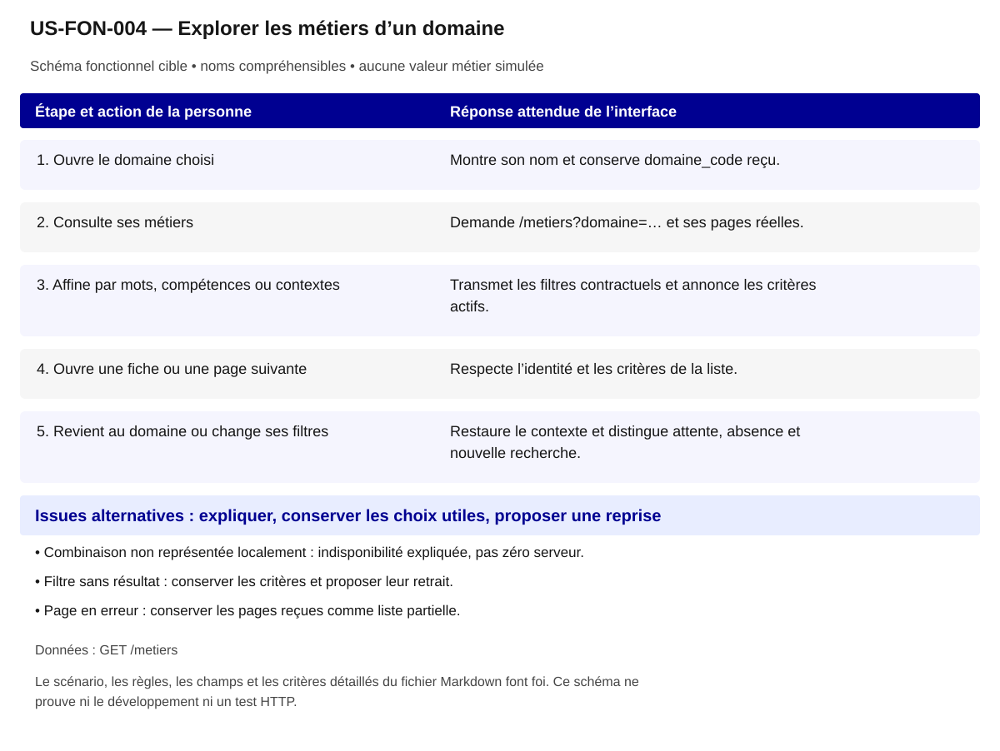

# US-FON-004 — Explorer les métiers d’un domaine

**Rattachement :** E04 · alias historique US-E04. **Lot :** L2.

**Périmètre :** inclus. Les dépendances et les tests à réaliser organisent la réalisation, sans retirer la fonctionnalité.

**Dépendances et passerelles :** [US-FON-003](US-FON-003.md) (E03).

**État constaté au 2 novembre 2026 :** Liste locale et navigation testées ; combinaisons et pagination HTTP à tracer.

[Retour au backlog](../04_BACKLOG_USER_STORIES.md) · [Modèle commun](../../00_MODELE_COMMUN_USER_STORIES/MODELE_US_FONCTIONNELLE.md)

## 1. Objectif fonctionnel

Permettre à la personne de explorer les métiers d’un domaine, pour découvrir des métiers dans un périmètre explicite. Je veux voir les métiers d'un domaine et affiner la liste.

## 2. User Story

En tant que personne qui explore ses possibilités professionnelles, je souhaite explorer les métiers d’un domaine, afin de découvrir des métiers dans un périmètre explicite.

## 3. Préconditions

- Les noms et identifiants sélectionnables proviennent des réponses autorisées ; aucun métier, lieu ou résultat n’est choisi implicitement.
- Les appels disposent de leurs paramètres exacts et le contexte de navigation est identifié. Les GET sont protégés par l’intégration prévue au contrat ; aucun secret d’accès n’est embarqué dans le HTML public.
- Les fonctionnalités liées restent accessibles selon les dépendances ci-dessus ; un volet indisponible ne bloque pas toute la fiche.

## 4. Scénario nominal

| Étape | Action utilisateur | Comportement attendu du système |
|---|---|---|
| 1 | Ouvre le domaine choisi | Montre son nom et conserve domaine_code reçu. |
| 2 | Consulte ses métiers | Demande /metiers?domaine=… et ses pages réelles. |
| 3 | Affine par mots, compétences ou contextes | Transmet les filtres contractuels et annonce les critères actifs. |
| 4 | Ouvre une fiche ou une page suivante | Respecte l’identité et les critères de la liste. |
| 5 | Revient au domaine ou change ses filtres | Restaure le contexte et distingue attente, absence et nouvelle recherche. |

## 5. Scénarios alternatifs

- Combinaison non représentée localement : indisponibilité expliquée, pas zéro serveur.
- Filtre sans résultat : conserver les critères et proposer leur retrait.
- Page en erreur : conserver les pages reçues comme liste partielle.

**États et erreurs complémentaires à couvrir :** Chargement/erreur partielle, 400/401/404/422/429/503/5xx/réseau ; annuler réponse périmée ; null, 0, secret_stat, clé absente et liste vide distincts ; reprise bornée, aucune donnée de remplacement. Les statuts ci-dessus sont des cas de recette, leur retour effectif dépend de l’endpoint ; ne pas inventer un corps d’erreur serveur.

## 6. Règles de gestion

- Chaque métier respecte le domaine_code demandé.
- Ne pas additionner salaires ou projets pour produire une statistique du domaine.
- Compétences et contextes restent des filtres documentaires, pas une adéquation personnelle.

**Règles héritées conservées :** Référentiel ROME V3 ; pagination et filtrage ne créent aucun agrégat statistique.

**Traitements :** `/metiers?domaine=...&page=...` ; Référentiel ROME V3 ; pagination et filtrage ne créent aucun agrégat statistique.

**Règles statistiques :** Afficher source, période/millésime, définition/unité, grain et géographie effective ; aucun score/delta/agrégat inventé, aucune inférence personnelle ; secret_stat non calculable. Référentiel ROME V3 ; pagination et filtrage ne créent aucun agrégat statistique.

**Règles communes :** noms et explications en langage courant ; ROME V3 uniquement ; aucune source métier extérieure aux 21 GET ; aucune moyenne, conversion annuelle/mensuelle, interpolation ou correspondance construite. Les codes restent internes aux requêtes, routes et tests.

Une valeur nulle, absente, `secret_stat`, zéro et une liste vide conservent leur sens distinct. Afficher le lieu réellement mesuré et expliquer le repli par indicateur ; ne pas attribuer un résultat de famille à un seul métier ou un résultat national à une session.

## 7. Données et API

**Source et portée de conception :** ROME V3 ; grain ROME V3 ; période référentiel courant. Les métadonnées de chaque réponse/mesure priment toute valeur observée dans un exemple.

### Appel 1 — GET `/metiers`

**Déclenchement :** À la sélection ou ouverture de la section. Ordre/chaînage : suivre les étapes du scénario, les identifiants reçus et les dépendances liées ; charger les détails à leur ouverture et réutiliser le cache à paramètres strictement identiques.

| Paramètre exact | Emplacement | Obligation du contrat | Type / domaine Swagger | Usage pour cette US |
|---|---|---|---|---|
| `domaine` | query | Facultatif Swagger | `string ; défaut API null` | code ROME lettre+2chiffres |
| `page` | query | Facultatif Swagger | `integer ; défaut API 1 ; minimum=0` | >=1 |
| `competence` | query | Facultatif Swagger | `string ; défaut API null` | optionnel codes OGR |
| `mode_competence` | query | Facultatif Swagger | `string ; valeurs toutes, au_moins_une ; défaut API null` | toutes ou au_moins_une |
| `contexte` | query | Facultatif Swagger | `string ; défaut API null` | optionnel OGR |
| `sans_contexte` | query | Facultatif Swagger | `string ; défaut API null` | optionnel OGR |
| `q` | query | Facultatif Swagger | `string ; défaut API null ; minLength=2 ; maxLength=100` | optionnel 2–100 caractères |

| Chemin JSON exact | Type connu | Niveau de preuve du chemin/type |
|---|---|---|
| `$.items[].rome_code` | string ou null | Type OpenAPI officiel ; chemin observé |
| `$.items[].rome_libelle` | string ou null | Type OpenAPI officiel ; chemin observé |
| `$.items[].domaine_code` | string ou null | Type OpenAPI officiel ; chemin observé |
| `$.items[].domaine_libelle` | string ou null | Type OpenAPI officiel ; chemin observé |
| `$.items[].grand_domaine_code` | string ou null | Type OpenAPI officiel ; chemin observé |
| `$.items[].grand_domaine_libelle` | string ou null | Type OpenAPI officiel ; chemin observé |
| `$.items[].appellations` | array | Type OpenAPI officiel ; chemin observé |
| `$.items[].definitions` | array | Type OpenAPI officiel ; chemin observé |
| `$.items[].tag_transition_ecologique` | boolean ou null | Type OpenAPI officiel ; chemin observé |
| `$.items[].tag_transition_numerique` | boolean ou null | Type OpenAPI officiel ; chemin observé |
| `$.items[].tag_transition_demographique` | boolean ou null | Type OpenAPI officiel ; chemin observé |
| `$.items[].tag_emploi_reglemente` | boolean ou null | Type OpenAPI officiel ; chemin observé |
| `$.items[].tag_emploi_cadre` | boolean ou null | Type OpenAPI officiel ; chemin observé |
| `$.items[].metiers_proches_codes` | array | Type OpenAPI officiel ; chemin observé |
| `$.items[].metiers_proches_libelles` | array | Type OpenAPI officiel ; chemin observé |
| `$.items[].savoir_etre_libelles` | array | Type OpenAPI officiel ; chemin observé |
| `$.items[].contexte_travail_codes` | array | Type OpenAPI officiel ; chemin observé |
| `$.items[].contexte_travail_libelles` | array | Type OpenAPI officiel ; chemin observé |
| `$.items[].fap228_codes` | array | Type OpenAPI officiel ; chemin observé |
| `$.items[].formacode_codes` | array | Type OpenAPI officiel ; chemin observé |
| `$.items[].formacode_libelles` | array | Type OpenAPI officiel ; chemin observé |
| `$.items[].source_libelle` | string ou null | Type OpenAPI officiel ; chemin observé |

**Réponses natives utilisées pour vérifier les chemins :** [06_controles/resultats/R23 test/R23 GET metierscompetence=125416&mode_competence=toutes&page=1.json](<../../../06_controles/resultats/R23 test/R23 GET metierscompetence=125416&mode_competence=toutes&page=1.json>); [06_controles/resultats/R23 test/R23 GET metierscompetence=125416,103659&mode_competence=au_moins_une&page=1.json](<../../../06_controles/resultats/R23 test/R23 GET metierscompetence=125416,103659&mode_competence=au_moins_une&page=1.json>); [06_controles/resultats/R23 test/R23 GET metierscompetence=125416,103659&mode_competence=toutes&page=1.json](<../../../06_controles/resultats/R23 test/R23 GET metierscompetence=125416,103659&mode_competence=toutes&page=1.json>); [06_controles/resultats/R24/R24 GET metiersdomaine=F16&contexte=300782&page=1.json](<../../../06_controles/resultats/R24/R24 GET metiersdomaine=F16&contexte=300782&page=1.json>); [06_controles/resultats/R24/R24 GET metiersdomaine=F16&sans_contexte=300782&page=1.json](<../../../06_controles/resultats/R24/R24 GET metiersdomaine=F16&sans_contexte=300782&page=1.json>).

### Preuves et contrôles restant à produire

**Documenté :** [contrat](../../../01_sources/contrat_interface_2026-10-19.md) ; [OpenAPI officiel](../../../01_sources/openapi/docs_json_interface.json). Dix réponses sur les 21 GET n’ont pas de schéma officiel de réponse ; un type observé ne devient pas un schéma fournisseur.

**Références conservées de la conception :** [04_relations/CHAINES_APPELS_API.md](../../../04_relations/CHAINES_APPELS_API.md); [03_catalogue/routes_openapi.csv](../../../03_catalogue/routes_openapi.csv).

**Contrôle local déjà rapporté :** Mission 007 et contrôle de la liste locale du domaine F16. [Recette UX existante](../TESTS_UX_EXPLORER.md). Ces résultats sur JSON locaux ne valident pas les appels HTTP.

**Tests à réaliser :** T-E04 : Tracer domaine seul puis avec filtres, vérifier chaque `domaine_code` et toutes pages requises.

**Points RCO associés :** Q03/Q05 : combinaison et périmètre ; tri contractuel/tests/demande fournisseur dans 06 section Q01–Q14. Lire le tri déjà établi dans [Q01–Q14](../06_DECISIONS_ET_POINTS_A_VALIDER.md) avant toute nouvelle demande ; ne pas redemander une réponse démontrée par le contrat.

## 8. Critères d’acceptation

**US-FON-004-CA-01** — **Étant donné** le domaine F16 des preuves, **Quand** la liste aboutit, **Alors** chaque résultat conserve le domaine demandé.

**US-FON-004-CA-02** — **Étant donné** un filtre actif, **Quand** je le retire, **Alors** la liste et l’état du filtre sont actualisés.

**US-FON-004-CA-03** — **Étant donné** une page manquante, **Quand** je lis les résultats, **Alors** la liste n’est pas déclarée exhaustive.

**US-FON-004-CA-04** — **Étant donné** une fiche ouverte depuis le domaine, **Quand** je reviens, **Alors** domaine et critères restent accessibles.

**US-FON-004-CA-05** — **Étant donné** un intitulé public et son identifiant technique disponibles, **Quand** le contenu est présenté, **Alors** les noms sont compréhensibles, les sources restent accessibles et aucun code de référentiel n’est imposé à la personne.

**US-FON-004-CA-06** — **Étant donné** une réponse absente, protégée ou en erreur pour un seul volet, **Quand** les autres réponses sont disponibles, **Alors** les volets disponibles restent consultables et l’état manquant est expliqué sans valeur de substitution.

**Trace de conception conservée :** La liste ne contient que des métiers du domaine choisi ; Métiers du domaine, filtres compétences/contextes combinables ; pagination progressive ; Tracer domaine seul puis avec filtres, vérifier chaque `domaine_code` et toutes pages requises ; états d'erreur de la ligne vérifiés, aucune preuve HTTP déduite de fixtures. ; Recette citoyenne : aucun identifiant ou sigle de référentiel imposé à l’usager ; nombres et unités inchangés ; explication des limites et des absences ; sources conservées, sans score supplémentaire. ; Vérifier les scénarios de navigation correspondants dans la recette UX, sans déduire un test HTTP d’un contrôle du prototype.

**Recette de rattachement :** `T-E04` ; les critères ci-dessus constituent les cas vérifiables à décliner dans cette recette et la matrice de traçabilité.

## 9. Composants UX/UI

- DSFR : cartes, filtres simultanés, chips, pagination et retour Domaine.
- Pas de métier cible obligatoire ni de score ; changements utiles annoncés.

**États à rendre accessibles :** initial, saisie/choix, attente annoncée, résultat, résultat partiel, vide, valeur non renseignée/protégée, erreur et reprise. Afficher des messages près des commandes concernées ; conserver les sélections utiles et ignorer les réponses périmées.

**Accessibilité :** libellés permanents, structure des titres, liens explicites, focus visible et logique, navigation intégrale au clavier ; annoncer les changements utiles sans lire chaque frappe. Aucune information portée par la seule couleur, le survol ou une carte. Tableau de données équivalent pour chaque graphique ; source, période, unité, population et lieu effectif accessibles au même endroit.

**Responsive et sobriété :** progression par questions, détails à la demande, réemploi des GET identiques ; repli sans perte de contenu, lecture à 320 px et zoom navigateur 200/400 % à recetter. JavaScript indisponible : afficher le contenu de repli et les limites réelles. Une recette locale ne constitue pas une conformité RGAA complète.

**Bibliothèques :** DSFR installé pour les contrôles et tableaux ; DSFR Chart officiel (`@gouvfr/dsfr-chart` 2.1.1 dans l’intégration actuelle) et DataBox quand une représentation convient. Pas de graphique personnalisé pour remplacer un composant adapté. GenUI n’est pas une dépendance de réalisation décidée ; aucun service ni endpoint supplémentaire n’est supposé.

**Composants et interaction hérités :** Métiers du domaine ; Métiers du domaine, filtres compétences/contextes combinables ; pagination progressive ; Présentation citoyenne : noms plutôt que codes ; pas de version ou de détail interne ; explication du sens des chiffres, des personnes concernées, du lieu et de la période ; sources accessibles. ; Évolution UX ciblée : Ouvrir le domaine effectivement choisi et les métiers de ce domaine ; conserver recherche et lieu au retour.

**SEO / validation conservés :** Proposition à valider D10 : Liens fiches ROME. Ce statut est une proposition de déploiement, pas une décision produit acquise.

## 10. Maquette fonctionnelle

[Ouvrir le schéma SVG accessible](svg/US-FON-004.svg). Le texte intégral du scénario en section 4 et des alternatives en section 5 fournit son alternative. Il s’agit de la cible fonctionnelle, sans données de démonstration inventées ni déclaration de disponibilité HTTP.
