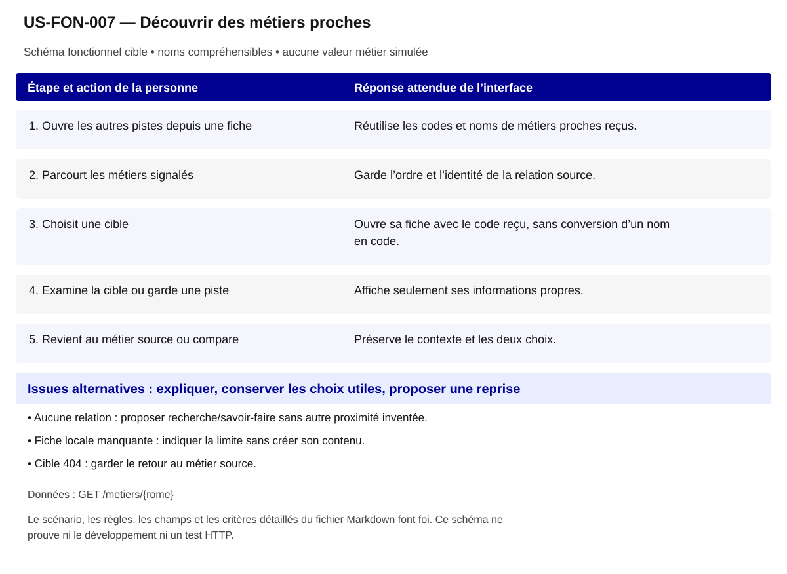

# US-FON-007 — Découvrir des métiers proches

**Rattachement :** E07 · alias historique US-E07. **Lot :** L2.

**Périmètre :** inclus. Les dépendances et les tests à réaliser organisent la réalisation, sans retirer la fonctionnalité.

**Dépendances et passerelles :** [US-FON-005](US-FON-005.md) (E05).

**État constaté au 2 novembre 2026 :** Navigation locale et historique testés ; ouverture HTTP des cibles à confirmer.

[Retour au backlog](../04_BACKLOG_USER_STORIES.md) · [Modèle commun](../../00_MODELE_COMMUN_USER_STORIES/MODELE_US_FONCTIONNELLE.md)

## 1. Objectif fonctionnel

Permettre à la personne de découvrir des métiers proches, pour examiner des alternatives sans promesse de transition. Je veux découvrir et ouvrir des métiers proches.

## 2. User Story

En tant que personne qui explore ses possibilités professionnelles, je souhaite découvrir des métiers proches, afin d’examiner des alternatives sans promesse de transition.

## 3. Préconditions

- Les noms et identifiants sélectionnables proviennent des réponses autorisées ; aucun métier, lieu ou résultat n’est choisi implicitement.
- Les appels disposent de leurs paramètres exacts et le contexte de navigation est identifié. Les GET sont protégés par l’intégration prévue au contrat ; aucun secret d’accès n’est embarqué dans le HTML public.
- Les fonctionnalités liées restent accessibles selon les dépendances ci-dessus ; un volet indisponible ne bloque pas toute la fiche.

## 4. Scénario nominal

| Étape | Action utilisateur | Comportement attendu du système |
|---|---|---|
| 1 | Ouvre les autres pistes depuis une fiche | Réutilise les codes et noms de métiers proches reçus. |
| 2 | Parcourt les métiers signalés | Garde l’ordre et l’identité de la relation source. |
| 3 | Choisit une cible | Ouvre sa fiche avec le code reçu, sans conversion d’un nom en code. |
| 4 | Examine la cible ou garde une piste | Affiche seulement ses informations propres. |
| 5 | Revient au métier source ou compare | Préserve le contexte et les deux choix. |

## 5. Scénarios alternatifs

- Aucune relation : proposer recherche/savoir-faire sans autre proximité inventée.
- Fiche locale manquante : indiquer la limite sans créer son contenu.
- Cible 404 : garder le retour au métier source.

**États et erreurs complémentaires à couvrir :** Chargement/erreur partielle, 400/401/404/422/429/503/5xx/réseau ; annuler réponse périmée ; null, 0, secret_stat, clé absente et liste vide distincts ; reprise bornée, aucune donnée de remplacement. Les statuts ci-dessus sont des cas de recette, leur retour effectif dépend de l’endpoint ; ne pas inventer un corps d’erreur serveur.

## 6. Règles de gestion

- Proximité documentaire, compétence commune et flux observé sont distincts.
- Aucun score ajouté ; ordre reçu préservé.
- Un nom déjà fourni ne nécessite pas un GET supplémentaire par carte.

**Règles héritées conservées :** Proximité documentaire ordonnée comme reçue, distincte d'un flux de mobilité observé.

**Traitements :** `metiers_proches_codes[]` + libellés → détail de la cible ; Proximité documentaire ordonnée comme reçue, distincte d'un flux de mobilité observé.

**Règles statistiques :** Afficher source, période/millésime, définition/unité, grain et géographie effective ; aucun score/delta/agrégat inventé, aucune inférence personnelle ; secret_stat non calculable. Proximité documentaire ordonnée comme reçue, distincte d'un flux de mobilité observé.

**Règles communes :** noms et explications en langage courant ; ROME V3 uniquement ; aucune source métier extérieure aux 21 GET ; aucune moyenne, conversion annuelle/mensuelle, interpolation ou correspondance construite. Les codes restent internes aux requêtes, routes et tests.

Une valeur nulle, absente, `secret_stat`, zéro et une liste vide conservent leur sens distinct. Afficher le lieu réellement mesuré et expliquer le repli par indicateur ; ne pas attribuer un résultat de famille à un seul métier ou un résultat national à une session.

## 7. Données et API

**Source et portée de conception :** ROME V3 ; grain ROME V3 ; période référentiel courant. Les métadonnées de chaque réponse/mesure priment toute valeur observée dans un exemple.

### Appel 1 — GET `/metiers/{rome}`

**Déclenchement :** Libellés déjà dans la fiche, GET détail à l'ouverture de la cible. Ordre/chaînage : suivre les étapes du scénario, les identifiants reçus et les dépendances liées ; charger les détails à leur ouverture et réutiliser le cache à paramètres strictement identiques.

| Paramètre exact | Emplacement | Obligation du contrat | Type / domaine Swagger | Usage pour cette US |
|---|---|---|---|---|
| `rome` | path | Requis Swagger | `string` | chemin issu de metiers_proches_codes[] |

| Chemin JSON exact | Type connu | Niveau de preuve du chemin/type |
|---|---|---|
| `$.rome_code` | string ou null | Type OpenAPI officiel ; chemin observé |
| `$.rome_libelle` | string ou null | Type OpenAPI officiel ; chemin observé |
| `$.domaine_code` | string ou null | Type OpenAPI officiel ; chemin observé |
| `$.domaine_libelle` | string ou null | Type OpenAPI officiel ; chemin observé |
| `$.grand_domaine_code` | string ou null | Type OpenAPI officiel ; chemin observé |
| `$.grand_domaine_libelle` | string ou null | Type OpenAPI officiel ; chemin observé |
| `$.appellations` | array | Type OpenAPI officiel ; chemin observé |
| `$.definitions` | array | Type OpenAPI officiel ; chemin observé |
| `$.tag_transition_ecologique` | boolean ou null | Type OpenAPI officiel ; chemin observé |
| `$.tag_transition_numerique` | boolean ou null | Type OpenAPI officiel ; chemin observé |
| `$.tag_transition_demographique` | boolean ou null | Type OpenAPI officiel ; chemin observé |
| `$.tag_emploi_reglemente` | boolean ou null | Type OpenAPI officiel ; chemin observé |
| `$.tag_emploi_cadre` | boolean ou null | Type OpenAPI officiel ; chemin observé |
| `$.metiers_proches_codes` | array | Type OpenAPI officiel ; chemin observé |
| `$.metiers_proches_libelles` | array | Type OpenAPI officiel ; chemin observé |
| `$.savoir_etre_libelles` | array | Type OpenAPI officiel ; chemin observé |
| `$.contexte_travail_codes` | array | Type OpenAPI officiel ; chemin observé |
| `$.contexte_travail_libelles` | array | Type OpenAPI officiel ; chemin observé |
| `$.fap228_codes` | array | Type OpenAPI officiel ; chemin observé |
| `$.formacode_codes` | array | Type OpenAPI officiel ; chemin observé |
| `$.formacode_libelles` | array | Type OpenAPI officiel ; chemin observé |
| `$.source_libelle` | string ou null | Type OpenAPI officiel ; chemin observé |

**Réponses natives utilisées pour vérifier les chemins :** [02_reponses_observees/metiers/response_metiers-rome.json](../../../02_reponses_observees/metiers/response_metiers-rome.json).

### Preuves et contrôles restant à produire

**Documenté :** [contrat](../../../01_sources/contrat_interface_2026-10-19.md) ; [OpenAPI officiel](../../../01_sources/openapi/docs_json_interface.json). Dix réponses sur les 21 GET n’ont pas de schéma officiel de réponse ; un type observé ne devient pas un schéma fournisseur.

**Références conservées de la conception :** [02_reponses_observees/metiers/response_metiers-rome.json](../../../02_reponses_observees/metiers/response_metiers-rome.json); [04_relations/CHAINES_APPELS_API.md](../../../04_relations/CHAINES_APPELS_API.md).

**Contrôle local déjà rapporté :** Mission 004 : cible et historique avant/arrière. [Recette UX existante](../TESTS_UX_EXPLORER.md). Ces résultats sur JSON locaux ne valident pas les appels HTTP.

**Tests à réaliser :** T-E07 : Ouvrir effectivement plusieurs cibles ; tester doublons éventuels/404 sans inventer d'autre proximité.

**Points RCO associés :** Q01 si divergence de codes entre liste et détail ; tri contractuel/tests/demande fournisseur dans 06 section Q01–Q14. Lire le tri déjà établi dans [Q01–Q14](../06_DECISIONS_ET_POINTS_A_VALIDER.md) avant toute nouvelle demande ; ne pas redemander une réponse démontrée par le contrat.

## 8. Critères d’acceptation

**US-FON-007-CA-01** — **Étant donné** des métiers proches reçus, **Quand** je consulte la liste, **Alors** les liens utilisent les codes natifs correspondants.

**US-FON-007-CA-02** — **Étant donné** une cible choisie, **Quand** j’ouvre sa fiche, **Alors** aucune donnée du métier initial ne la remplit.

**US-FON-007-CA-03** — **Étant donné** un retour arrière puis avant, **Quand** je navigue, **Alors** les fiches et le contexte sont retrouvés.

**US-FON-007-CA-04** — **Étant donné** aucune relation, **Quand** j’ouvre les alternatives, **Alors** aucune proximité supplémentaire n’est inventée.

**US-FON-007-CA-05** — **Étant donné** un intitulé public et son identifiant technique disponibles, **Quand** le contenu est présenté, **Alors** les noms sont compréhensibles, les sources restent accessibles et aucun code de référentiel n’est imposé à la personne.

**US-FON-007-CA-06** — **Étant donné** une réponse absente, protégée ou en erreur pour un seul volet, **Quand** les autres réponses sont disponibles, **Alors** les volets disponibles restent consultables et l’état manquant est expliqué sans valeur de substitution.

**Trace de conception conservée :** Chaque métier proche est ouvrable; aucun score ; Alternatives ordonnées comme reçues, ouverture/ajout aux pistes ; pas d'appel par carte pour un libellé déjà présent ; Ouvrir effectivement plusieurs cibles ; tester doublons éventuels/404 sans inventer d'autre proximité ; états d'erreur de la ligne vérifiés, aucune preuve HTTP déduite de fixtures. ; Recette citoyenne : aucun identifiant ou sigle de référentiel imposé à l’usager ; nombres et unités inchangés ; explication des limites et des absences ; sources conservées, sans score supplémentaire.

**Recette de rattachement :** `T-E07` ; les critères ci-dessus constituent les cas vérifiables à décliner dans cette recette et la matrice de traçabilité.

## 9. Composants UX/UI

- DSFR : cartes, liens de fiche, Garder, Comparer et retour source.
- Nom de la cible dans le lien ; pas de graphe de compatibilité.

**États à rendre accessibles :** initial, saisie/choix, attente annoncée, résultat, résultat partiel, vide, valeur non renseignée/protégée, erreur et reprise. Afficher des messages près des commandes concernées ; conserver les sélections utiles et ignorer les réponses périmées.

**Accessibilité :** libellés permanents, structure des titres, liens explicites, focus visible et logique, navigation intégrale au clavier ; annoncer les changements utiles sans lire chaque frappe. Aucune information portée par la seule couleur, le survol ou une carte. Tableau de données équivalent pour chaque graphique ; source, période, unité, population et lieu effectif accessibles au même endroit.

**Responsive et sobriété :** progression par questions, détails à la demande, réemploi des GET identiques ; repli sans perte de contenu, lecture à 320 px et zoom navigateur 200/400 % à recetter. JavaScript indisponible : afficher le contenu de repli et les limites réelles. Une recette locale ne constitue pas une conformité RGAA complète.

**Bibliothèques :** DSFR installé pour les contrôles et tableaux ; DSFR Chart officiel (`@gouvfr/dsfr-chart` 2.1.1 dans l’intégration actuelle) et DataBox quand une représentation convient. Pas de graphique personnalisé pour remplacer un composant adapté. GenUI n’est pas une dépendance de réalisation décidée ; aucun service ni endpoint supplémentaire n’est supposé.

**Composants et interaction hérités :** Métiers proches ; Alternatives ordonnées comme reçues, ouverture/ajout aux pistes ; pas d'appel par carte pour un libellé déjà présent ; Présentation citoyenne : noms plutôt que codes ; pas de version ou de détail interne ; explication du sens des chiffres, des personnes concernées, du lieu et de la période ; sources accessibles.

**SEO / validation conservés :** Proposition à valider D10 : Liens entre pages métier. Ce statut est une proposition de déploiement, pas une décision produit acquise.

## 10. Maquette fonctionnelle

[Ouvrir le schéma SVG accessible](svg/US-FON-007.svg). Le texte intégral du scénario en section 4 et des alternatives en section 5 fournit son alternative. Il s’agit de la cible fonctionnelle, sans données de démonstration inventées ni déclaration de disponibilité HTTP.
