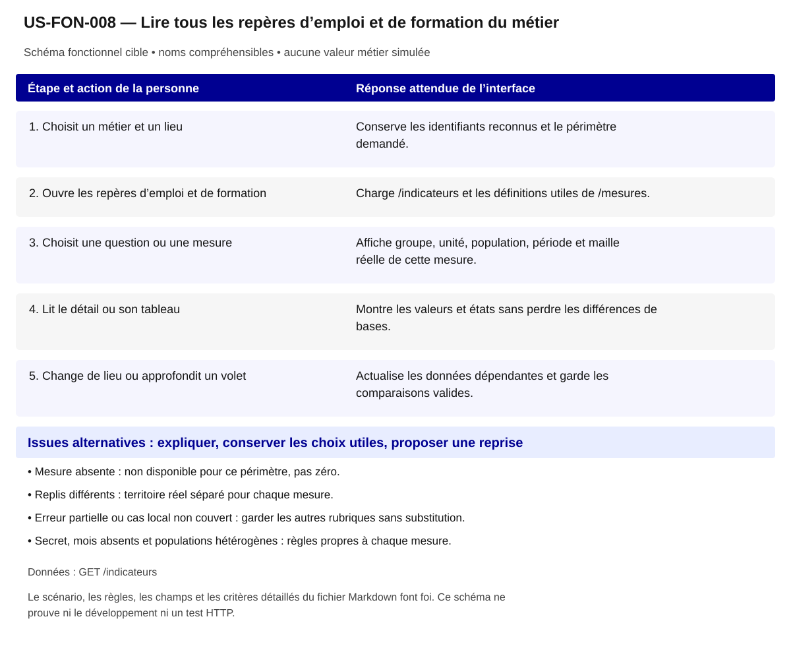

# US-FON-008 — Lire tous les repères d’emploi et de formation du métier

**Rattachement :** E08 · alias historique US-E08. **Lot :** L4.

**Périmètre :** inclus. Les dépendances et les tests à réaliser organisent la réalisation, sans retirer la fonctionnalité.

**Dépendances et passerelles :** [US-FON-005](US-FON-005.md) (E05);[US-FON-009](US-FON-009.md) (E09);[US-FON-031](US-FON-031.md) (E31).

**État constaté au 2 novembre 2026 :** 14 mesures observées dans R16 ; restitutions locales partielles selon les rubriques ; variantes HTTP à tester.

[Retour au backlog](../04_BACKLOG_USER_STORIES.md) · [Modèle commun](../../00_MODELE_COMMUN_USER_STORIES/MODELE_US_FONCTIONNELLE.md)

## 1. Objectif fonctionnel

Permettre à la personne de lire tous les repères d’emploi et de formation du métier, pour situer les chiffres au lieu et au groupe réellement observés. Je veux comprendre le marché du travail au territoire réellement mesuré.

## 2. User Story

En tant que personne qui explore ses possibilités professionnelles, je souhaite lire tous les repères d’emploi et de formation du métier, afin de situer les chiffres au lieu et au groupe réellement observés.

## 3. Préconditions

- Les noms et identifiants sélectionnables proviennent des réponses autorisées ; aucun métier, lieu ou résultat n’est choisi implicitement.
- Les appels disposent de leurs paramètres exacts et le contexte de navigation est identifié. Les GET sont protégés par l’intégration prévue au contrat ; aucun secret d’accès n’est embarqué dans le HTML public.
- Le métier et le lieu sont identifiés. Chaque mesure peut avoir son propre repli, grain et millésime.
- Les fonctionnalités liées restent accessibles selon les dépendances ci-dessus ; un volet indisponible ne bloque pas toute la fiche.

## 4. Scénario nominal

| Étape | Action utilisateur | Comportement attendu du système |
|---|---|---|
| 1 | Choisit un métier et un lieu | Conserve les identifiants reconnus et le périmètre demandé. |
| 2 | Ouvre les repères d’emploi et de formation | Charge /indicateurs et les définitions utiles de /mesures. |
| 3 | Choisit une question ou une mesure | Affiche groupe, unité, population, période et maille réelle de cette mesure. |
| 4 | Lit le détail ou son tableau | Montre les valeurs et états sans perdre les différences de bases. |
| 5 | Change de lieu ou approfondit un volet | Actualise les données dépendantes et garde les comparaisons valides. |

## 5. Scénarios alternatifs

- Mesure absente : non disponible pour ce périmètre, pas zéro.
- Replis différents : territoire réel séparé pour chaque mesure.
- Erreur partielle ou cas local non couvert : garder les autres rubriques sans substitution.
- Secret, mois absents et populations hétérogènes : règles propres à chaque mesure.

**États et erreurs complémentaires à couvrir :** Chargement/erreur partielle, 400/401/404/422/429/503/5xx/réseau ; annuler réponse périmée ; null, 0, secret_stat, clé absente et liste vide distincts ; reprise bornée, aucune donnée de remplacement. Les statuts ci-dessus sont des cas de recette, leur retour effectif dépend de l’endpoint ; ne pas inventer un corps d’erreur serveur.

## 6. Règles de gestion

- Les 14 mesures figurent dans la cible ; JSON présent ne signifie pas restitution entièrement développée.
- Résultat familial non attribué au seul métier ; noms des familles et nb_rome_famille explicités.
- Ne pas additionner offres diffusées, collectées, postes annoncés et projets BMO.
- Interpréter maille_demandee, maille_reelle et repli mesure par mesure.
- Les sous-scénarios de toutes les mesures ci-dessous sont obligatoires, y compris statuts, offres et formations.

**Règles héritées conservées :** Formes de valeurs[] par mesure, grain rome/fap_228/fap_225/fap_87, maille_reelle/repli par mesure ; nb_rome_famille et familles multiples ; unités de la définition, pas de champ unite supposé.

**Traitements :** `/indicateurs?rome=...&zonage=...&territoire=...` ; Formes de valeurs[] par mesure, grain rome/fap_228/fap_225/fap_87, maille_reelle/repli par mesure ; nb_rome_famille et familles multiples ; unités de la définition, pas de champ unite supposé.

**Règles statistiques :** Afficher source, période/millésime, définition/unité, grain et géographie effective ; aucun score/delta/agrégat inventé, aucune inférence personnelle ; secret_stat non calculable. Formes de valeurs[] par mesure, grain rome/fap_228/fap_225/fap_87, maille_reelle/repli par mesure ; nb_rome_famille et familles multiples ; unités de la définition, pas de champ unite supposé.

**Règles communes :** noms et explications en langage courant ; ROME V3 uniquement ; aucune source métier extérieure aux 21 GET ; aucune moyenne, conversion annuelle/mensuelle, interpolation ou correspondance construite. Les codes restent internes aux requêtes, routes et tests.

Une valeur nulle, absente, `secret_stat`, zéro et une liste vide conservent leur sens distinct. Afficher le lieu réellement mesuré et expliquer le repli par indicateur ; ne pas attribuer un résultat de famille à un seul métier ou un résultat national à une session.

## 7. Données et API

**Source et portée de conception :** Sources propres à chaque mesure ; grain ROME/FAP ; période par mesure. Les métadonnées de chaque réponse/mesure priment toute valeur observée dans un exemple.

### Appel 1 — GET `/indicateurs`

**Déclenchement :** À la sélection ou ouverture de la section. Ordre/chaînage : suivre les étapes du scénario, les identifiants reçus et les dépendances liées ; charger les détails à leur ouverture et réutiliser le cache à paramètres strictement identiques.

| Paramètre exact | Emplacement | Obligation du contrat | Type / domaine Swagger | Usage pour cette US |
|---|---|---|---|---|
| `rome` | query | Facultatif Swagger | `string ; défaut API null` | V3 requis fonctionnellement |
| `zonage` | query | Facultatif Swagger | `string ; valeurs france, region, departement, clpe, commune ; défaut API null` | france/region/departement/clpe/commune requis |
| `territoire` | query | Facultatif Swagger | `string ; défaut API null` | code requis sauf france |
| `onisep` | query | Facultatif Swagger | `string ; valeurs exclure, inclure, seulement ; défaut API "exclure"` | exclure/inclure/seulement pour formations_metier |

| Chemin JSON exact | Type connu | Niveau de preuve du chemin/type |
|---|---|---|
| `$.rome_code` | chaîne | Types observés seulement ; null seul ne prouve pas le type publié |
| `$.zonage` | chaîne | Types observés seulement ; null seul ne prouve pas le type publié |
| `$.territoire` | chaîne | Types observés seulement ; null seul ne prouve pas le type publié |
| `$.territoires[].maille` | chaîne | Types observés seulement ; null seul ne prouve pas le type publié |
| `$.territoires[].code` | chaîne / null | Types observés seulement ; null seul ne prouve pas le type publié |
| `$.territoires[].libelle` | chaîne | Types observés seulement ; null seul ne prouve pas le type publié |
| `$.items[].mesure` | chaîne | Types observés seulement ; null seul ne prouve pas le type publié |
| `$.items[].libelle` | chaîne | Types observés seulement ; null seul ne prouve pas le type publié |
| `$.items[].grain` | chaîne | Types observés seulement ; null seul ne prouve pas le type publié |
| `$.items[].maille_demandee` | chaîne | Types observés seulement ; null seul ne prouve pas le type publié |
| `$.items[].maille_reelle` | chaîne | Types observés seulement ; null seul ne prouve pas le type publié |
| `$.items[].territoire_code` | chaîne / null | Types observés seulement ; null seul ne prouve pas le type publié |
| `$.items[].territoire_libelle` | chaîne | Types observés seulement ; null seul ne prouve pas le type publié |
| `$.items[].repli` | booléen | Types observés seulement ; null seul ne prouve pas le type publié |
| `$.items[].source_libelle` | chaîne | Types observés seulement ; null seul ne prouve pas le type publié |
| `$.items[].millesime` | chaîne | Types observés seulement ; null seul ne prouve pas le type publié |
| `$.items[].valeurs` | tableau | Types observés seulement ; null seul ne prouve pas le type publié |
| `$.items[].valeurs[].nb_rome_famille` | entier | Types observés seulement ; null seul ne prouve pas le type publié |
| `$.items[].valeurs[].fap_228_code` | chaîne | Types observés seulement ; null seul ne prouve pas le type publié |
| `$.items[].valeurs[].fap_228_libelle` | chaîne | Types observés seulement ; null seul ne prouve pas le type publié |
| `$.items[].valeurs[].tension_globale` | chaîne | Types observés seulement ; null seul ne prouve pas le type publié |
| `$.items[].valeurs[].tension_intensite_embauche` | chaîne | Types observés seulement ; null seul ne prouve pas le type publié |
| `$.items[].valeurs[].tension_lien_formation_emploi` | chaîne | Types observés seulement ; null seul ne prouve pas le type publié |
| `$.items[].valeurs[].tension_manque_main_oeuvre` | chaîne | Types observés seulement ; null seul ne prouve pas le type publié |
| `$.items[].valeurs[].tension_non_durabilite_emploi` | chaîne | Types observés seulement ; null seul ne prouve pas le type publié |
| `$.items[].valeurs[].tension_conditions_travail_contraignantes` | chaîne | Types observés seulement ; null seul ne prouve pas le type publié |
| `$.items[].valeurs[].tension_inadequation_geographique` | chaîne | Types observés seulement ; null seul ne prouve pas le type publié |
| `$.items[].valeurs[].tension_non_attractivite_salariale` | chaîne | Types observés seulement ; null seul ne prouve pas le type publié |
| `$.items[].valeurs[].nb_demandeurs_emploi` | entier | Types observés seulement ; null seul ne prouve pas le type publié |
| `$.items[].valeurs[].nb_offres_emploi_diffusees` | entier | Types observés seulement ; null seul ne prouve pas le type publié |
| `$.items[].valeurs[].nb_offres_emploi_collectees` | entier | Types observés seulement ; null seul ne prouve pas le type publié |
| `$.items[].valeurs[].fap_225_code` | chaîne | Types observés seulement ; null seul ne prouve pas le type publié |
| `$.items[].valeurs[].fap_225_libelle` | chaîne | Types observés seulement ; null seul ne prouve pas le type publié |
| `$.items[].valeurs[].salaire_net_annuel_q1` | entier | Types observés seulement ; null seul ne prouve pas le type publié |
| `$.items[].valeurs[].salaire_net_annuel_median` | entier | Types observés seulement ; null seul ne prouve pas le type publié |
| `$.items[].valeurs[].salaire_net_annuel_q3` | entier | Types observés seulement ; null seul ne prouve pas le type publié |
| `$.items[].valeurs[].salaire_net_mensuel_median` | entier | Types observés seulement ; null seul ne prouve pas le type publié |
| `$.items[].valeurs[].tranche_salaire_median_libelle` | chaîne | Types observés seulement ; null seul ne prouve pas le type publié |
| `$.items[].valeurs[].nb_salaries_temps_complet` | entier | Types observés seulement ; null seul ne prouve pas le type publié |
| `$.items[].valeurs[].nb_projets_recrutement` | entier | Types observés seulement ; null seul ne prouve pas le type publié |
| `$.items[].valeurs[].nb_projets_recrutement_difficiles` | entier | Types observés seulement ; null seul ne prouve pas le type publié |
| `$.items[].valeurs[].tx_projets_recrutement_difficiles` | nombre | Types observés seulement ; null seul ne prouve pas le type publié |
| `$.items[].valeurs[].nb_projets_recrutement_saisonniers` | entier | Types observés seulement ; null seul ne prouve pas le type publié |
| `$.items[].valeurs[].tx_projets_recrutement_saisonniers` | nombre | Types observés seulement ; null seul ne prouve pas le type publié |
| `$.items[].valeurs[].fap_87_code` | chaîne | Types observés seulement ; null seul ne prouve pas le type publié |
| `$.items[].valeurs[].fap_87_libelle` | chaîne | Types observés seulement ; null seul ne prouve pas le type publié |
| `$.items[].valeurs[].nb_emplois_2019` | entier | Types observés seulement ; null seul ne prouve pas le type publié |
| `$.items[].valeurs[].tx_part_emploi_region_2019` | nombre | Types observés seulement ; null seul ne prouve pas le type publié |
| `$.items[].valeurs[].indice_specificite_region_2019` | nombre | Types observés seulement ; null seul ne prouve pas le type publié |
| `$.items[].valeurs[].nb_creations_nettes_emplois_2030` | entier | Types observés seulement ; null seul ne prouve pas le type publié |
| `$.items[].valeurs[].tx_creations_nettes_emplois_2030` | nombre | Types observés seulement ; null seul ne prouve pas le type publié |
| `$.items[].valeurs[].nb_departs_fin_carriere_2030` | entier | Types observés seulement ; null seul ne prouve pas le type publié |
| `$.items[].valeurs[].tx_departs_fin_carriere_2030` | nombre | Types observés seulement ; null seul ne prouve pas le type publié |
| `$.items[].valeurs[].nb_postes_a_pourvoir_2030` | entier | Types observés seulement ; null seul ne prouve pas le type publié |
| `$.items[].valeurs[].tx_postes_a_pourvoir_2030` | nombre | Types observés seulement ; null seul ne prouve pas le type publié |
| `$.items[].valeurs[].nb_jeunes_debutants_2030` | entier | Types observés seulement ; null seul ne prouve pas le type publié |
| `$.items[].valeurs[].tx_jeunes_debutants_2030` | entier / nombre | Types observés seulement ; null seul ne prouve pas le type publié |
| `$.items[].valeurs[].nb_desequilibre_potentiel_2030` | entier | Types observés seulement ; null seul ne prouve pas le type publié |
| `$.items[].valeurs[].tx_desequilibre_potentiel_2030` | entier / nombre | Types observés seulement ; null seul ne prouve pas le type publié |
| `$.items[].valeurs[].tension_niveau_2019` | chaîne | Types observés seulement ; null seul ne prouve pas le type publié |
| `$.items[].valeurs[].periode_libelle` | chaîne | Types observés seulement ; null seul ne prouve pas le type publié |
| `$.items[].valeurs[].nb_offres_emploi_base` | entier | Types observés seulement ; null seul ne prouve pas le type publié |
| `$.items[].valeurs[].tx_offres_cdi` | nombre | Types observés seulement ; null seul ne prouve pas le type publié |
| `$.items[].valeurs[].tx_offres_cdd` | entier | Types observés seulement ; null seul ne prouve pas le type publié |
| `$.items[].valeurs[].tx_offres_interim` | nombre | Types observés seulement ; null seul ne prouve pas le type publié |
| `$.items[].valeurs[].tx_offres_saisonnier` | entier | Types observés seulement ; null seul ne prouve pas le type publié |
| `$.items[].valeurs[].tx_offres_non_salarie` | entier | Types observés seulement ; null seul ne prouve pas le type publié |
| `$.items[].valeurs[].tx_offres_emploi_durable` | nombre | Types observés seulement ; null seul ne prouve pas le type publié |
| `$.items[].valeurs[].tx_offres_alternance` | nombre | Types observés seulement ; null seul ne prouve pas le type publié |
| `$.items[].valeurs[].tx_offres_debutant_accepte` | entier | Types observés seulement ; null seul ne prouve pas le type publié |
| `$.items[].valeurs[].tx_offres_ouvrier_non_qualifie` | nombre | Types observés seulement ; null seul ne prouve pas le type publié |
| `$.items[].valeurs[].tx_offres_ouvrier_qualifie` | nombre | Types observés seulement ; null seul ne prouve pas le type publié |
| `$.items[].valeurs[].tx_offres_employe_non_qualifie` | nombre | Types observés seulement ; null seul ne prouve pas le type publié |
| `$.items[].valeurs[].tx_offres_employe_qualifie` | nombre | Types observés seulement ; null seul ne prouve pas le type publié |
| `$.items[].valeurs[].tx_offres_technicien_agent_maitrise` | nombre | Types observés seulement ; null seul ne prouve pas le type publié |
| `$.items[].valeurs[].tx_offres_cadre` | entier | Types observés seulement ; null seul ne prouve pas le type publié |
| `$.items[].valeurs[].nb_offres_niveau_formation_renseigne` | entier | Types observés seulement ; null seul ne prouve pas le type publié |
| `$.items[].valeurs[].tx_niveau_formation_infra_bac` | nombre | Types observés seulement ; null seul ne prouve pas le type publié |
| `$.items[].valeurs[].tx_niveau_formation_bac` | nombre | Types observés seulement ; null seul ne prouve pas le type publié |
| `$.items[].valeurs[].tx_niveau_formation_bac2` | nombre | Types observés seulement ; null seul ne prouve pas le type publié |
| `$.items[].valeurs[].tx_niveau_formation_bac3_4` | entier | Types observés seulement ; null seul ne prouve pas le type publié |
| `$.items[].valeurs[].tx_niveau_formation_bac5` | entier | Types observés seulement ; null seul ne prouve pas le type publié |
| `$.items[].valeurs[].periode_code` | chaîne | Types observés seulement ; null seul ne prouve pas le type publié |
| `$.items[].valeurs[].nb_offres_emploi_mois` | entier | Types observés seulement ; null seul ne prouve pas le type publié |
| `$.items[].valeurs[].nb_postes_offres_emploi_mois` | entier | Types observés seulement ; null seul ne prouve pas le type publié |
| `$.items[].valeurs[].rang_competence` | entier | Types observés seulement ; null seul ne prouve pas le type publié |
| `$.items[].valeurs[].competence_code` | chaîne | Types observés seulement ; null seul ne prouve pas le type publié |
| `$.items[].valeurs[].competence_libelle` | chaîne | Types observés seulement ; null seul ne prouve pas le type publié |
| `$.items[].valeurs[].competence_type_libelles` | tableau | Types observés seulement ; null seul ne prouve pas le type publié |
| `$.items[].valeurs[].nb_offres_competence` | entier | Types observés seulement ; null seul ne prouve pas le type publié |
| `$.items[].valeurs[].nb_offres_avec_competences` | entier | Types observés seulement ; null seul ne prouve pas le type publié |
| `$.items[].valeurs[].tx_offres_competence` | entier / nombre | Types observés seulement ; null seul ne prouve pas le type publié |
| `$.items[].valeurs[].rang_secteur` | entier | Types observés seulement ; null seul ne prouve pas le type publié |
| `$.items[].valeurs[].secteur_naf38_code` | chaîne | Types observés seulement ; null seul ne prouve pas le type publié |
| `$.items[].valeurs[].secteur_naf38_libelle` | chaîne | Types observés seulement ; null seul ne prouve pas le type publié |
| `$.items[].valeurs[].nb_actifs_emploi` | entier | Types observés seulement ; null seul ne prouve pas le type publié |
| `$.items[].valeurs[].tx_actifs_secteur` | entier / nombre | Types observés seulement ; null seul ne prouve pas le type publié |
| `$.items[].valeurs[].nb_actifs_salaries` | entier | Types observés seulement ; null seul ne prouve pas le type publié |
| `$.items[].valeurs[].nb_actifs_independants` | entier | Types observés seulement ; null seul ne prouve pas le type publié |
| `$.items[].valeurs[].nb_actifs_employeurs` | entier | Types observés seulement ; null seul ne prouve pas le type publié |
| `$.items[].valeurs[].nb_actifs_aides_familiaux` | entier | Types observés seulement ; null seul ne prouve pas le type publié |
| `$.items[].valeurs[].tx_actifs_salaries` | nombre | Types observés seulement ; null seul ne prouve pas le type publié |
| `$.items[].valeurs[].tx_actifs_independants` | nombre | Types observés seulement ; null seul ne prouve pas le type publié |
| `$.items[].valeurs[].tx_actifs_employeurs` | nombre | Types observés seulement ; null seul ne prouve pas le type publié |
| `$.items[].valeurs[].tx_actifs_aides_familiaux` | entier | Types observés seulement ; null seul ne prouve pas le type publié |
| `$.items[].valeurs[].nb_inscrits_voie_scolaire` | null | Types observés seulement ; null seul ne prouve pas le type publié |
| `$.items[].valeurs[].nb_inscrits_apprentissage` | null | Types observés seulement ; null seul ne prouve pas le type publié |
| `$.items[].valeurs[].nb_inscrits_enseignement_sup` | null | Types observés seulement ; null seul ne prouve pas le type publié |
| `$.items[].valeurs[].nb_inscrits_sanitaire_social` | null | Types observés seulement ; null seul ne prouve pas le type publié |
| `$.items[].valeurs[].nb_entrees_formation_de` | null | Types observés seulement ; null seul ne prouve pas le type publié |
| `$.items[].valeurs[].nb_de_sortants` | chaîne | Types observés seulement ; null seul ne prouve pas le type publié |
| `$.items[].valeurs[].nb_de_acces_emploi_6m` | chaîne | Types observés seulement ; null seul ne prouve pas le type publié |
| `$.items[].valeurs[].tx_de_acces_emploi_6m` | chaîne | Types observés seulement ; null seul ne prouve pas le type publié |
| `$.items[].valeurs[].nb_affelnet_places` | null | Types observés seulement ; null seul ne prouve pas le type publié |
| `$.items[].valeurs[].nb_affelnet_voeux_1` | null | Types observés seulement ; null seul ne prouve pas le type publié |
| `$.items[].valeurs[].indice_affelnet_pression` | null | Types observés seulement ; null seul ne prouve pas le type publié |
| `$.items[].valeurs[].nb_parcoursup_places` | null | Types observés seulement ; null seul ne prouve pas le type publié |
| `$.items[].valeurs[].nb_parcoursup_candidatures` | null | Types observés seulement ; null seul ne prouve pas le type publié |
| `$.items[].valeurs[].nb_sessions_a_venir` | null | Types observés seulement ; null seul ne prouve pas le type publié |
| `$.items[].valeurs[].nb_certifications` | entier | Types observés seulement ; null seul ne prouve pas le type publié |
| `$.items[].valeurs[].nb_ij_scolaire_sortants` | entier | Types observés seulement ; null seul ne prouve pas le type publié |
| `$.items[].valeurs[].nb_ij_scolaire_emploi_12m` | entier | Types observés seulement ; null seul ne prouve pas le type publié |
| `$.items[].valeurs[].tx_ij_scolaire_emploi_12m` | nombre | Types observés seulement ; null seul ne prouve pas le type publié |
| `$.items[].valeurs[].nb_ij_apprentissage_sortants` | entier | Types observés seulement ; null seul ne prouve pas le type publié |
| `$.items[].valeurs[].nb_ij_apprentissage_emploi_12m` | entier | Types observés seulement ; null seul ne prouve pas le type publié |
| `$.items[].valeurs[].tx_ij_apprentissage_emploi_12m` | nombre | Types observés seulement ; null seul ne prouve pas le type publié |
| `$.items[].valeurs[].nb_ij_scolaire_annee_terminale` | entier | Types observés seulement ; null seul ne prouve pas le type publié |
| `$.items[].valeurs[].nb_ij_scolaire_poursuite_etudes` | entier | Types observés seulement ; null seul ne prouve pas le type publié |
| `$.items[].valeurs[].tx_ij_scolaire_poursuite_etudes` | entier | Types observés seulement ; null seul ne prouve pas le type publié |
| `$.items[].valeurs[].nb_ij_apprentissage_annee_terminale` | entier | Types observés seulement ; null seul ne prouve pas le type publié |
| `$.items[].valeurs[].nb_ij_apprentissage_poursuite_etudes` | entier | Types observés seulement ; null seul ne prouve pas le type publié |
| `$.items[].valeurs[].tx_ij_apprentissage_poursuite_etudes` | nombre | Types observés seulement ; null seul ne prouve pas le type publié |

**Réponses natives utilisées pour vérifier les chemins :** [06_controles/resultats/R16 test/GET_indicateurs__rome_F1610__zonage_commune__territoire_34172.json](<../../../06_controles/resultats/R16 test/GET_indicateurs__rome_F1610__zonage_commune__territoire_34172.json>).

### Preuves et contrôles restant à produire

**Documenté :** [contrat](../../../01_sources/contrat_interface_2026-10-19.md) ; [OpenAPI officiel](../../../01_sources/openapi/docs_json_interface.json). Dix réponses sur les 21 GET n’ont pas de schéma officiel de réponse ; un type observé ne devient pas un schéma fournisseur.

**Références conservées de la conception :** [06_controles/VALIDATION_R16_territoires_indicateurs.md](../../../06_controles/VALIDATION_R16_territoires_indicateurs.md); [02_reponses_observees/indicateurs/Recrutementregions/response_indicateurs.json](../../../02_reponses_observees/indicateurs/Recrutementregions/response_indicateurs.json); [06_controles/resultats/R16 test/GET_indicateurs__rome_F1610__zonage_commune__territoire_34172.json](<../../../06_controles/resultats/R16 test/GET_indicateurs__rome_F1610__zonage_commune__territoire_34172.json>).

**Contrôle local déjà rapporté :** Mission 006 et contrôles DSFR Chart ; sous-rubriques partiellement restituées. [Recette UX existante](../TESTS_UX_EXPLORER.md). Ces résultats sur JSON locaux ne valident pas les appels HTTP.

**Tests à réaliser :** T-E08 : Étendre R16 à autre ROME/territoire dont cas sans valeur ; vérifier toutes variantes des 14 mesures documentées, pas seulement une structure commune.

**Points RCO associés :** Q06 : repli et métadonnées/secret ; tri contractuel/tests/demande fournisseur dans 06 section Q01–Q14. Lire le tri déjà établi dans [Q01–Q14](../06_DECISIONS_ET_POINTS_A_VALIDER.md) avant toute nouvelle demande ; ne pas redemander une réponse démontrée par le contrat.

### Couverture détaillée des 14 mesures rattachées à cette US

Chaque mesure est un sous-scénario de cette US. Ses champs, sa population et ses critères sont conservés même si aucune valeur n’est publiée dans le jeu local.

Les quatorze mesures de `/indicateurs` sont détaillées ici. Le pilotage du sous-scénario `emploi_secteurs` appartient à [US-FON-026](US-FON-026.md) : il reste obligatoire dans cette fiche territoriale et est partagé entre les deux US, sans créer une trentième mesure.

#### `tension` — Tension sur le marché du travail

**Source API :** GET /indicateurs. Filtrer `items[].mesure` par ce code ; ne pas supposer une forme commune de `valeurs[]`.

**Grain :** `fap_228`. **Mailles du catalogue :** dep, reg, nat. **Millésime observé :** 2024.

**Producteur :** DARES - France Travail, Les tensions sur le marché du travail. **Unité et population :** Niveaux de tension libellés ; aucune unité en pourcentage pour les niveaux et leurs sept composantes.

**Définition source :** Indicateur DARES - France Travail de tension par famille professionnelle (FAP 2021, 228 postes) et ses sept composantes, rattaché au ROME V3 par la table de passage DARES FAP 2021 x ROME. Un ROME peut relever de plusieurs FAP : une valeur par FAP.

**Champs nécessaires :** `$.items[].valeurs[].fap_228_code`, `$.items[].valeurs[].fap_228_libelle`, `$.items[].valeurs[].tension_globale`, `$.items[].valeurs[].tension_intensite_embauche`, `$.items[].valeurs[].tension_lien_formation_emploi`, `$.items[].valeurs[].tension_manque_main_oeuvre`, `$.items[].valeurs[].tension_non_durabilite_emploi`, `$.items[].valeurs[].tension_conditions_travail_contraignantes`, `$.items[].valeurs[].tension_inadequation_geographique`, `$.items[].valeurs[].tension_non_attractivite_salariale`.

**Présentation attendue :** DSFR : libellé de synthèse et tableau des sept composantes, regroupés par famille ; DataBox DSFR Chart pour la provenance si compatible avec le contenu textuel.

- Lire tension_globale et les sept champs tension_* comme les catégories publiées, sans convertir les libellés en score numérique ou en probabilité de recrutement.
- Conserver une ligne par fap_228_code/fap_228_libelle ; nb_rome_famille explique qu'une même observation concerne plusieurs métiers lorsque sa valeur est supérieure à un.
- Le millésime observé est 2024 ; dans /indicateurs, utiliser maille_reelle, territoire_libelle et repli propres à cette mesure, sans reprendre la géographie d'une autre mesure.
- Présenter les difficultés de recrutement des employeurs ; une tension élevée ne garantit ni une offre disponible ni une embauche pour la personne.

**Dépendance / tests :** Catalogue observé : fap_228, 2024, dep/reg/nat. Mesure territoriale de /indicateurs ; comparateur E28 et méthodologie E12/E31. Tester plusieurs familles et replis ; ne pas confondre avec tension_fap228_principale de la certification.

**Preuve :** [notice native /mesures](../../../02_reponses_observees/indicateurs/Recrutementregions/response_mesures.json) ; les paramètres exacts figurent dans les appels ci-dessus. La présence au catalogue ne prouve pas une valeur disponible pour tout métier ou lieu.

#### `demandeurs_emploi` — Demandeurs d'emploi

**Source API :** GET /indicateurs. Filtrer `items[].mesure` par ce code ; ne pas supposer une forme commune de `valeurs[]`.

**Grain :** `rome`. **Mailles du catalogue :** clpe, dep, reg. **Millésime observé :** 2026T1.

**Producteur :** France Travail, demandeurs d'emploi catégories ABC. **Unité et population :** Personnes inscrites à France Travail en catégories A, B, C, pour le métier recherché.

**Définition source :** Demandeurs d'emploi inscrits à France Travail en catégories A, B, C, par ROME V3 recherché (API DEFM).

**Champs nécessaires :** `$.items[].valeurs[].nb_demandeurs_emploi`.

**Présentation attendue :** DSFR : carte de chiffre accompagnée de la définition de la population et d'une alternative tabulaire ; barres DSFR Chart seulement pour des territoires effectivement comparables.

- Utiliser nb_demandeurs_emploi au grain rome ; la population est celle des inscrits des catégories A, B, C par métier recherché, sans assimiler ce nombre aux personnes sans emploi de toute la population.
- Le millésime observé est 2026 T1 ; conserver le trimestre effectivement reçu et le territoire réel de la mesure.
- La valeur peut être un effectif, null ou secret_stat ; zéro reste un effectif observé et secret_stat ne participe à aucun calcul.
- Ne pas diviser les offres ou projets de recrutement par cet effectif pour fabriquer un indicateur de concurrence ou une probabilité personnelle.

**Dépendance / tests :** Catalogue observé : rome, 2026 T1, clpe/dep/reg. Les mailles du catalogue ne démontrent pas une valeur pour chaque territoire ; vérifier la réponse. Secret suivi Q06.

**Preuve :** [notice native /mesures](../../../02_reponses_observees/indicateurs/Recrutementregions/response_mesures.json) ; les paramètres exacts figurent dans les appels ci-dessus. La présence au catalogue ne prouve pas une valeur disponible pour tout métier ou lieu.

#### `offres_emploi_diffusees` — Offres d'emploi diffusées

**Source API :** GET /indicateurs. Filtrer `items[].mesure` par ce code ; ne pas supposer une forme commune de `valeurs[]`.

**Grain :** `rome`. **Mailles du catalogue :** clpe, dep. **Millésime observé :** 3 derniers mois.

**Producteur :** France Travail, API Offres d'emploi. **Unité et population :** Postes proposés dans les offres partenaires diffusées par France Travail sur les trois derniers mois complets.

**Définition source :** Postes proposés dans les offres d'emploi partenaires diffusées par France Travail sur les trois derniers mois complets, par ROME V3.

**Champs nécessaires :** `$.items[].valeurs[].nb_offres_emploi_diffusees`.

**Présentation attendue :** DSFR : carte de chiffre et texte de définition ; tableau de comparaison des territoires ou métiers, avec données comparables uniquement.

- Restituer nb_offres_emploi_diffusees comme un nombre de postes proposés, et non comme un nombre d'annonces, d'embauches réalisées ou de places toujours disponibles.
- Conserver la période reçue : le catalogue observé indique les trois derniers mois complets, sans inventer une date de début ou de fin absente de la réponse.
- Distinguer les offres partenaires diffusées des offres déposées directement à France Travail ; ne pas additionner automatiquement les deux mesures.
- Utiliser la maille et le territoire effectifs de cette mesure ; null, zéro, absence et liste vide conservent leur sens distinct.

**Dépendance / tests :** Catalogue observé : rome, 3 derniers mois, clpe/dep. Vérifier les périodes réelles de deux appels avant comparaison ; aucune liste d'offres individuelles n'est fournie par cette mesure.

**Preuve :** [notice native /mesures](../../../02_reponses_observees/indicateurs/Recrutementregions/response_mesures.json) ; les paramètres exacts figurent dans les appels ci-dessus. La présence au catalogue ne prouve pas une valeur disponible pour tout métier ou lieu.

#### `offres_emploi_collectees` — Offres d'emploi collectées

**Source API :** GET /indicateurs. Filtrer `items[].mesure` par ce code ; ne pas supposer une forme commune de `valeurs[]`.

**Grain :** `rome`. **Mailles du catalogue :** clpe, dep. **Millésime observé :** 3 derniers mois.

**Producteur :** France Travail, API Offres d'emploi. **Unité et population :** Postes proposés dans les offres déposées à France Travail sur les trois derniers mois complets.

**Définition source :** Postes proposés dans les offres d'emploi déposées à France Travail sur les trois derniers mois complets, par ROME V3.

**Champs nécessaires :** `$.items[].valeurs[].nb_offres_emploi_collectees`.

**Présentation attendue :** DSFR : carte de chiffre avec population explicitée ; tableau accessible pour la comparaison, sans graphique obligatoire.

- Restituer nb_offres_emploi_collectees comme les postes proposés dans les offres déposées à France Travail, pas comme un nombre d'annonces ou d'embauches.
- La fenêtre du catalogue observé est de trois derniers mois complets ; elle diffère de la fenêtre de douze mois des caractéristiques et de la série mensuelle.
- Ne pas additionner cette mesure à offres_emploi_diffusees et ne pas l'utiliser pour recalculer les taux des caractéristiques d'offres sur une autre période.
- Garder le grain rome et le repli propre à la mesure ; aucun chiffre d'une maille parent n'est présenté comme un chiffre du lieu choisi.

**Dépendance / tests :** Catalogue observé : rome, 3 derniers mois, clpe/dep. Comparer à périmètre égal ; la mesure n'est pas un moteur d'offres d'emploi individuelles.

**Preuve :** [notice native /mesures](../../../02_reponses_observees/indicateurs/Recrutementregions/response_mesures.json) ; les paramètres exacts figurent dans les appels ci-dessus. La présence au catalogue ne prouve pas une valeur disponible pour tout métier ou lieu.

#### `salaires` — Salaires nets annuels

**Source API :** GET /indicateurs. Filtrer `items[].mesure` par ce code ; ne pas supposer une forme commune de `valeurs[]`.

**Grain :** `fap_225`. **Mailles du catalogue :** dep, reg, nat. **Millésime observé :** 2023.

**Producteur :** INSEE, Base Tous salariés, fichier salariés open data. **Unité et population :** Euros nets par an pour Q1, médiane et Q3 ; euros nets par mois pour salaire_net_mensuel_median ; salariés pour nb_salaries_temps_complet.

**Définition source :** Quartiles et médiane du salaire net annuel des salariés à temps complet présents toute l'année (poste principal, emploi ordinaire), par famille professionnelle (FAP 225) rattachée au ROME V3, au lieu de travail. Estimés par interpolation dans les tranches de rémunération de la BTS ; null au-delà de 50 000 euros (tranche ouverte). Publiés à partir de 30 salariés dans l'échantillon, sinon repli sur le territoire parent. Un ROME peut relever de plusieurs FAP : une valeur par FAP.

**Champs nécessaires :** `$.items[].valeurs[].fap_225_code`, `$.items[].valeurs[].fap_225_libelle`, `$.items[].valeurs[].salaire_net_annuel_q1`, `$.items[].valeurs[].salaire_net_annuel_median`, `$.items[].valeurs[].salaire_net_annuel_q3`, `$.items[].valeurs[].salaire_net_mensuel_median`, `$.items[].valeurs[].tranche_salaire_median_libelle`, `$.items[].valeurs[].nb_salaries_temps_complet`.

**Présentation attendue :** DSFR : médiane mensuelle expliquée et tableau des quartiles annuels ; DSFR Chart DataBox et barres pour les médianes territoriales disponibles, sans boîte à moustaches personnalisée.

- Afficher séparément salaire_net_annuel_q1, salaire_net_annuel_median, salaire_net_annuel_q3 et salaire_net_mensuel_median ; Q1 et Q3 délimitent la moitié centrale des salaires et ne sont ni le minimum ni le maximum.
- Population : poste principal, emploi ordinaire, temps complet, présence toute l'année ; lieu de travail ; BTS 2023 observée, hors Mayotte. La publication exige au moins trente salariés dans l'échantillon.
- Conserver les valeurs et arrondis fournis ; ne pas recalculer le salaire mensuel par division ni les quartiles par interpolation côté consommateur.
- Médiane null avec tranche_salaire_median_libelle indiquant 50 000 euros et plus : afficher la tranche ouverte sans fabriquer un montant ni la dessiner à zéro ; préserver le rang fourni dans /salaires.
- Une observation par famille FAP225 avec nb_rome_famille ; ne pas fusionner les familles ni présenter deux métiers de la même famille comme deux observations indépendantes.

**Dépendance / tests :** Catalogue observé : fap_225, 2023, dep/reg/nat. Réutilisation E11/E28 : /salaires classe les territoires et donne france[], /indicateurs renseigne un lieu et son repli. Tester seuil, tranche ouverte, familles multiples et rangs.

**Preuve :** [notice native /mesures](../../../02_reponses_observees/indicateurs/Recrutementregions/response_mesures.json) ; les paramètres exacts figurent dans les appels ci-dessus. La présence au catalogue ne prouve pas une valeur disponible pour tout métier ou lieu.

#### `projets_recrutement` — Projets de recrutement (BMO)

**Source API :** GET /indicateurs. Filtrer `items[].mesure` par ce code ; ne pas supposer une forme commune de `valeurs[]`.

**Grain :** `fap_228`. **Mailles du catalogue :** clpe, dep, reg, nat. **Millésime observé :** 2026.

**Producteur :** France Travail, enquête Besoins en main-d'œuvre. **Unité et population :** Projets de recrutement ; pourcentages publiés des projets difficiles et saisonniers.

**Définition source :** Projets de recrutement déclarés par les employeurs pour l'année dans l'enquête Besoins en main-d'œuvre, par famille professionnelle (FAP 2021, 228 postes) rattachée au ROME V3 : nombre de projets, projets jugés difficiles et projets saisonniers, et leur part. Estimations issues d'une enquête, arrondies à l'unité : un petit nombre est peu précis. Un ROME peut relever de plusieurs FAP : une valeur par FAP.

**Champs nécessaires :** `$.items[].valeurs[].fap_228_code`, `$.items[].valeurs[].fap_228_libelle`, `$.items[].valeurs[].nb_projets_recrutement`, `$.items[].valeurs[].nb_projets_recrutement_difficiles`, `$.items[].valeurs[].tx_projets_recrutement_difficiles`, `$.items[].valeurs[].nb_projets_recrutement_saisonniers`, `$.items[].valeurs[].tx_projets_recrutement_saisonniers`.

**Présentation attendue :** DSFR Chart DataBox et barres par territoire/famille ; DSFR cartes de chiffres pour les projets et tableaux séparés des taux de difficulté et de saisonnalité.

- Présenter des intentions annuelles déclarées par les employeurs dans BMO, non des offres disponibles ni des recrutements certains ; catalogue observé 2026.
- Conserver nb_projets_recrutement, nb_projets_recrutement_difficiles, nb_projets_recrutement_saisonniers et les deux tx_* fournis, sans recalcul à partir de volumes arrondis.
- Les projets difficiles et saisonniers peuvent se recouper : ne pas les additionner ni les représenter comme une partition exhaustive du total.
- Respecter le grain FAP228 et les rangs par famille ; /recrutements fournit les tris projets, projets_difficiles, tx_difficiles, projets_saisonniers, tx_saisonniers et la référence france[].
- Conserver le couple R16 nb_projets_recrutement_saisonniers=0 et tx_projets_recrutement_saisonniers=1.7 avec une note de précision en attente Q07 ; ne pas corriger l'une des valeurs.

**Dépendance / tests :** Catalogue observé : fap_228, 2026, clpe/dep/reg/nat. E10/E28 réutilisent les mêmes règles. Q07 ouvert pour précision des petits volumes ; tests GET sur les tris et périmètres compatibles restent nécessaires.

**Preuve :** [notice native /mesures](../../../02_reponses_observees/indicateurs/Recrutementregions/response_mesures.json) ; les paramètres exacts figurent dans les appels ci-dessus. La présence au catalogue ne prouve pas une valeur disponible pour tout métier ou lieu.

#### `metiers_2030` — Les métiers en 2030 (prospective)

**Source API :** GET /indicateurs. Filtrer `items[].mesure` par ce code ; ne pas supposer une forme commune de `valeurs[]`.

**Grain :** `fap_87`. **Mailles du catalogue :** reg, nat. **Millésime observé :** 2019-2030.

**Producteur :** DARES - France Stratégie, Les métiers en 2030 (PMQ). **Unité et population :** Emplois et flux cumulés 2019-2030 ; taux en pourcentage de l'emploi 2019 ; part régionale en pourcentage ; indice de spécificité sans unité ; niveau de tension 2019 libellé.

**Définition source :** Projection 2019-2030 de l'exercice Prospective des métiers et qualifications (scénario de référence), par famille professionnelle FAP 87 rattachée au ROME V3 : emploi 2019, créations nettes d'emploi, départs en fin de carrière, postes à pourvoir (départs + créations), jeunes débutants et déséquilibre potentiel (postes à pourvoir - jeunes débutants, et en région solde des mobilités entre régions : positif, les jeunes débutants ne suffiraient pas). Taux en % de l'emploi 2019. En région : part du métier dans l'emploi régional et indice de spécificité (> 1 : métier plus présent qu'en France). Régions de métropole uniquement.

**Champs nécessaires :** `$.items[].valeurs[].fap_87_code`, `$.items[].valeurs[].fap_87_libelle`, `$.items[].valeurs[].nb_emplois_2019`, `$.items[].valeurs[].tx_part_emploi_region_2019`, `$.items[].valeurs[].indice_specificite_region_2019`, `$.items[].valeurs[].nb_creations_nettes_emplois_2030`, `$.items[].valeurs[].tx_creations_nettes_emplois_2030`, `$.items[].valeurs[].nb_departs_fin_carriere_2030`, `$.items[].valeurs[].tx_departs_fin_carriere_2030`, `$.items[].valeurs[].nb_postes_a_pourvoir_2030`, `$.items[].valeurs[].tx_postes_a_pourvoir_2030`, `$.items[].valeurs[].nb_jeunes_debutants_2030`, `$.items[].valeurs[].tx_jeunes_debutants_2030`, `$.items[].valeurs[].nb_desequilibre_potentiel_2030`, `$.items[].valeurs[].tx_desequilibre_potentiel_2030`, `$.items[].valeurs[].tension_niveau_2019`.

**Présentation attendue :** DSFR Chart DataBox et barres comparant les composantes publiées, avec prise en charge des valeurs négatives ; DSFR tableau détaillé de tous les effectifs/taux, carte régionale officielle si le grain est compatible.

- Conserver toutes les composantes reçues : emploi 2019, créations nettes, départs en fin de carrière, postes à pourvoir, jeunes débutants, déséquilibre potentiel, taux associés, part régionale, spécificité et tension 2019.
- Présenter le scénario de référence PMQ et les flux cumulés de 2019 à 2030 ; aucune série annuelle ni certitude d'embauche n'est reconstruite.
- Les taux tx_* des flux sont rapportés à l'emploi 2019 ; tx_part_emploi_region_2019 est la part dans l'emploi régional et indice_specificite_region_2019 est un indice, pas un pourcentage.
- Préserver les créations nettes et déséquilibres négatifs ; utiliser les valeurs publiées sans recalculer postes ou déséquilibre, notamment le solde de mobilités interrégionales intégré au régional.
- Garder les FAP87 distinctes et les regroupements corses explicités ; régions de métropole et France seulement, sans données départementales inventées ; les DOM peuvent recevoir le repli France de /indicateurs.

**Dépendance / tests :** Catalogue observé : fap_87, 2019-2030, reg/nat. Couverture détaillée E24 et comparaison E28 conservées : /prospective/regions?rome&tri, /prospective/metiers?region&tri, puis rome_codes[] vers fiches. Tris limités aux enums ; aucun tri jeunes débutants. Tester agrégats, DOM/Corse, null et négatifs.

**Preuve :** [notice native /mesures](../../../02_reponses_observees/indicateurs/Recrutementregions/response_mesures.json) ; les paramètres exacts figurent dans les appels ci-dessus. La présence au catalogue ne prouve pas une valeur disponible pour tout métier ou lieu.

#### `offres_emploi_caracteristiques` — Caractéristiques des offres d'emploi

**Source API :** GET /indicateurs. Filtrer `items[].mesure` par ce code ; ne pas supposer une forme commune de `valeurs[]`.

**Grain :** `rome`. **Mailles du catalogue :** dep, reg, nat. **Millésime observé :** 12 derniers mois.

**Producteur :** France Travail, API Offres d'emploi (offres collectées). **Unité et population :** Offres pour les effectifs de base ; pourcentages des offres de la base correspondante pour les champs tx_*.

**Définition source :** Offres d'emploi collectées par France Travail créées sur les 12 derniers mois complets (`periode_libelle`), par ROME V3 : part des CDI (y compris CDI intérimaires), CDD (y compris d'insertion), intérim, saisonniers et emplois non salariés ; part des offres d'emploi durable (CDI ou contrat d'au moins 6 mois) ; part des contrats en alternance (apprentissage, professionnalisation) ; part des offres ouvertes aux débutants ; répartition par qualification demandée (ouvriers, employés, techniciens et agents de maîtrise, cadres). Le niveau de formation n'est renseigné que dans une partie des offres (`nb_offres_niveau_formation_renseigne`) : sa répartition est calculée sur ces offres seulement. Taux en %. Offres des partenaires exclues. Publié à partir de 20 offres, sinon repli sur le territoire parent.

**Champs nécessaires :** `$.items[].valeurs[].periode_libelle`, `$.items[].valeurs[].nb_offres_emploi_base`, `$.items[].valeurs[].tx_offres_cdi`, `$.items[].valeurs[].tx_offres_cdd`, `$.items[].valeurs[].tx_offres_interim`, `$.items[].valeurs[].tx_offres_saisonnier`, `$.items[].valeurs[].tx_offres_non_salarie`, `$.items[].valeurs[].tx_offres_emploi_durable`, `$.items[].valeurs[].tx_offres_alternance`, `$.items[].valeurs[].tx_offres_debutant_accepte`, `$.items[].valeurs[].tx_offres_ouvrier_non_qualifie`, `$.items[].valeurs[].tx_offres_ouvrier_qualifie`, `$.items[].valeurs[].tx_offres_employe_non_qualifie`, `$.items[].valeurs[].tx_offres_employe_qualifie`, `$.items[].valeurs[].tx_offres_technicien_agent_maitrise`, `$.items[].valeurs[].tx_offres_cadre`, `$.items[].valeurs[].nb_offres_niveau_formation_renseigne`, `$.items[].valeurs[].tx_niveau_formation_infra_bac`, `$.items[].valeurs[].tx_niveau_formation_bac`, `$.items[].valeurs[].tx_niveau_formation_bac2`, `$.items[].valeurs[].tx_niveau_formation_bac3_4`, `$.items[].valeurs[].tx_niveau_formation_bac5`.

**Présentation attendue :** DSFR Chart DataBox et barres horizontales par question : contrats, durée, alternance, débutants, qualifications et niveaux de formation ; DSFR tableau affichant le dénominateur de chaque groupe.

- Population : offres collectées créées sur les douze derniers mois complets, partenaires exclus ; conserver periode_libelle et nb_offres_emploi_base ; seuil de publication vingt offres, puis repli territorial.
- Les taux de contrats, emploi durable, alternance, débutants et qualifications sont ceux publiés ; CDI inclut CDI intérimaire et CDD inclut CDD d'insertion.
- Le niveau de formation est renseigné sur une partie des offres seulement : les tx_niveau_formation_* ont pour base nb_offres_niveau_formation_renseigne, pas nb_offres_emploi_base.
- Emploi durable, contrats, alternance et débutants sont des lectures qui peuvent se recouper ; aucun camembert commun, somme à 100 % ou score de qualité de l'emploi n'est fabriqué.
- Ne pas utiliser les effectifs d'offres sur trois mois d'une autre mesure comme dénominateur des taux sur douze mois ; valeurs manquantes et zéro demeurent distincts.

**Dépendance / tests :** Catalogue observé : rome, 12 derniers mois, dep/reg/nat. Tester le repli et les deux dénominateurs ; aucune généralisation à toutes les offres du marché. Les offres accessibles aux débutants ne garantissent pas une admission à la personne.

**Preuve :** [notice native /mesures](../../../02_reponses_observees/indicateurs/Recrutementregions/response_mesures.json) ; les paramètres exacts figurent dans les appels ci-dessus. La présence au catalogue ne prouve pas une valeur disponible pour tout métier ou lieu.

#### `offres_emploi_mensuelles` — Offres d'emploi par mois

**Source API :** GET /indicateurs. Filtrer `items[].mesure` par ce code ; ne pas supposer une forme commune de `valeurs[]`.

**Grain :** `rome`. **Mailles du catalogue :** dep, reg, nat. **Millésime observé :** 12 derniers mois.

**Producteur :** France Travail, API Offres d'emploi (offres collectées). **Unité et population :** Nombre d'offres et nombre de postes proposés par mois de création AAAA-MM.

**Définition source :** Série mensuelle des offres d'emploi collectées par France Travail, par mois de création (`periode_code`, AAAA-MM), sur les 12 derniers mois complets, par ROME V3 : nombre d'offres et de postes proposés. Valeurs dans l'ordre chronologique ; un mois sans offre est absent. Offres des partenaires exclues. Les mois ne sont pas corrigés des variations saisonnières : comparer des mois d'années différentes plutôt que des mois successifs.

**Champs nécessaires :** `$.items[].valeurs[].periode_code`, `$.items[].valeurs[].nb_offres_emploi_mois`, `$.items[].valeurs[].nb_postes_offres_emploi_mois`.

**Présentation attendue :** DSFR Chart DataBox et barres chronologiques des mois publiés ; courbe officielle seulement si les lacunes ne sont pas interpolées ; tableau DSFR de periode_code et des deux effectifs.

- Utiliser exclusivement les mois effectivement reçus dans periode_code, avec nb_offres_emploi_mois et nb_postes_offres_emploi_mois distingués ; ne pas convertir un nombre d'offres en postes.
- Un mois sans offre est absent dans la source : ne pas insérer une valeur numérique zéro, prolonger une courbe ou interpoler un mois manquant.
- La population correspond aux offres collectées par France Travail sur les douze derniers mois complets, partenaires exclus ; respecter l'ordre chronologique.
- La série est brute, non corrigée des variations saisonnières ; une variation entre deux mois successifs ne démontre pas une tendance structurelle.
- Ne pas inventer d'historique au-delà des mois fournis ni de comparaison annuelle si le mois de l'année antérieure n'est pas disponible.

**Dépendance / tests :** Catalogue observé : rome, 12 derniers mois, dep/reg/nat. Une série temporelle est ici documentée, contrairement à une trajectoire annuelle 2030 reconstruite. Tester changements d'année, lacunes et série vide avec fixtures de contrôle identifiées comme telles.

**Preuve :** [notice native /mesures](../../../02_reponses_observees/indicateurs/Recrutementregions/response_mesures.json) ; les paramètres exacts figurent dans les appels ci-dessus. La présence au catalogue ne prouve pas une valeur disponible pour tout métier ou lieu.

#### `competences_offres` — Compétences demandées dans les offres d'emploi

**Source API :** GET /indicateurs. Filtrer `items[].mesure` par ce code ; ne pas supposer une forme commune de `valeurs[]`.

**Grain :** `rome`. **Mailles du catalogue :** nat. **Millésime observé :** 2024.

**Producteur :** France Travail, offres d'emploi enregistrées (OEFM). **Unité et population :** Offres citant une compétence ; pourcentage des offres du métier qui citent au moins une compétence, pas de toutes les offres.

**Définition source :** Les 20 compétences (référentiel ROME 4.0) les plus citées dans les offres d'emploi collectées par France Travail et enregistrées en 2024, par ROME V3, en % des offres du métier qui citent au moins une compétence (`nb_offres_avec_competences`). Type : savoir-faire ou compétence détaillée. Environ 17 % des offres citent une compétence. France entière uniquement. Publié à partir de 20 offres citant une compétence.

**Champs nécessaires :** `$.items[].valeurs[].rang_competence`, `$.items[].valeurs[].competence_code`, `$.items[].valeurs[].competence_libelle`, `$.items[].valeurs[].competence_type_libelles`, `$.items[].valeurs[].nb_offres_competence`, `$.items[].valeurs[].nb_offres_avec_competences`, `$.items[].valeurs[].tx_offres_competence`.

**Présentation attendue :** DSFR Chart DataBox et classement de barres horizontales par competence_libelle, avec rang et base nb_offres_avec_competences ; tableau accessible et action explicite de recherche par compétence si le code est exploitable.

- Restituer les vingt compétences les plus citées dans les offres collectées en 2024 au grain métier et France entière ; conserver rang_competence et les libellés reçus.
- tx_offres_competence porte sur nb_offres_avec_competences, non sur toutes les offres ; le catalogue précise qu'environ dix-sept pour cent des offres citent une compétence.
- Publication à partir de vingt offres citant au moins une compétence ; une offre peut citer plusieurs compétences, donc les parts ne constituent pas une répartition exhaustive à sommer.
- Les codes OGR désignent les compétences consolidées sur le métier ROME V3 ; le contenu des annonces ne remplace ni la liste référentielle du métier ni une mesure de maîtrise personnelle.
- Pour une navigation de recherche, utiliser le code reçu dans /competences ou /metiers?competence= avec les filtres existants ; aucune équivalence déduite d'un libellé.

**Dépendance / tests :** Catalogue observé : rome, 2024, nat. Relation de recherche réutilisant E13/E14 ; ne pas restituer de code métier ROME4. Tester la résolution des codes de compétences et la complétude du classement publié.

**Preuve :** [notice native /mesures](../../../02_reponses_observees/indicateurs/Recrutementregions/response_mesures.json) ; les paramètres exacts figurent dans les appels ci-dessus. La présence au catalogue ne prouve pas une valeur disponible pour tout métier ou lieu.

#### `emploi_secteurs` — Secteurs d'activité qui emploient le métier

**Source API :** GET /indicateurs. Filtrer `items[].mesure` par ce code ; ne pas supposer une forme commune de `valeurs[]`.

**Grain :** `fap_225`. **Mailles du catalogue :** reg, nat. **Millésime observé :** 2021.

**Producteur :** INSEE, recensement de la population. **Unité et population :** Actifs en emploi, salariés et non-salariés ; pourcentage des actifs de chaque famille professionnelle dans le secteur.

**Définition source :** Actifs en emploi de chaque famille professionnelle (FAP 225) rattachée au ROME V3 par secteur d'activité de l'employeur (NAF 38 postes), salariés et non-salariés : les 10 premiers secteurs par FAP (`rang_secteur`), avec la part des actifs de la FAP qui y travaillent (`tx_actifs_secteur`). Estimations du recensement, publiées à partir de 20 actifs. Pour la dynamique de ces secteurs sur le territoire, cf. /secteurs?rome=.

**Champs nécessaires :** `$.items[].valeurs[].fap_225_code`, `$.items[].valeurs[].fap_225_libelle`, `$.items[].valeurs[].rang_secteur`, `$.items[].valeurs[].secteur_naf38_code`, `$.items[].valeurs[].secteur_naf38_libelle`, `$.items[].valeurs[].nb_actifs_emploi`, `$.items[].valeurs[].tx_actifs_secteur`.

**Présentation attendue :** DSFR Chart DataBox et barres classées par secteur_naf38_libelle, séparées par famille FAP225 ; tableau DSFR avec rang_secteur, effectif et part.

- Utiliser /indicateurs, mesure emploi_secteurs : une ligne par FAP225 et secteur NAF38, jusqu'aux dix premiers secteurs de chaque famille, au recensement 2021 observé.
- nb_actifs_emploi inclut salariés et non-salariés ; tx_actifs_secteur est la part des actifs de la famille dans ce secteur et ne doit pas être remplacé par tx_salaries_secteur de 2023.
- Conserver chaque famille et nb_rome_famille ; ne pas sommer les FAP pour fabriquer un effectif propre au seul métier ROME ni renormaliser les dix secteurs à cent pour cent.
- Seuil de publication vingt actifs ; couverture régionale ou nationale, dont le lieu effectif est lu dans la mesure, et non comptages d'employeurs au niveau communal.
- Garder séparée la dynamique économique de /secteurs ; le résultat familial publié ne corrige pas silencieusement l'anomalie R17 du filtre métier.

**Dépendance / tests :** Catalogue observé : fap_225, 2021, reg/nat. R16 contient treize lignes pour F1610 ; /secteurs avec rome reste dépendant Q14. Réutilisable E08/E28 avec les avertissements de famille et de périmètre.

**Preuve :** [notice native /mesures](../../../02_reponses_observees/indicateurs/Recrutementregions/response_mesures.json) ; les paramètres exacts figurent dans les appels ci-dessus. La présence au catalogue ne prouve pas une valeur disponible pour tout métier ou lieu.

#### `statut_emploi` — Statut d'emploi : salarié ou indépendant

**Source API :** GET /indicateurs. Filtrer `items[].mesure` par ce code ; ne pas supposer une forme commune de `valeurs[]`.

**Grain :** `rome`. **Mailles du catalogue :** dep, reg, nat. **Millésime observé :** 2021.

**Producteur :** INSEE, recensement de la population, fichier détail individus. **Unité et population :** Actifs occupés au lieu de résidence ; effectifs et pourcentages de salariés, indépendants, employeurs et aides familiaux.

**Définition source :** Répartition des actifs occupés qui exercent le métier (lieu de résidence) entre salariés, indépendants, employeurs et aides familiaux, en effectifs et en %. Métier : professions (PCS) des familles professionnelles (FAP 225) rattachées au ROME V3 (les FAP d'exploitants agricoles indépendants ne sont rattachées à aucun ROME : les ROME agricoles ne comptent que des salariés). Département identifié seulement pour les départements de plus de 700 000 habitants (les autres : repli sur la région). Estimations du recensement, publiées à partir de 200 actifs occupés. Grain `rome` : la valeur est propre au métier, mais agrège des professions (PCS) partagées avec les autres métiers des mêmes familles.

**Champs nécessaires :** `$.items[].valeurs[].nb_actifs_emploi`, `$.items[].valeurs[].nb_actifs_salaries`, `$.items[].valeurs[].nb_actifs_independants`, `$.items[].valeurs[].nb_actifs_employeurs`, `$.items[].valeurs[].nb_actifs_aides_familiaux`, `$.items[].valeurs[].tx_actifs_salaries`, `$.items[].valeurs[].tx_actifs_independants`, `$.items[].valeurs[].tx_actifs_employeurs`, `$.items[].valeurs[].tx_actifs_aides_familiaux`.

**Présentation attendue :** DSFR Chart DataBox et barres par statut ; tableau DSFR avec les effectifs et parts reçus, sans total recalculé ni graphique à cent pour cent forcé.

- Présenter nb_actifs_emploi et les nb_actifs_*/tx_actifs_* des salariés, indépendants, employeurs et aides familiaux, au recensement 2021 observé et au lieu de résidence.
- Bien que grain=rome, la mesure agrège des professions PCS partagées avec les autres métiers des familles FAP225 du ROME ; ne pas promettre une observation exclusive du métier.
- Publication à partir de deux cents actifs ; seuls les départements de plus de sept cent mille habitants sont identifiés, les autres se repliant sur la région.
- Les FAP d'exploitants agricoles indépendants ne sont rattachées à aucun ROME : les données des métiers agricoles ne démontrent donc pas l'absence d'indépendants dans la réalité.
- Afficher les parts publiées sans recomposer un total à cent pour cent ni inférer un statut individuel ou un droit lié à ce statut.

**Dépendance / tests :** Catalogue observé : rome, 2021, dep/reg/nat. Tester populations partagées, repli lié au seuil et couverture agricole ; ne pas confondre avec salariés privés de /secteurs ou population BTS des salaires.

**Preuve :** [notice native /mesures](../../../02_reponses_observees/indicateurs/Recrutementregions/response_mesures.json) ; les paramètres exacts figurent dans les appels ci-dessus. La présence au catalogue ne prouve pas une valeur disponible pour tout métier ou lieu.

#### `formations_metier` — Formations préparant au métier sur le territoire

**Source API :** GET /indicateurs. Filtrer `items[].mesure` par ce code ; ne pas supposer une forme commune de `valeurs[]`.

**Grain :** `rome`. **Mailles du catalogue :** clpe, dep, reg, nat. **Millésime observé :** Rentrée 2023 (DEPP), 2024 (SIES, DREES), 2025 (Affelnet, Parcoursup, entrées DE), sortants DE 2024.

**Producteur :** DEPP ; SIES ; DREES ; France Travail ; DGESCO, Affelnet ; MESR, Parcoursup ; RCO, Offre info. **Unité et population :** Inscrits, entrées et sortants de formation, accès à l'emploi, places, vœux, candidatures, sessions publiées et certifications ; taux d'accès à six mois en pourcentage ; indice Affelnet en vœux de rang un par place.

**Définition source :** Effectifs des formations dont la certification est rattachée au ROME V3 (Certif Info), sur le territoire : inscrits en voie scolaire et en apprentissage, dans l'enseignement supérieur et dans les formations sanitaires et sociales (lieu de formation), entrées en formation et sortants de formation des demandeurs d'emploi avec leur accès à l'emploi à 6 mois (lieu de résidence), places et vœux de rang 1 Affelnet (département au plus fin, nuls à la CLPE), places et candidatures Parcoursup (un candidat compte dans chaque formation où il postule), sessions de formation à venir des Carif (les offres Onisep, formations initiales sans session datée, ne sont comptées qu'avec `onisep=inclure` ou `onisep=seulement`), nombre de certifications concernées. Une certification rattachée à plusieurs ROME compte pour chacun ; codes Certif Info archivés rattachés à leur successeur. Pour le détail par certification : /certifications?rome= (national) et /sessions_a_venir.

**Champs nécessaires :** `$.items[].valeurs[].nb_inscrits_voie_scolaire`, `$.items[].valeurs[].nb_inscrits_apprentissage`, `$.items[].valeurs[].nb_inscrits_enseignement_sup`, `$.items[].valeurs[].nb_inscrits_sanitaire_social`, `$.items[].valeurs[].nb_entrees_formation_de`, `$.items[].valeurs[].nb_de_sortants`, `$.items[].valeurs[].nb_de_acces_emploi_6m`, `$.items[].valeurs[].tx_de_acces_emploi_6m`, `$.items[].valeurs[].nb_affelnet_places`, `$.items[].valeurs[].nb_affelnet_voeux_1`, `$.items[].valeurs[].indice_affelnet_pression`, `$.items[].valeurs[].nb_parcoursup_places`, `$.items[].valeurs[].nb_parcoursup_candidatures`, `$.items[].valeurs[].nb_sessions_a_venir`, `$.items[].valeurs[].nb_certifications`.

**Présentation attendue :** DSFR : groupes de cartes et tableaux par population et millésime ; DSFR Chart DataBox et barres uniquement à base commune ; liens vers certifications et sessions publiées.

- Conserver toutes les familles de champs : inscrits scolaire/apprentissage/supérieur/sanitaire-social, entrées DE, sortants DE et accès à six mois, Affelnet, Parcoursup, sessions à venir et nombre de certifications.
- Séparer les personnes au lieu de formation et les demandeurs d'emploi au lieu de résidence ; les sources et millésimes 2023, 2024 et 2025 du catalogue observé ne forment pas un même total.
- Une certification rattachée à plusieurs ROME compte pour chacun ; les codes Certif Info archivés sont rattachés à leur successeur, sans accès public à une archive inventé.
- Les places et vœux Affelnet sont départementaux au plus fin, null à la CLPE ; une candidature Parcoursup est comptée dans chaque formation demandée et n'est pas une personne unique ni une place de session disponible.
- Le nombre de sessions dépend du mode onisep : les offres à date conventionnelle sont exclues par défaut et incluses seulement selon le paramètre existant ; détail via /certifications?rome= et /sessions_a_venir avec certifinfo.

**Dépendance / tests :** Catalogue observé : rome, Rentrée 2023 DEPP /2024 SIES-DREES /2025 Affelnet-Parcoursup-entréesDE /sortantsDE 2024, clpe/dep/reg/nat. Secret sur inscrits/sortants ; conserver les sous-scénarios E17/E20/E21/E22 et les dépendances Q06/Q11.

**Preuve :** [notice native /mesures](../../../02_reponses_observees/indicateurs/Recrutementregions/response_mesures.json) ; les paramètres exacts figurent dans les appels ci-dessus. La présence au catalogue ne prouve pas une valeur disponible pour tout métier ou lieu.

#### `insertion_formations_metier` — Insertion des sortants des formations au métier (InserJeunes)

**Source API :** GET /indicateurs. Filtrer `items[].mesure` par ce code ; ne pas supposer une forme commune de `valeurs[]`.

**Grain :** `rome`. **Mailles du catalogue :** reg, nat. **Millésime observé :** Cumul 2023-2024.

**Producteur :** DEPP - DARES, InserJeunes. **Unité et population :** Sortants en emploi salarié à douze mois et inscrits en année terminale poursuivant leurs études ; effectifs et pourcentages par voie.

**Définition source :** Pour les formations dont la certification est rattachée au ROME V3 : part des sortants de voie scolaire et d'apprentissage en emploi salarié 12 mois après la sortie, et part des inscrits en année terminale qui poursuivent leurs études (inscrits = poursuivants + sortants). Région ou France (somme des régions).

**Champs nécessaires :** `$.items[].valeurs[].nb_ij_scolaire_sortants`, `$.items[].valeurs[].nb_ij_scolaire_emploi_12m`, `$.items[].valeurs[].tx_ij_scolaire_emploi_12m`, `$.items[].valeurs[].nb_ij_apprentissage_sortants`, `$.items[].valeurs[].nb_ij_apprentissage_emploi_12m`, `$.items[].valeurs[].tx_ij_apprentissage_emploi_12m`, `$.items[].valeurs[].nb_ij_scolaire_annee_terminale`, `$.items[].valeurs[].nb_ij_scolaire_poursuite_etudes`, `$.items[].valeurs[].tx_ij_scolaire_poursuite_etudes`, `$.items[].valeurs[].nb_ij_apprentissage_annee_terminale`, `$.items[].valeurs[].nb_ij_apprentissage_poursuite_etudes`, `$.items[].valeurs[].tx_ij_apprentissage_poursuite_etudes`.

**Présentation attendue :** DSFR Chart DataBox et barres séparant emploi et poursuite d'études ; tableau DSFR scolaire/apprentissage avec chaque dénominateur.

- Distinguer voie scolaire et apprentissage pour chaque nb_ij_* et tx_ij_* ; ne pas fusionner les taux ou calculer une moyenne.
- Emploi salarié à douze mois : base des sortants ; poursuite d'études : base des inscrits en année terminale, qui comprend poursuivants et sortants.
- Le catalogue observé porte sur le cumul 2023-2024, à l'échelle régionale ou nationale ; ne pas présenter une valeur régionale comme celle d'une session locale.
- La couverture InserJeunes concerne la voie professionnelle, notamment CAP, bac professionnel et BTS ; ne pas l'étendre aux diplômes universitaires ou diplômes d'État sanitaires.
- Traiter secret_stat comme non diffusable sans déduire un sous-effectif, un taux ou la poursuite d'études à partir d'un complément.

**Dépendance / tests :** Catalogue observé : rome, Cumul 2023-2024, reg/nat. Ne pas assimiler cette agrégation métier à la certification nationale insertion_inserjeunes, ni à des résultats de session. Q06 et tests de couverture restent tracés.

**Preuve :** [notice native /mesures](../../../02_reponses_observees/indicateurs/Recrutementregions/response_mesures.json) ; les paramètres exacts figurent dans les appels ci-dessus. La présence au catalogue ne prouve pas une valeur disponible pour tout métier ou lieu.

## 8. Critères d’acceptation

**US-FON-008-CA-01** — **Étant donné** les 14 mesures R16, **Quand** je consulte les rubriques, **Alors** aucune mesure ne disparaît faute de test ou de restitution actuelle.

**US-FON-008-CA-02** — **Étant donné** salaire départemental et BMO de bassin, **Quand** je consulte le même métier, **Alors** chacun montre son propre territoire réel.

**US-FON-008-CA-03** — **Étant donné** un zéro publié et un null, **Quand** je lis les chiffres, **Alors** zéro reste un nombre et null une donnée indisponible.

**US-FON-008-CA-04** — **Étant donné** des mois réellement publiés, **Quand** je lis la tendance, **Alors** aucun mois, taux ou point intermédiaire n’est reconstitué.

**US-FON-008-CA-05** — **Étant donné** une mesure tension contenant deux familles et des libellés différents, **Quand** la personne ouvre les difficultés de recrutement, **Alors** les deux familles et leurs sept composantes restent distinctes, avec lieu effectif et millésime, sans moyenne ni score.

**US-FON-008-CA-06** — **Étant donné** une composante absente ou null, **Quand** la personne consulte le détail, **Alors** le système indique son indisponibilité sans déduire son niveau de tension_globale.

**US-FON-008-CA-07** — **Étant donné** nb_demandeurs_emploi vaut secret_stat, **Quand** la personne consulte les opportunités du territoire, **Alors** le système affiche donnée non diffusable, avec la population et le trimestre, sans zéro ni ratio calculé.

**US-FON-008-CA-08** — **Étant donné** la mesure est publiée à une maille plus large que le lieu choisi, **Quand** le chiffre est affiché, **Alors** le territoire effectif est nommé à côté du chiffre et le repli est expliqué.

**US-FON-008-CA-09** — **Étant donné** un nombre de postes diffusés sur trois mois et un territoire effectif sont reçus, **Quand** la personne consulte les opportunités, **Alors** le chiffre est nommé postes proposés dans les offres partenaires diffusées, avec période et lieu, sans promesse de disponibilité.

**US-FON-008-CA-10** — **Étant donné** les offres diffusées et collectées sont présentes, **Quand** les deux chiffres sont présentés, **Alors** leurs populations sont expliquées séparément et aucun total additionné n'est produit.

**US-FON-008-CA-11** — **Étant donné** les caractéristiques d'offres sur douze mois et les postes collectés sur trois mois sont disponibles, **Quand** la personne parcourt les recrutements, **Alors** les deux fenêtres restent visibles et aucun taux n'utilise le nombre de trois mois comme dénominateur.

**US-FON-008-CA-12** — **Étant donné** nb_offres_emploi_collectees vaut zéro, **Quand** la carte est affichée, **Alors** le système affiche zéro poste observé pour cette source et cette période, sans conclure à aucune possibilité d'emploi.

**US-FON-008-CA-13** — **Étant donné** la médiane annuelle est null et la tranche publiée est 50 000 euros et plus, **Quand** la personne consulte les rémunérations, **Alors** la tranche est affichée en texte, sans montant inventé ni point à zéro sur le graphique.

**US-FON-008-CA-14** — **Étant donné** des quartiles annuels et une médiane mensuelle sont reçus pour une famille, **Quand** la personne consulte la dispersion, **Alors** les unités et la population sont explicites et aucune borne annuelle n'est présentée comme un salaire mensuel ou un minimum/maximum.

**US-FON-008-CA-15** — **Étant donné** le fournisseur publie zéro projet saisonnier et un taux de 1,7 %, **Quand** la personne consulte le détail BMO, **Alors** les deux valeurs reçues sont conservées et leur précision est signalée, sans taux recalculé.

**US-FON-008-CA-16** — **Étant donné** un classement comprend plusieurs familles professionnelles, **Quand** la personne choisit un tri fourni par /recrutements, **Alors** les familles, rangs et références France restent distincts et le libellé rappelle qu'il s'agit de projets.

**US-FON-008-CA-17** — **Étant donné** une famille présente des créations nettes négatives et des postes à pourvoir positifs, **Quand** la personne ouvre les perspectives à 2030, **Alors** les deux valeurs et leurs taux fournis sont conservés avec l'explication du scénario, sans écrêtage ni recalcul.

**US-FON-008-CA-18** — **Étant donné** un territoire ultramarin reçoit une projection France par repli, **Quand** les perspectives sont affichées, **Alors** le chiffre est nommé France et la couverture métropolitaine est expliquée, sans attribution au territoire choisi.

**US-FON-008-CA-19** — **Étant donné** nb_offres_niveau_formation_renseigne est différent de nb_offres_emploi_base, **Quand** la personne consulte les niveaux de formation demandés, **Alors** le dénominateur des seuls niveaux renseignés est indiqué et les taux reçus sont conservés.

**US-FON-008-CA-20** — **Étant donné** des taux d'alternance, CDI et emploi durable sont publiés, **Quand** la personne consulte les contrats proposés, **Alors** les lectures sont séparées et leur recoupement est expliqué, sans total ou partition artificielle.

**US-FON-008-CA-21** — **Étant donné** un mois intermédiaire est absent de la réponse, **Quand** le graphique et son tableau sont rendus, **Alors** aucun zéro ni valeur interpolée ne remplace ce mois et la lacune est expliquée.

**US-FON-008-CA-22** — **Étant donné** la réponse contient des nombres différents d'offres et de postes, **Quand** la personne consulte l'évolution mensuelle, **Alors** les deux séries sont nommées distinctement et le caractère non désaisonnalisé est indiqué.

**US-FON-008-CA-23** — **Étant donné** un taux de compétence et nb_offres_avec_competences sont reçus, **Quand** la personne consulte les compétences citées, **Alors** la base des seules offres renseignées et le caractère national sont visibles, sans généralisation à toutes les offres locales.

**US-FON-008-CA-24** — **Étant donné** une compétence classée porte un code OGR exploitable, **Quand** la personne choisit rechercher des métiers avec cette compétence, **Alors** la recherche transmet ce code exact et ne prétend pas que la personne maîtrise cette compétence.

**US-FON-008-CA-25** — **Étant donné** deux familles sont présentes dans les secteurs d'emploi de 2021, **Quand** la personne consulte les secteurs employeurs, **Alors** deux groupes avec leurs noms, effectifs, parts et lieu régional sont affichés sans agrégat métier fabriqué.

**US-FON-008-CA-26** — **Étant donné** les salaires sectoriels de 2023 sont également disponibles, **Quand** la personne passe d'un volet à l'autre, **Alors** la population actifs de 2021 reste distincte de la population salariés de 2023 et les champs de part ne sont pas substitués.

**US-FON-008-CA-27** — **Étant donné** le lieu choisi se replie sur une région pour statut_emploi, **Quand** la personne consulte les façons d'exercer, **Alors** la répartition est nommée pour les actifs au lieu de résidence de cette région, avec l'avertissement sur les professions partagées.

**US-FON-008-CA-28** — **Étant donné** une fiche d'un métier agricole ne couvre pas les indépendants, **Quand** la personne consulte le détail, **Alors** la limite de couverture est expliquée sans affirmer que le métier ne peut être exercé comme indépendant.

**US-FON-008-CA-29** — **Étant donné** la mesure contient des inscrits de plusieurs filières et années, **Quand** la personne consulte les voies de formation, **Alors** chaque population garde son année et son lieu de référence et aucun total d'inscrits toutes sources n'est calculé.

**US-FON-008-CA-30** — **Étant donné** le lieu demandé est une CLPE et l'Affelnet est null, **Quand** la personne consulte l'accès aux formations, **Alors** l'indisponibilité à cette maille est indiquée sans zéro ni déduction sur les places disponibles.

**US-FON-008-CA-31** — **Étant donné** des taux d'emploi et de poursuite d'études existent pour les deux voies, **Quand** la personne consulte les résultats des formations du métier, **Alors** quatre lectures distinctes sont présentées avec bases, horizon, cumul et territoire propres.

**US-FON-008-CA-32** — **Étant donné** un taux ou un effectif est secret_stat, **Quand** le détail est affiché, **Alors** la valeur est signalée non diffusable et aucun complément n'est reconstruit.

**US-FON-008-CA-33** — **Étant donné** un intitulé public et son identifiant technique disponibles, **Quand** le contenu est présenté, **Alors** les noms sont compréhensibles, les sources restent accessibles et aucun code de référentiel n’est imposé à la personne.

**US-FON-008-CA-34** — **Étant donné** une réponse absente, protégée ou en erreur pour un seul volet, **Quand** les autres réponses sont disponibles, **Alors** les volets disponibles restent consultables et l’état manquant est expliqué sans valeur de substitution.

**Trace de conception conservée :** Afficher maille réelle source année secret_stat séparément ; Synthèse questionnelle puis accès à toutes les mesures exposées, chacune avec ses valeurs, source, grain, période et lieu effectif ; Étendre R16 à autre ROME/territoire dont cas sans valeur ; vérifier toutes variantes des 14 mesures documentées, pas seulement une structure commune ; états d'erreur de la ligne vérifiés, aucune preuve HTTP déduite de fixtures. ; Recette citoyenne : aucun identifiant ou sigle de référentiel imposé à l’usager ; nombres et unités inchangés ; explication des limites et des absences ; sources conservées, sans score supplémentaire.

**Recette de rattachement :** `T-E08` ; les critères ci-dessus constituent les cas vérifiables à décliner dans cette recette et la matrice de traçabilité.

## 9. Composants UX/UI

- DSFR : questions, filtres et tableaux ; DataBox avec chiffres clés, barres ou courbes appropriées.
- Alternative tabulaire indépendante ; catégories expliquées en texte sans numérisation arbitraire.

**États à rendre accessibles :** initial, saisie/choix, attente annoncée, résultat, résultat partiel, vide, valeur non renseignée/protégée, erreur et reprise. Afficher des messages près des commandes concernées ; conserver les sélections utiles et ignorer les réponses périmées.

**Accessibilité :** libellés permanents, structure des titres, liens explicites, focus visible et logique, navigation intégrale au clavier ; annoncer les changements utiles sans lire chaque frappe. Aucune information portée par la seule couleur, le survol ou une carte. Tableau de données équivalent pour chaque graphique ; source, période, unité, population et lieu effectif accessibles au même endroit.

**Responsive et sobriété :** progression par questions, détails à la demande, réemploi des GET identiques ; repli sans perte de contenu, lecture à 320 px et zoom navigateur 200/400 % à recetter. JavaScript indisponible : afficher le contenu de repli et les limites réelles. Une recette locale ne constitue pas une conformité RGAA complète.

**Bibliothèques :** DSFR installé pour les contrôles et tableaux ; DSFR Chart officiel (`@gouvfr/dsfr-chart` 2.1.1 dans l’intégration actuelle) et DataBox quand une représentation convient. Pas de graphique personnalisé pour remplacer un composant adapté. GenUI n’est pas une dépendance de réalisation décidée ; aucun service ni endpoint supplémentaire n’est supposé.

**Composants et interaction hérités :** Indicateurs territoriaux complets ; Synthèse questionnelle puis accès à toutes les mesures exposées, chacune avec ses valeurs, source, grain, période et lieu effectif ; Présentation citoyenne : noms plutôt que codes ; pas de version ou de détail interne ; explication du sens des chiffres, des personnes concernées, du lieu et de la période ; sources accessibles.

**SEO / validation conservés :** Proposition à valider D10 : Métadonnées visibles. Ce statut est une proposition de déploiement, pas une décision produit acquise.

## 10. Maquette fonctionnelle

[Ouvrir le schéma SVG accessible](svg/US-FON-008.svg). Le texte intégral du scénario en section 4 et des alternatives en section 5 fournit son alternative. Il s’agit de la cible fonctionnelle, sans données de démonstration inventées ni déclaration de disponibilité HTTP.
