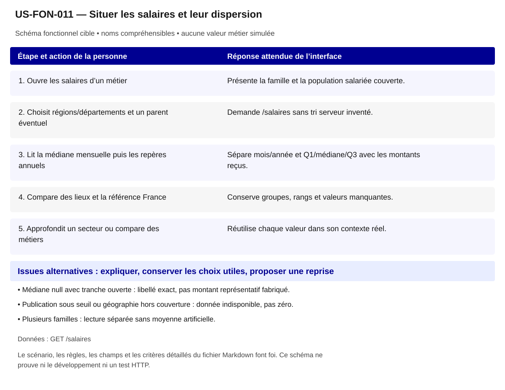

# US-FON-011 — Situer les salaires et leur dispersion

**Rattachement :** E11 · alias historique US-E11. **Lot :** L4.

**Périmètre :** inclus. Les dépendances et les tests à réaliser organisent la réalisation, sans retirer la fonctionnalité.

**Dépendances et passerelles :** [US-FON-005](US-FON-005.md) (E05);[US-FON-009](US-FON-009.md) (E09);[US-FON-031](US-FON-031.md) (E31).

**État constaté au 2 novembre 2026 :** Salaires et cartes sur JSON testés ; tranches ouvertes, replis et variations HTTP à collecter.

[Retour au backlog](../04_BACKLOG_USER_STORIES.md) · [Modèle commun](../../00_MODELE_COMMUN_USER_STORIES/MODELE_US_FONCTIONNELLE.md)

## 1. Objectif fonctionnel

Permettre à la personne de situer les salaires et leur dispersion, pour examiner des rémunérations sans les prendre pour un salaire promis. Je veux consulter les salaires et comparer les territoires par famille.

## 2. User Story

En tant que personne qui explore ses possibilités professionnelles, je souhaite situer les salaires et leur dispersion, afin d’examiner des rémunérations sans les prendre pour un salaire promis.

## 3. Préconditions

- Les noms et identifiants sélectionnables proviennent des réponses autorisées ; aucun métier, lieu ou résultat n’est choisi implicitement.
- Les appels disposent de leurs paramètres exacts et le contexte de navigation est identifié. Les GET sont protégés par l’intégration prévue au contrat ; aucun secret d’accès n’est embarqué dans le HTML public.
- Les fonctionnalités liées restent accessibles selon les dépendances ci-dessus ; un volet indisponible ne bloque pas toute la fiche.

## 4. Scénario nominal

| Étape | Action utilisateur | Comportement attendu du système |
|---|---|---|
| 1 | Ouvre les salaires d’un métier | Présente la famille et la population salariée couverte. |
| 2 | Choisit régions/départements et un parent éventuel | Demande /salaires sans tri serveur inventé. |
| 3 | Lit la médiane mensuelle puis les repères annuels | Sépare mois/année et Q1/médiane/Q3 avec les montants reçus. |
| 4 | Compare des lieux et la référence France | Conserve groupes, rangs et valeurs manquantes. |
| 5 | Approfondit un secteur ou compare des métiers | Réutilise chaque valeur dans son contexte réel. |

## 5. Scénarios alternatifs

- Médiane null avec tranche ouverte : libellé exact, pas montant représentatif fabriqué.
- Publication sous seuil ou géographie hors couverture : donnée indisponible, pas zéro.
- Plusieurs familles : lecture séparée sans moyenne artificielle.

**États et erreurs complémentaires à couvrir :** Chargement/erreur partielle, 400/401/404/422/429/503/5xx/réseau ; annuler réponse périmée ; null, 0, secret_stat, clé absente et liste vide distincts ; reprise bornée, aucune donnée de remplacement. null avec tranche ouverte = afficher tranche, pas salaire inventé. Les statuts ci-dessus sont des cas de recette, leur retour effectif dépend de l’endpoint ; ne pas inventer un corps d’erreur serveur.

## 6. Règles de gestion

- Q1/Q3 annuels ne sont ni minimum ni maximum.
- La médiane mensuelle est reçue ; ne pas diviser l’annuelle par douze.
- Population à temps complet, emploi ordinaire toute l’année, poste principal et lieu de travail ; couverture et seuil du contrat.
- Un rang fournisseur peut être reçu malgré une médiane null avec tranche ouverte.

**Règles héritées conservées :** BTS 2023 fap_225 ; médiane mensuelle distincte des Q1/médiane/Q3 annuels ; tranche ouverte reçue (ex. « 50 000 euros et plus ») si médiane null ; conserver rang, seuil 30 observations échantillon.

**Traitements :** `/salaires?rome=...&zonage=...&region=...` ; BTS 2023 fap_225 ; médiane mensuelle distincte des Q1/médiane/Q3 annuels ; tranche ouverte reçue (ex. « 50 000 euros et plus ») si médiane null ; conserver rang, seuil 30 observations échantillon.

**Règles statistiques :** Afficher source, période/millésime, définition/unité, grain et géographie effective ; aucun score/delta/agrégat inventé, aucune inférence personnelle ; secret_stat non calculable. BTS 2023 fap_225 ; médiane mensuelle distincte des Q1/médiane/Q3 annuels ; tranche ouverte reçue (ex. « 50 000 euros et plus ») si médiane null ; conserver rang, seuil 30 observations échantillon.

**Règles communes :** noms et explications en langage courant ; ROME V3 uniquement ; aucune source métier extérieure aux 21 GET ; aucune moyenne, conversion annuelle/mensuelle, interpolation ou correspondance construite. Les codes restent internes aux requêtes, routes et tests.

Une valeur nulle, absente, `secret_stat`, zéro et une liste vide conservent leur sens distinct. Afficher le lieu réellement mesuré et expliquer le repli par indicateur ; ne pas attribuer un résultat de famille à un seul métier ou un résultat national à une session.

## 7. Données et API

**Source et portée de conception :** Source salaires renvoyée ; grain fap_225 ; période 2023 observé, vérifier réponse. Les métadonnées de chaque réponse/mesure priment toute valeur observée dans un exemple.

### Appel 1 — GET `/salaires`

**Déclenchement :** À la sélection ou ouverture de la section. Ordre/chaînage : suivre les étapes du scénario, les identifiants reçus et les dépendances liées ; charger les détails à leur ouverture et réutiliser le cache à paramètres strictement identiques.

| Paramètre exact | Emplacement | Obligation du contrat | Type / domaine Swagger | Usage pour cette US |
|---|---|---|---|---|
| `rome` | query | Facultatif Swagger | `string ; défaut API null` | V3 requis fonctionnellement |
| `zonage` | query | Facultatif Swagger | `string ; valeurs region, departement ; défaut API "region"` | region/departement |
| `region` | query | Facultatif Swagger | `string ; défaut API null` | seulement avec zonage=departement |

| Chemin JSON exact | Type connu | Niveau de preuve du chemin/type |
|---|---|---|
| `$.source_libelle` | chaîne | Types observés seulement ; null seul ne prouve pas le type publié |
| `$.grain` | chaîne | Types observés seulement ; null seul ne prouve pas le type publié |
| `$.millesime` | chaîne | Types observés seulement ; null seul ne prouve pas le type publié |
| `$.total` | entier | Types observés seulement ; null seul ne prouve pas le type publié |
| `$.items[].fap_225_code` | chaîne | Types observés seulement ; null seul ne prouve pas le type publié |
| `$.items[].fap_225_libelle` | chaîne | Types observés seulement ; null seul ne prouve pas le type publié |
| `$.items[].salaire_net_annuel_q1` | entier | Types observés seulement ; null seul ne prouve pas le type publié |
| `$.items[].salaire_net_annuel_median` | entier | Types observés seulement ; null seul ne prouve pas le type publié |
| `$.items[].salaire_net_annuel_q3` | entier | Types observés seulement ; null seul ne prouve pas le type publié |
| `$.items[].salaire_net_mensuel_median` | entier | Types observés seulement ; null seul ne prouve pas le type publié |
| `$.items[].tranche_salaire_median_libelle` | chaîne | Types observés seulement ; null seul ne prouve pas le type publié |
| `$.items[].nb_salaries_temps_complet` | entier | Types observés seulement ; null seul ne prouve pas le type publié |
| `$.items[].nb_rome_famille` | entier | Types observés seulement ; null seul ne prouve pas le type publié |
| `$.items[].rang` | entier | Types observés seulement ; null seul ne prouve pas le type publié |
| `$.items[].territoire_code` | chaîne | Types observés seulement ; null seul ne prouve pas le type publié |
| `$.items[].territoire_libelle` | chaîne | Types observés seulement ; null seul ne prouve pas le type publié |
| `$.france[].fap_225_code` | chaîne | Types observés seulement ; null seul ne prouve pas le type publié |
| `$.france[].fap_225_libelle` | chaîne | Types observés seulement ; null seul ne prouve pas le type publié |
| `$.france[].salaire_net_annuel_q1` | entier | Types observés seulement ; null seul ne prouve pas le type publié |
| `$.france[].salaire_net_annuel_median` | entier | Types observés seulement ; null seul ne prouve pas le type publié |
| `$.france[].salaire_net_annuel_q3` | entier | Types observés seulement ; null seul ne prouve pas le type publié |
| `$.france[].salaire_net_mensuel_median` | entier | Types observés seulement ; null seul ne prouve pas le type publié |
| `$.france[].tranche_salaire_median_libelle` | chaîne | Types observés seulement ; null seul ne prouve pas le type publié |
| `$.france[].nb_salaries_temps_complet` | entier | Types observés seulement ; null seul ne prouve pas le type publié |
| `$.france[].nb_rome_famille` | entier | Types observés seulement ; null seul ne prouve pas le type publié |

**Réponses natives utilisées pour vérifier les chemins :** [02_reponses_observees/indicateurs/salaires/response_departement.json](../../../02_reponses_observees/indicateurs/salaires/response_departement.json); [02_reponses_observees/indicateurs/salaires/response_regions.json](../../../02_reponses_observees/indicateurs/salaires/response_regions.json).

### Preuves et contrôles restant à produire

**Documenté :** [contrat](../../../01_sources/contrat_interface_2026-10-19.md) ; [OpenAPI officiel](../../../01_sources/openapi/docs_json_interface.json). Dix réponses sur les 21 GET n’ont pas de schéma officiel de réponse ; un type observé ne devient pas un schéma fournisseur.

**Références conservées de la conception :** [02_reponses_observees/indicateurs/salaires/response_regions.json](../../../02_reponses_observees/indicateurs/salaires/response_regions.json).

**Contrôle local déjà rapporté :** Mission 005 et contrôles de montants, cartes et alternative tabulaire. [Recette UX existante](../TESTS_UX_EXPLORER.md). Ces résultats sur JSON locaux ne valident pas les appels HTTP.

**Tests à réaliser :** T-E11 : Cas tranche ouverte et seuil territorial ; région seule vs départements d'une région ; préserver `rang` et null.

**Points RCO associés :** Q08 : seuils, tranche et rang ; tri contractuel/tests/demande fournisseur dans 06 section Q01–Q14. Lire le tri déjà établi dans [Q01–Q14](../06_DECISIONS_ET_POINTS_A_VALIDER.md) avant toute nouvelle demande ; ne pas redemander une réponse démontrée par le contrat.

## 8. Critères d’acceptation

**US-FON-011-CA-01** — **Étant donné** quartiles annuels et médiane mensuelle, **Quand** je les lis, **Alors** les unités restent séparées et les montants inchangés.

**US-FON-011-CA-02** — **Étant donné** une tranche ouverte sans médiane, **Quand** j’affiche le repère, **Alors** la tranche reçue est conservée sans médiane inventée.

**US-FON-011-CA-03** — **Étant donné** des groupes distincts, **Quand** je compare les lieux, **Alors** chaque série garde son groupe et sa population.

**US-FON-011-CA-04** — **Étant donné** un lieu non couvert, **Quand** je le choisis, **Alors** aucun salaire d’un autre lieu ne le remplace.

**US-FON-011-CA-05** — **Étant donné** un intitulé public et son identifiant technique disponibles, **Quand** le contenu est présenté, **Alors** les noms sont compréhensibles, les sources restent accessibles et aucun code de référentiel n’est imposé à la personne.

**US-FON-011-CA-06** — **Étant donné** une réponse absente, protégée ou en erreur pour un seul volet, **Quand** les autres réponses sont disponibles, **Alors** les volets disponibles restent consultables et l’état manquant est expliqué sans valeur de substitution.

**Trace de conception conservée :** Pas de mélange unités mensuelles et annuelles ; Classements par FAP225, référence France, médiane mensuelle et distribution annuelle distinctes ; tranche ouverte explicite ; Cas tranche ouverte et seuil territorial ; région seule vs départements d'une région ; préserver `rang` et null ; états d'erreur de la ligne vérifiés, aucune preuve HTTP déduite de fixtures. ; Recette citoyenne : aucun identifiant ou sigle de référentiel imposé à l’usager ; nombres et unités inchangés ; explication des limites et des absences ; sources conservées, sans score supplémentaire.

**Recette de rattachement :** `T-E11` ; les critères ci-dessus constituent les cas vérifiables à décliner dans cette recette et la matrice de traçabilité.

## 9. Composants UX/UI

- DataBox : chiffre mensuel, repères annuels en barres/tableau, classement et carte officielle.
- Pas de boîte à moustaches avec faux min/max ; unité et population lisibles sans infobulle.

**États à rendre accessibles :** initial, saisie/choix, attente annoncée, résultat, résultat partiel, vide, valeur non renseignée/protégée, erreur et reprise. Afficher des messages près des commandes concernées ; conserver les sélections utiles et ignorer les réponses périmées.

**Accessibilité :** libellés permanents, structure des titres, liens explicites, focus visible et logique, navigation intégrale au clavier ; annoncer les changements utiles sans lire chaque frappe. Aucune information portée par la seule couleur, le survol ou une carte. Tableau de données équivalent pour chaque graphique ; source, période, unité, population et lieu effectif accessibles au même endroit.

**Responsive et sobriété :** progression par questions, détails à la demande, réemploi des GET identiques ; repli sans perte de contenu, lecture à 320 px et zoom navigateur 200/400 % à recetter. JavaScript indisponible : afficher le contenu de repli et les limites réelles. Une recette locale ne constitue pas une conformité RGAA complète.

**Bibliothèques :** DSFR installé pour les contrôles et tableaux ; DSFR Chart officiel (`@gouvfr/dsfr-chart` 2.1.1 dans l’intégration actuelle) et DataBox quand une représentation convient. Pas de graphique personnalisé pour remplacer un composant adapté. GenUI n’est pas une dépendance de réalisation décidée ; aucun service ni endpoint supplémentaire n’est supposé.

**Composants et interaction hérités :** Classements des salaires ; Classements par FAP225, référence France, médiane mensuelle et distribution annuelle distinctes ; tranche ouverte explicite ; Présentation citoyenne : noms plutôt que codes ; pas de version ou de détail interne ; explication du sens des chiffres, des personnes concernées, du lieu et de la période ; sources accessibles.

**SEO / validation conservés :** Proposition à valider D10 : Métadonnées publiques. Ce statut est une proposition de déploiement, pas une décision produit acquise.

## 10. Maquette fonctionnelle

[Ouvrir le schéma SVG accessible](svg/US-FON-011.svg). Le texte intégral du scénario en section 4 et des alternatives en section 5 fournit son alternative. Il s’agit de la cible fonctionnelle, sans données de démonstration inventées ni déclaration de disponibilité HTTP.
