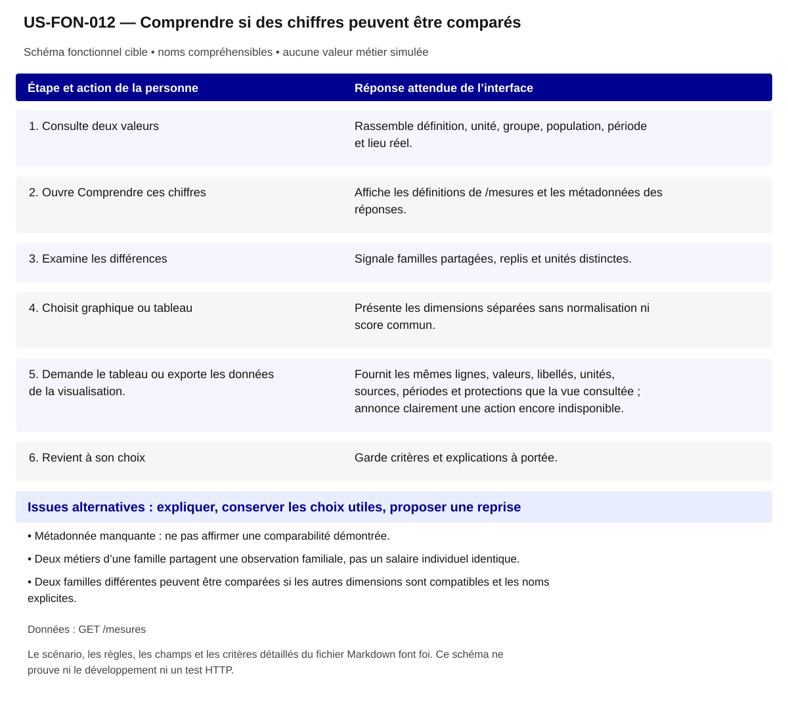

# US-FON-012 — Comprendre si des chiffres peuvent être comparés

**Rattachement :** E12 · alias historique US-E12. **Lot :** L4.

**Périmètre :** inclus. Les dépendances et les tests à réaliser organisent la réalisation, sans retirer la fonctionnalité.

**Dépendances et passerelles :** [US-FON-008](US-FON-008.md) (E08);[US-FON-010](US-FON-010.md) (E10);[US-FON-011](US-FON-011.md) (E11);[US-FON-031](US-FON-031.md) (E31).

**État constaté au 2 novembre 2026 :** Règles et alternatives locales contrôlées sur les cas disponibles ; variantes et comparabilité générale à compléter. Export des données encore à développer : les actions de bibliothèque actuellement désactivées ne constituent pas une livraison.

[Retour au backlog](../04_BACKLOG_USER_STORIES.md) · [Modèle commun](../../00_MODELE_COMMUN_USER_STORIES/MODELE_US_FONCTIONNELLE.md)

## 1. Objectif fonctionnel

Permettre à la personne de comprendre si des chiffres peuvent être comparés, pour éviter une décision fondée sur des populations différentes. Je veux comprendre quand deux valeurs décrivent des populations comparables.

## 2. User Story

En tant que personne qui explore ses possibilités professionnelles, je souhaite comprendre si des chiffres peuvent être comparés, afin d’éviter une décision fondée sur des populations différentes.

## 3. Préconditions

- Les noms et identifiants sélectionnables proviennent des réponses autorisées ; aucun métier, lieu ou résultat n’est choisi implicitement.
- Les appels disposent de leurs paramètres exacts et le contexte de navigation est identifié. Les GET sont protégés par l’intégration prévue au contrat ; aucun secret d’accès n’est embarqué dans le HTML public.
- Les fonctionnalités liées restent accessibles selon les dépendances ci-dessus ; un volet indisponible ne bloque pas toute la fiche.

## 4. Scénario nominal

| Étape | Action utilisateur | Comportement attendu du système |
|---|---|---|
| 1 | Consulte deux valeurs | Rassemble définition, unité, groupe, population, période et lieu réel. |
| 2 | Ouvre Comprendre ces chiffres | Affiche les définitions de /mesures et les métadonnées des réponses. |
| 3 | Examine les différences | Signale familles partagées, replis et unités distinctes. |
| 4 | Choisit graphique ou tableau | Présente les dimensions séparées sans normalisation ni score commun. |
| 5 | Demande le tableau ou exporte les données de la visualisation. | Fournit les mêmes lignes, valeurs, libellés, unités, sources, périodes et protections que la vue consultée ; annonce clairement une action encore indisponible. |
| 6 | Revient à son choix | Garde critères et explications à portée. |

## 5. Scénarios alternatifs

- Métadonnée manquante : ne pas affirmer une comparabilité démontrée.
- Deux métiers d’une famille partagent une observation familiale, pas un salaire individuel identique.
- Deux familles différentes peuvent être comparées si les autres dimensions sont compatibles et les noms explicites.

**États et erreurs complémentaires à couvrir :** Chargement/erreur partielle, 400/401/404/422/429/503/5xx/réseau ; annuler réponse périmée ; null, 0, secret_stat, clé absente et liste vide distincts ; reprise bornée, aucune donnée de remplacement. Les statuts ci-dessus sont des cas de recette, leur retour effectif dépend de l’endpoint ; ne pas inventer un corps d’erreur serveur.

## 6. Règles de gestion

- Aucun score composite, delta ou taux recomposé.
- Pas de radar mélangeant euros, pourcentages et nombres.
- DataBox et tableau gardent les mêmes valeurs ; une zone sans donnée n’est pas un zéro.
- Les taux d’insertion de populations/horizons différents ne constituent pas un classement unique.
- L’export CSV est une cible de réalisation incluse : conserver les valeurs et états publiés sans dévoiler secret_stat ni convertir null en zéro, et joindre libellés, unités, population, géographie réelle, source et période.
- Échapper les séparateurs, guillemets et retours à la ligne du CSV ; neutraliser les formules de tableur dans les libellés textuels sans altérer les valeurs numériques natives. Le tableau accessible reste disponible indépendamment de l’export.
- Les actions CSV, capture et plein écran désactivées dans l’intégration actuelle ne sont pas déclarées opérationnelles. L’export des données reste inclus ; capture et plein écran sont des options de bibliothèque à décider selon le besoin.

**Règles héritées conservées :** Comparabilité par mesure, unité, période, population, famille et territoire réel ; même FAP = même observation ; aucune soustraction inter-grains.

**Traitements :** `/mesures` jointure locale `code=mesure` + métadonnées des résultats ; Comparabilité par mesure, unité, période, population, famille et territoire réel ; même FAP = même observation ; aucune soustraction inter-grains.

**Règles statistiques :** Afficher source, période/millésime, définition/unité, grain et géographie effective ; aucun score/delta/agrégat inventé, aucune inférence personnelle ; secret_stat non calculable. Comparabilité par mesure, unité, période, population, famille et territoire réel ; même FAP = même observation ; aucune soustraction inter-grains.

**Règles communes :** noms et explications en langage courant ; ROME V3 uniquement ; aucune source métier extérieure aux 21 GET ; aucune moyenne, conversion annuelle/mensuelle, interpolation ou correspondance construite. Les codes restent internes aux requêtes, routes et tests.

Une valeur nulle, absente, `secret_stat`, zéro et une liste vide conservent leur sens distinct. Afficher le lieu réellement mesuré et expliquer le repli par indicateur ; ne pas attribuer un résultat de famille à un seul métier ou un résultat national à une session.

## 7. Données et API

**Source et portée de conception :** Catalogue mesures ; grain par mesure ; période par mesure. Les métadonnées de chaque réponse/mesure priment toute valeur observée dans un exemple.

### Appel 1 — GET `/mesures`

**Déclenchement :** À la sélection ou ouverture de la section. Ordre/chaînage : suivre les étapes du scénario, les identifiants reçus et les dépendances liées ; charger les détails à leur ouverture et réutiliser le cache à paramètres strictement identiques.

| Paramètre exact | Emplacement | Obligation du contrat | Type / domaine Swagger | Usage pour cette US |
|---|---|---|---|---|
| `fields` | query | Facultatif Swagger | `string ; défaut API null` | facultatif ; omis initialement |

| Chemin JSON exact | Type connu | Niveau de preuve du chemin/type |
|---|---|---|
| `$.items[].code` | chaîne | Types observés seulement ; null seul ne prouve pas le type publié |
| `$.items[].ressource` | chaîne | Types observés seulement ; null seul ne prouve pas le type publié |
| `$.items[].grain` | chaîne | Types observés seulement ; null seul ne prouve pas le type publié |
| `$.items[].libelle` | chaîne | Types observés seulement ; null seul ne prouve pas le type publié |
| `$.items[].definition` | chaîne | Types observés seulement ; null seul ne prouve pas le type publié |
| `$.items[].champs` | tableau | Types observés seulement ; null seul ne prouve pas le type publié |
| `$.items[].mailles` | tableau | Types observés seulement ; null seul ne prouve pas le type publié |
| `$.items[].source` | chaîne | Types observés seulement ; null seul ne prouve pas le type publié |
| `$.items[].millesime` | chaîne | Types observés seulement ; null seul ne prouve pas le type publié |
| `$.items[].nb_rome_couverts` | entier / null | Types observés seulement ; null seul ne prouve pas le type publié |
| `$.items[].tx_rome_couverts` | entier / nombre / null | Types observés seulement ; null seul ne prouve pas le type publié |

**Réponses natives utilisées pour vérifier les chemins :** [02_reponses_observees/indicateurs/Recrutementregions/response_mesures.json](../../../02_reponses_observees/indicateurs/Recrutementregions/response_mesures.json).

### Preuves et contrôles restant à produire

**Documenté :** [contrat](../../../01_sources/contrat_interface_2026-10-19.md) ; [OpenAPI officiel](../../../01_sources/openapi/docs_json_interface.json). Dix réponses sur les 21 GET n’ont pas de schéma officiel de réponse ; un type observé ne devient pas un schéma fournisseur.

**Références conservées de la conception :** [02_reponses_observees/indicateurs/Recrutementregions/response_mesures.json](../../../02_reponses_observees/indicateurs/Recrutementregions/response_mesures.json).

**Contrôle local déjà rapporté :** Contrôles DataBox, tableaux, unités et familles ; métadonnées et cas limites encore partiels. [Recette UX existante](../TESTS_UX_EXPLORER.md). Ces résultats sur JSON locaux ne valident pas les appels HTTP.

**Tests à réaliser :** T-E12 : Comparaison même famille, familles différentes, périodes/mailles différentes ; tester catalogue indisponible.

**Points RCO associés :** Q06 : correspondance métadonnées et évolutions ; tri contractuel/tests/demande fournisseur dans 06 section Q01–Q14. Lire le tri déjà établi dans [Q01–Q14](../06_DECISIONS_ET_POINTS_A_VALIDER.md) avant toute nouvelle demande ; ne pas redemander une réponse démontrée par le contrat.

## 8. Critères d’acceptation

**US-FON-012-CA-01** — **Étant donné** deux valeurs de périodes ou grains distincts, **Quand** je les rapproche, **Alors** les différences sont indiquées et aucun chiffre synthétique n’est calculé.

**US-FON-012-CA-02** — **Étant donné** deux métiers d’une famille, **Quand** je compare les salaires, **Alors** l’observation partagée est expliquée sans attribution individuelle.

**US-FON-012-CA-03** — **Étant donné** une valeur absente, **Quand** je lis graphique et tableau, **Alors** aucune barre à zéro ne remplace son état.

**US-FON-012-CA-04** — **Étant donné** un graphique utile, **Quand** je passe au tableau, **Alors** valeurs, unités et contexte restent équivalents.

**US-FON-012-CA-05** — **Étant donné** un tableau contenant des nombres, zéro, null, secret_stat et des libellés avec séparateurs ou guillemets, **Quand** je demande son export, **Alors** le fichier reprend exactement les lignes et états visibles, leur contexte et la protection statistique, reste lisible par un tableur et ne transforme pas un libellé en formule.

**US-FON-012-CA-06** — **Étant donné** un bouton d’export non encore branché, **Quand** je consulte les actions de la DataBox, **Alors** l’indisponibilité est compréhensible et aucun fichier vide ou trompeur n’est proposé ; le tableau accessible demeure consultable.

**US-FON-012-CA-07** — **Étant donné** un intitulé public et son identifiant technique disponibles, **Quand** le contenu est présenté, **Alors** les noms sont compréhensibles, les sources restent accessibles et aucun code de référentiel n’est imposé à la personne.

**US-FON-012-CA-08** — **Étant donné** une réponse absente, protégée ou en erreur pour un seul volet, **Quand** les autres réponses sont disponibles, **Alors** les volets disponibles restent consultables et l’état manquant est expliqué sans valeur de substitution.

**Trace de conception conservée :** Alerte visible en cas de grilles non comparables ; Expliquer pourquoi deux valeurs sont ou ne sont pas comparables ; préciser bases et populations sans score ; Comparaison même famille, familles différentes, périodes/mailles différentes ; tester catalogue indisponible ; états d'erreur de la ligne vérifiés, aucune preuve HTTP déduite de fixtures. ; Recette citoyenne : aucun identifiant ou sigle de référentiel imposé à l’usager ; nombres et unités inchangés ; explication des limites et des absences ; sources conservées, sans score supplémentaire.

**Recette de rattachement :** `T-E12` ; les critères ci-dessus constituent les cas vérifiables à décliner dans cette recette et la matrice de traçabilité.

## 9. Composants UX/UI

- DSFR : notices, tableaux et messages ; DataBox associe graphique, date et source.
- Lecture sans infobulle obligatoire et sans information seulement colorée.

**États à rendre accessibles :** initial, saisie/choix, attente annoncée, résultat, résultat partiel, vide, valeur non renseignée/protégée, erreur et reprise. Afficher des messages près des commandes concernées ; conserver les sélections utiles et ignorer les réponses périmées.

**Accessibilité :** libellés permanents, structure des titres, liens explicites, focus visible et logique, navigation intégrale au clavier ; annoncer les changements utiles sans lire chaque frappe. Aucune information portée par la seule couleur, le survol ou une carte. Tableau de données équivalent pour chaque graphique ; source, période, unité, population et lieu effectif accessibles au même endroit.

**Responsive et sobriété :** progression par questions, détails à la demande, réemploi des GET identiques ; repli sans perte de contenu, lecture à 320 px et zoom navigateur 200/400 % à recetter. JavaScript indisponible : afficher le contenu de repli et les limites réelles. Une recette locale ne constitue pas une conformité RGAA complète.

**Bibliothèques :** DSFR installé pour les contrôles et tableaux ; DSFR Chart officiel (`@gouvfr/dsfr-chart` 2.1.1 dans l’intégration actuelle) et DataBox quand une représentation convient. Pas de graphique personnalisé pour remplacer un composant adapté. GenUI n’est pas une dépendance de réalisation décidée ; aucun service ni endpoint supplémentaire n’est supposé.

**Composants et interaction hérités :** Comparabilité des données ; Expliquer pourquoi deux valeurs sont ou ne sont pas comparables ; préciser bases et populations sans score ; Présentation citoyenne : noms plutôt que codes ; pas de version ou de détail interne ; explication du sens des chiffres, des personnes concernées, du lieu et de la période ; sources accessibles.

**SEO / validation conservés :** Proposition à valider D10 : Définitions pour lecteurs. Ce statut est une proposition de déploiement, pas une décision produit acquise.

## 10. Maquette fonctionnelle

[Ouvrir le schéma SVG accessible](svg/US-FON-012.svg). Le texte intégral du scénario en section 4 et des alternatives en section 5 fournit son alternative. Il s’agit de la cible fonctionnelle, sans données de démonstration inventées ni déclaration de disponibilité HTTP.
