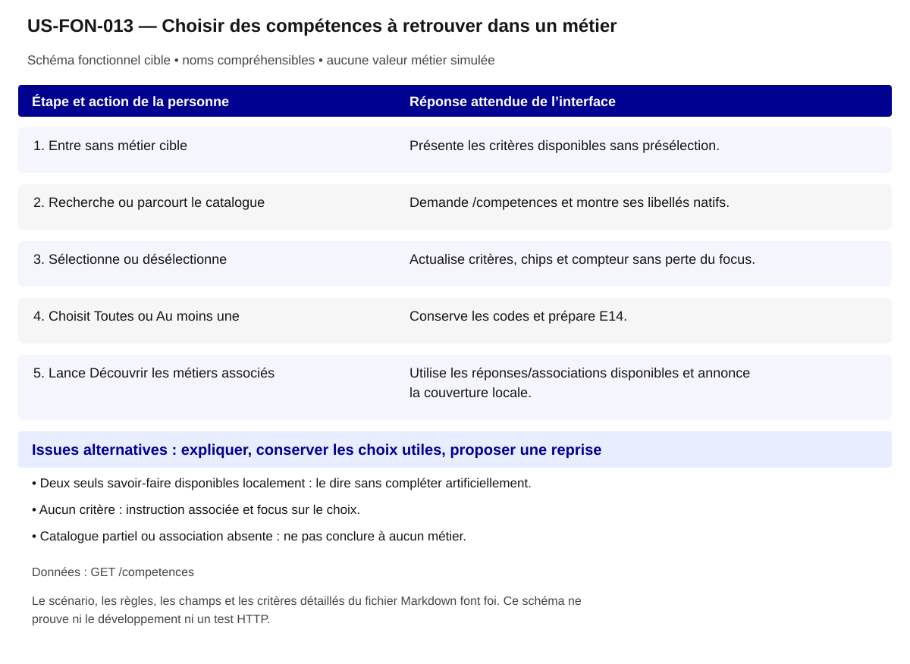

# US-FON-013 — Choisir des compétences à retrouver dans un métier

**Rattachement :** E13 · alias historique US-E13. **Lot :** L3.

**Périmètre :** inclus. Les dépendances et les tests à réaliser organisent la réalisation, sans retirer la fonctionnalité.

**Dépendances et passerelles :** [US-FON-006](US-FON-006.md) (E06) ou recherche catalogue directe.

**État constaté au 2 novembre 2026 :** Deux savoir-faire natifs, sélection et associations locales opérationnels ; catalogue complet et filtres HTTP à compléter.

[Retour au backlog](../04_BACKLOG_USER_STORIES.md) · [Modèle commun](../../00_MODELE_COMMUN_USER_STORIES/MODELE_US_FONCTIONNELLE.md)

## 1. Objectif fonctionnel

Permettre à la personne de choisir des compétences à retrouver dans un métier, pour partir d’activités ou de savoirs sans attester mon niveau. Je veux sélectionner des compétences effectivement référencées.

## 2. User Story

En tant que personne qui explore ses possibilités professionnelles, je souhaite choisir des compétences à retrouver dans un métier, afin de partir d’activités ou de savoirs sans attester mon niveau.

## 3. Préconditions

- Les noms et identifiants sélectionnables proviennent des réponses autorisées ; aucun métier, lieu ou résultat n’est choisi implicitement.
- Les appels disposent de leurs paramètres exacts et le contexte de navigation est identifié. Les GET sont protégés par l’intégration prévue au contrat ; aucun secret d’accès n’est embarqué dans le HTML public.
- Aucun métier cible ni niveau personnel n’est exigé pour choisir une compétence.
- Les fonctionnalités liées restent accessibles selon les dépendances ci-dessus ; un volet indisponible ne bloque pas toute la fiche.

## 4. Scénario nominal

| Étape | Action utilisateur | Comportement attendu du système |
|---|---|---|
| 1 | Entre sans métier cible | Présente les critères disponibles sans présélection. |
| 2 | Recherche ou parcourt le catalogue | Demande /competences et montre ses libellés natifs. |
| 3 | Sélectionne ou désélectionne | Actualise critères, chips et compteur sans perte du focus. |
| 4 | Choisit Toutes ou Au moins une | Conserve les codes et prépare E14. |
| 5 | Lance Découvrir les métiers associés | Utilise les réponses/associations disponibles et annonce la couverture locale. |

## 5. Scénarios alternatifs

- Deux seuls savoir-faire disponibles localement : le dire sans compléter artificiellement.
- Aucun critère : instruction associée et focus sur le choix.
- Catalogue partiel ou association absente : ne pas conclure à aucun métier.

**États et erreurs complémentaires à couvrir :** Chargement/erreur partielle, 400/401/404/422/429/503/5xx/réseau ; annuler réponse périmée ; null, 0, secret_stat, clé absente et liste vide distincts ; reprise bornée, aucune donnée de remplacement. Les statuts ci-dessus sont des cas de recette, leur retour effectif dépend de l’endpoint ; ne pas inventer un corps d’erreur serveur.

## 6. Règles de gestion

- Libellés reçus, codes OGR internes, métiers associés ROME V3.
- Domaine de compétence 1–6 distinct du Domaine ROME et du thème Formacode.
- Les choix sont des critères/intérêts, pas un niveau certifié.
- rome_codes[] est une association observée, pas la validation d’un GET /metiers non exécuté.

**Règles héritées conservées :** OGR string 6 chiffres, 1–10 pour résolution code ; nb_metiers documenté, pas de maîtrise utilisateur.

**Traitements :** `/competences?q=...&categorie=...`, résolution `code=...,...` (1–10) ; OGR string 6 chiffres, 1–10 pour résolution code ; nb_metiers documenté, pas de maîtrise utilisateur.

**Règles statistiques :** Afficher source, période/millésime, définition/unité, grain et géographie effective ; aucun score/delta/agrégat inventé, aucune inférence personnelle ; secret_stat non calculable. OGR string 6 chiffres, 1–10 pour résolution code ; nb_metiers documenté, pas de maîtrise utilisateur.

**Règles communes :** noms et explications en langage courant ; ROME V3 uniquement ; aucune source métier extérieure aux 21 GET ; aucune moyenne, conversion annuelle/mensuelle, interpolation ou correspondance construite. Les codes restent internes aux requêtes, routes et tests.

Une valeur nulle, absente, `secret_stat`, zéro et une liste vide conservent leur sens distinct. Afficher le lieu réellement mesuré et expliquer le repli par indicateur ; ne pas attribuer un résultat de famille à un seul métier ou un résultat national à une session.

## 7. Données et API

**Source et portée de conception :** OGR ; grain compétence ; période référentiel courant. Les métadonnées de chaque réponse/mesure priment toute valeur observée dans un exemple.

### Appel 1 — GET `/competences`

**Déclenchement :** À la sélection ou ouverture de la section. Ordre/chaînage : suivre les étapes du scénario, les identifiants reçus et les dépendances liées ; charger les détails à leur ouverture et réutiliser le cache à paramètres strictement identiques.

| Paramètre exact | Emplacement | Obligation du contrat | Type / domaine Swagger | Usage pour cette US |
|---|---|---|---|---|
| `q` | query | Facultatif Swagger | `string ; défaut API null ; minLength=2 ; maxLength=100` | 2–100 caractères facultatif |
| `code` | query | Facultatif Swagger | `string ; défaut API null` | 1–10 OGR séparés virgules facultatif |
| `categorie` | query | Facultatif Swagger | `string ; valeurs savoir_faire, savoir, savoir_etre, contexte_travail ; défaut API null` | savoir_faire/savoir/savoir_etre, contexte exclu du filtre competence |
| `domaine` | query | Facultatif Swagger | `string ; défaut API null` | domaine de compétence1–6 et non Domaine métier |
| `enjeu` | query | Facultatif Swagger | `string ; défaut API null` | facultatif |
| `macro_competence` | query | Facultatif Swagger | `string ; défaut API null` | OGR facultatif |
| `rome` | query | Facultatif Swagger | `string ; défaut API null` | V3 facultatif |
| `page` | query | Facultatif Swagger | `integer ; défaut API 1 ; minimum=0` | >=1 |

| Chemin JSON exact | Type connu | Niveau de preuve du chemin/type |
|---|---|---|
| `$.items[].competence_code` | string ou null | Type OpenAPI officiel ; chemin observé |
| `$.items[].competence_libelle` | string ou null | Type OpenAPI officiel ; chemin observé |
| `$.items[].categorie_competence_code` | string ou null | Type OpenAPI officiel ; chemin observé |
| `$.items[].categorie_competence_libelle` | string ou null | Type OpenAPI officiel ; chemin observé |
| `$.items[].macro_competence_code` | string ou null | Type OpenAPI officiel ; chemin observé |
| `$.items[].macro_competence_libelle` | string ou null | Type OpenAPI officiel ; chemin observé |
| `$.items[].enjeu_competence_code` | string ou null | Type OpenAPI officiel ; chemin observé |
| `$.items[].enjeu_competence_libelle` | string ou null | Type OpenAPI officiel ; chemin observé |
| `$.items[].domaine_competence_code` | string ou null | Type OpenAPI officiel ; chemin observé |
| `$.items[].domaine_competence_libelle` | string ou null | Type OpenAPI officiel ; chemin observé |
| `$.items[].nb_metiers` | integer ou null | Type OpenAPI officiel ; chemin observé |
| `$.items[].rome_codes` | array | Type OpenAPI officiel ; chemin observé |
| `$.items[].rome_libelles` | array | Type OpenAPI officiel ; chemin observé |
| `$.items[].rome_coeur_metier_codes` | array | Type OpenAPI officiel ; chemin observé |
| `$.items[].source_libelle` | string ou null | Type OpenAPI officiel ; chemin observé |

**Réponses natives utilisées pour vérifier les chemins :** [06_controles/resultats/R23 test/GET_competences__code_103659__page_1.json](<../../../06_controles/resultats/R23 test/GET_competences__code_103659__page_1.json>); [06_controles/resultats/R23 test/R23 GET competencescode=125416&page=1.json](<../../../06_controles/resultats/R23 test/R23 GET competencescode=125416&page=1.json>).

### Preuves et contrôles restant à produire

**Documenté :** [contrat](../../../01_sources/contrat_interface_2026-10-19.md) ; [OpenAPI officiel](../../../01_sources/openapi/docs_json_interface.json). Dix réponses sur les 21 GET n’ont pas de schéma officiel de réponse ; un type observé ne devient pas un schéma fournisseur.

**Références conservées de la conception :** [06_controles/VALIDATION_R23_recherche_multicompetences.md](../../../06_controles/VALIDATION_R23_recherche_multicompetences.md).

**Contrôle local déjà rapporté :** Mission 001 et guide au clavier ; deux choix natifs et compteur synchronisé. [Recette UX existante](../TESTS_UX_EXPLORER.md). Ces résultats sur JSON locaux ne valident pas les appels HTTP.

**Tests à réaliser :** T-E13 : Recherche libre et multi-code ; conserver zéro initial et catégories ; pas de correspondance RNCP par texte.

**Points RCO associés :** Q02/Q04 : recherche et codes ; tri contractuel/tests/demande fournisseur dans 06 section Q01–Q14. Lire le tri déjà établi dans [Q01–Q14](../06_DECISIONS_ET_POINTS_A_VALIDER.md) avant toute nouvelle demande ; ne pas redemander une réponse démontrée par le contrat.

## 8. Critères d’acceptation

**US-FON-013-CA-01** — **Étant donné** une arrivée sans choix, **Quand** j’ouvre le guide, **Alors** aucun critère n’est coché pour moi.

**US-FON-013-CA-02** — **Étant donné** deux compétences, **Quand** j’en retire une, **Alors** case, chip et compteur se mettent à jour ensemble.

**US-FON-013-CA-03** — **Étant donné** un libellé reçu, **Quand** je le lis, **Alors** aucune activité inventée ni code public ne le remplace.

**US-FON-013-CA-04** — **Étant donné** un savoir-faire disponible, **Quand** je découvre les métiers, **Alors** les associations reçues sont utilisées sans score personnel.

**US-FON-013-CA-05** — **Étant donné** un intitulé public et son identifiant technique disponibles, **Quand** le contenu est présenté, **Alors** les noms sont compréhensibles, les sources restent accessibles et aucun code de référentiel n’est imposé à la personne.

**US-FON-013-CA-06** — **Étant donné** une réponse absente, protégée ou en erreur pour un seul volet, **Quand** les autres réponses sont disponibles, **Alors** les volets disponibles restent consultables et l’état manquant est expliqué sans valeur de substitution.

**Trace de conception conservée :** Code 103659 validé, texte libre libre non inféré ; Choisir les OGR depuis le métier ou le catalogue ; voir leurs métiers associés sans conclure à une maîtrise ; Recherche libre et multi-code ; conserver zéro initial et catégories ; pas de correspondance RNCP par texte ; états d'erreur de la ligne vérifiés, aucune preuve HTTP déduite de fixtures. ; Recette citoyenne : aucun identifiant ou sigle de référentiel imposé à l’usager ; nombres et unités inchangés ; explication des limites et des absences ; sources conservées, sans score supplémentaire. ; Vérifier les scénarios de navigation correspondants dans la recette UX, sans déduire un test HTTP d’un contrôle du prototype.

**Recette de rattachement :** `T-E13` ; les critères ci-dessus constituent les cas vérifiables à décliner dans cette recette et la matrice de traçabilité.

## 9. Composants UX/UI

- DSFR : cases, catalogue, chips, compteur live et bouton de découverte.
- Retraits accessibles ; Tab/Espace/Entrée ; aucun slider de niveau.

**États à rendre accessibles :** initial, saisie/choix, attente annoncée, résultat, résultat partiel, vide, valeur non renseignée/protégée, erreur et reprise. Afficher des messages près des commandes concernées ; conserver les sélections utiles et ignorer les réponses périmées.

**Accessibilité :** libellés permanents, structure des titres, liens explicites, focus visible et logique, navigation intégrale au clavier ; annoncer les changements utiles sans lire chaque frappe. Aucune information portée par la seule couleur, le survol ou une carte. Tableau de données équivalent pour chaque graphique ; source, période, unité, population et lieu effectif accessibles au même endroit.

**Responsive et sobriété :** progression par questions, détails à la demande, réemploi des GET identiques ; repli sans perte de contenu, lecture à 320 px et zoom navigateur 200/400 % à recetter. JavaScript indisponible : afficher le contenu de repli et les limites réelles. Une recette locale ne constitue pas une conformité RGAA complète.

**Bibliothèques :** DSFR installé pour les contrôles et tableaux ; DSFR Chart officiel (`@gouvfr/dsfr-chart` 2.1.1 dans l’intégration actuelle) et DataBox quand une représentation convient. Pas de graphique personnalisé pour remplacer un composant adapté. GenUI n’est pas une dépendance de réalisation décidée ; aucun service ni endpoint supplémentaire n’est supposé.

**Composants et interaction hérités :** Choix de compétences OGR ; Choisir les OGR depuis le métier ou le catalogue ; voir leurs métiers associés sans conclure à une maîtrise ; Présentation citoyenne : noms plutôt que codes ; pas de version ou de détail interne ; explication du sens des chiffres, des personnes concernées, du lieu et de la période ; sources accessibles. ; Évolution UX ciblée : Filtres de savoir-faire accessibles simultanément, sans numérotation d’étapes.

**SEO / validation conservés :** Proposition à valider D10 : Pas de pages de faux matching. Ce statut est une proposition de déploiement, pas une décision produit acquise.

## 10. Maquette fonctionnelle

[Ouvrir le schéma SVG accessible](svg/US-FON-013.svg). Le texte intégral du scénario en section 4 et des alternatives en section 5 fournit son alternative. Il s’agit de la cible fonctionnelle, sans données de démonstration inventées ni déclaration de disponibilité HTTP.
