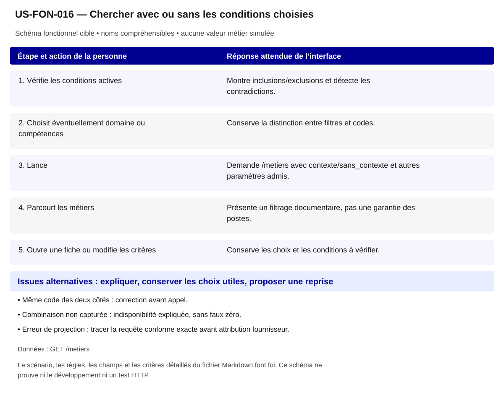

# US-FON-016 — Chercher avec ou sans les conditions choisies

**Rattachement :** E16 · alias historique US-E16. **Lot :** L3.

**Périmètre :** inclus. Les dépendances et les tests à réaliser organisent la réalisation, sans retirer la fonctionnalité.

**Dépendances et passerelles :** [US-FON-015](US-FON-015.md) (E15);[US-FON-003](US-FON-003.md) (E03) si Domaine choisi.

**État constaté au 2 novembre 2026 :** Deux cas R24 ciblés ; combinaison générale à réaliser avec les GET existants, pas déclarée opérationnelle localement.

[Retour au backlog](../04_BACKLOG_USER_STORIES.md) · [Modèle commun](../../00_MODELE_COMMUN_USER_STORIES/MODELE_US_FONCTIONNELLE.md)

## 1. Objectif fonctionnel

Permettre à la personne de chercher avec ou sans les conditions choisies, pour examiner des références documentées selon mes préférences. Je veux chercher des métiers avec ou sans les contextes choisis.

## 2. User Story

En tant que personne qui explore ses possibilités professionnelles, je souhaite chercher avec ou sans les conditions choisies, afin d’examiner des références documentées selon mes préférences.

## 3. Préconditions

- Les noms et identifiants sélectionnables proviennent des réponses autorisées ; aucun métier, lieu ou résultat n’est choisi implicitement.
- Les appels disposent de leurs paramètres exacts et le contexte de navigation est identifié. Les GET sont protégés par l’intégration prévue au contrat ; aucun secret d’accès n’est embarqué dans le HTML public.
- Les fonctionnalités liées restent accessibles selon les dépendances ci-dessus ; un volet indisponible ne bloque pas toute la fiche.

## 4. Scénario nominal

| Étape | Action utilisateur | Comportement attendu du système |
|---|---|---|
| 1 | Vérifie les conditions actives | Montre inclusions/exclusions et détecte les contradictions. |
| 2 | Choisit éventuellement domaine ou compétences | Conserve la distinction entre filtres et codes. |
| 3 | Lance | Demande /metiers avec contexte/sans_contexte et autres paramètres admis. |
| 4 | Parcourt les métiers | Présente un filtrage documentaire, pas une garantie des postes. |
| 5 | Ouvre une fiche ou modifie les critères | Conserve les choix et les conditions à vérifier. |

## 5. Scénarios alternatifs

- Même code des deux côtés : correction avant appel.
- Combinaison non capturée : indisponibilité expliquée, sans faux zéro.
- Erreur de projection : tracer la requête conforme exacte avant attribution fournisseur.

**États et erreurs complémentaires à couvrir :** Chargement/erreur partielle, 400/401/404/422/429/503/5xx/réseau ; annuler réponse périmée ; null, 0, secret_stat, clé absente et liste vide distincts ; reprise bornée, aucune donnée de remplacement. Les statuts ci-dessus sont des cas de recette, leur retour effectif dépend de l’endpoint ; ne pas inventer un corps d’erreur serveur.

## 6. Règles de gestion

- R24 : domaine F16 avec ou sans 300782 donne 10 ou 3 sur ces seules captures.
- contexte impose chacun des codes ; sans_contexte exclut dès qu’un code est porté.
- Non référencé ne garantit pas l’absence de la condition sur tous les postes.
- Q05 reste conditionnelle à une reproduction conforme, avec les champs pluriels exacts.

**Règles héritées conservées :** Parent V3 : contexte porté par au moins une spécialité ; exclusion prudente si une spécialité le porte, absence de code non-garantie terrain.

**Traitements :** `/metiers?domaine=...&contexte=...&sans_contexte=...&page=...` selon choix ; Parent V3 : contexte porté par au moins une spécialité ; exclusion prudente si une spécialité le porte, absence de code non-garantie terrain.

**Règles statistiques :** Afficher source, période/millésime, définition/unité, grain et géographie effective ; aucun score/delta/agrégat inventé, aucune inférence personnelle ; secret_stat non calculable. Parent V3 : contexte porté par au moins une spécialité ; exclusion prudente si une spécialité le porte, absence de code non-garantie terrain.

**Règles communes :** noms et explications en langage courant ; ROME V3 uniquement ; aucune source métier extérieure aux 21 GET ; aucune moyenne, conversion annuelle/mensuelle, interpolation ou correspondance construite. Les codes restent internes aux requêtes, routes et tests.

Une valeur nulle, absente, `secret_stat`, zéro et une liste vide conservent leur sens distinct. Afficher le lieu réellement mesuré et expliquer le repli par indicateur ; ne pas attribuer un résultat de famille à un seul métier ou un résultat national à une session.

## 7. Données et API

**Source et portée de conception :** ROME V3/OGR ; grain ROME V3 ; période référentiel courant. Les métadonnées de chaque réponse/mesure priment toute valeur observée dans un exemple.

### Appel 1 — GET `/metiers`

**Déclenchement :** À la sélection ou ouverture de la section. Ordre/chaînage : suivre les étapes du scénario, les identifiants reçus et les dépendances liées ; charger les détails à leur ouverture et réutiliser le cache à paramètres strictement identiques.

| Paramètre exact | Emplacement | Obligation du contrat | Type / domaine Swagger | Usage pour cette US |
|---|---|---|---|---|
| `domaine` | query | Facultatif Swagger | `string ; défaut API null` | code Domaine choisi facultatif |
| `contexte` | query | Facultatif Swagger | `string ; défaut API null` | 1–10OGR à inclure |
| `sans_contexte` | query | Facultatif Swagger | `string ; défaut API null` | 1–10OGR à exclure |
| `competence` | query | Facultatif Swagger | `string ; défaut API null` | facultatif codes sélectionnés |
| `mode_competence` | query | Facultatif Swagger | `string ; valeurs toutes, au_moins_une ; défaut API null` | toutes/au_moins_une si competence |
| `page` | query | Facultatif Swagger | `integer ; défaut API 1 ; minimum=0` | >=1 |

| Chemin JSON exact | Type connu | Niveau de preuve du chemin/type |
|---|---|---|
| `$.items[].rome_code` | string ou null | Type OpenAPI officiel ; chemin observé |
| `$.items[].rome_libelle` | string ou null | Type OpenAPI officiel ; chemin observé |
| `$.items[].domaine_code` | string ou null | Type OpenAPI officiel ; chemin observé |
| `$.items[].domaine_libelle` | string ou null | Type OpenAPI officiel ; chemin observé |
| `$.items[].grand_domaine_code` | string ou null | Type OpenAPI officiel ; chemin observé |
| `$.items[].grand_domaine_libelle` | string ou null | Type OpenAPI officiel ; chemin observé |
| `$.items[].appellations` | array | Type OpenAPI officiel ; chemin observé |
| `$.items[].definitions` | array | Type OpenAPI officiel ; chemin observé |
| `$.items[].tag_transition_ecologique` | boolean ou null | Type OpenAPI officiel ; chemin observé |
| `$.items[].tag_transition_numerique` | boolean ou null | Type OpenAPI officiel ; chemin observé |
| `$.items[].tag_transition_demographique` | boolean ou null | Type OpenAPI officiel ; chemin observé |
| `$.items[].tag_emploi_reglemente` | boolean ou null | Type OpenAPI officiel ; chemin observé |
| `$.items[].tag_emploi_cadre` | boolean ou null | Type OpenAPI officiel ; chemin observé |
| `$.items[].metiers_proches_codes` | array | Type OpenAPI officiel ; chemin observé |
| `$.items[].metiers_proches_libelles` | array | Type OpenAPI officiel ; chemin observé |
| `$.items[].savoir_etre_libelles` | array | Type OpenAPI officiel ; chemin observé |
| `$.items[].contexte_travail_codes` | array | Type OpenAPI officiel ; chemin observé |
| `$.items[].contexte_travail_libelles` | array | Type OpenAPI officiel ; chemin observé |
| `$.items[].fap228_codes` | array | Type OpenAPI officiel ; chemin observé |
| `$.items[].formacode_codes` | array | Type OpenAPI officiel ; chemin observé |
| `$.items[].formacode_libelles` | array | Type OpenAPI officiel ; chemin observé |
| `$.items[].source_libelle` | string ou null | Type OpenAPI officiel ; chemin observé |

**Réponses natives utilisées pour vérifier les chemins :** [06_controles/resultats/R23 test/R23 GET metierscompetence=125416&mode_competence=toutes&page=1.json](<../../../06_controles/resultats/R23 test/R23 GET metierscompetence=125416&mode_competence=toutes&page=1.json>); [06_controles/resultats/R23 test/R23 GET metierscompetence=125416,103659&mode_competence=au_moins_une&page=1.json](<../../../06_controles/resultats/R23 test/R23 GET metierscompetence=125416,103659&mode_competence=au_moins_une&page=1.json>); [06_controles/resultats/R23 test/R23 GET metierscompetence=125416,103659&mode_competence=toutes&page=1.json](<../../../06_controles/resultats/R23 test/R23 GET metierscompetence=125416,103659&mode_competence=toutes&page=1.json>); [06_controles/resultats/R24/R24 GET metiersdomaine=F16&contexte=300782&page=1.json](<../../../06_controles/resultats/R24/R24 GET metiersdomaine=F16&contexte=300782&page=1.json>); [06_controles/resultats/R24/R24 GET metiersdomaine=F16&sans_contexte=300782&page=1.json](<../../../06_controles/resultats/R24/R24 GET metiersdomaine=F16&sans_contexte=300782&page=1.json>).

### Preuves et contrôles restant à produire

**Documenté :** [contrat](../../../01_sources/contrat_interface_2026-10-19.md) ; [OpenAPI officiel](../../../01_sources/openapi/docs_json_interface.json). Dix réponses sur les 21 GET n’ont pas de schéma officiel de réponse ; un type observé ne devient pas un schéma fournisseur.

**Références conservées de la conception :** [06_controles/VALIDATION_R24_contextes_metiers.md](../../../06_controles/VALIDATION_R24_contextes_metiers.md).

**Contrôle local déjà rapporté :** Cas documentaires R24 ; combinaison générale non capturée signalée comme indisponible. [Recette UX existante](../TESTS_UX_EXPLORER.md). Ces résultats sur JSON locaux ne valident pas les appels HTTP.

**Tests à réaliser :** T-E16 : R24 puis multi-contextes/combinés ; re-test `fields` correctement encodé ; exclusion à l'échelle des spécialités.

**Points RCO associés :** Q05 : combinaison, projection et sémantique ; tri contractuel/tests/demande fournisseur dans 06 section Q01–Q14. Lire le tri déjà établi dans [Q01–Q14](../06_DECISIONS_ET_POINTS_A_VALIDER.md) avant toute nouvelle demande ; ne pas redemander une réponse démontrée par le contrat.

## 8. Critères d’acceptation

**US-FON-016-CA-01** — **Étant donné** le cas R24 avec contexte, **Quand** je lis la réponse, **Alors** ses dix métiers sont conservés.

**US-FON-016-CA-02** — **Étant donné** le cas R24 sans contexte, **Quand** je lis la réponse, **Alors** ses trois métiers sont conservés sans garantie terrain.

**US-FON-016-CA-03** — **Étant donné** une combinaison non capturée, **Quand** je l’essaie localement, **Alors** aucun résultat n’est fabriqué.

**US-FON-016-CA-04** — **Étant donné** des critères contradictoires, **Quand** je lance, **Alors** un message associé permet la correction.

**US-FON-016-CA-05** — **Étant donné** un intitulé public et son identifiant technique disponibles, **Quand** le contenu est présenté, **Alors** les noms sont compréhensibles, les sources restent accessibles et aucun code de référentiel n’est imposé à la personne.

**US-FON-016-CA-06** — **Étant donné** une réponse absente, protégée ou en erreur pour un seul volet, **Quand** les autres réponses sont disponibles, **Alors** les volets disponibles restent consultables et l’état manquant est expliqué sans valeur de substitution.

**Trace de conception conservée :** 300782 F16 avec=10 sans=3 ; expliquer limites ; Inclusion/exclusion de contextes référencés au parent V3 ; appliquer ensemble les sélections compatibles, expliquer absence non garantie dans tout emploi réel ; R24 puis multi-contextes/combinés ; re-test `fields` correctement encodé ; exclusion à l'échelle des spécialités ; états d'erreur de la ligne vérifiés, aucune preuve HTTP déduite de fixtures. ; Recette citoyenne : aucun identifiant ou sigle de référentiel imposé à l’usager ; nombres et unités inchangés ; explication des limites et des absences ; sources conservées, sans score supplémentaire. ; Vérifier les scénarios de navigation correspondants dans la recette UX, sans déduire un test HTTP d’un contrôle du prototype.

**Recette de rattachement :** `T-E16` ; les critères ci-dessus constituent les cas vérifiables à décliner dans cette recette et la matrice de traçabilité.

## 9. Composants UX/UI

- DSFR : critères simultanés, message associé, cartes et retour aux filtres.
- Aucune jauge ; focus préservé à la modification.

**États à rendre accessibles :** initial, saisie/choix, attente annoncée, résultat, résultat partiel, vide, valeur non renseignée/protégée, erreur et reprise. Afficher des messages près des commandes concernées ; conserver les sélections utiles et ignorer les réponses périmées.

**Accessibilité :** libellés permanents, structure des titres, liens explicites, focus visible et logique, navigation intégrale au clavier ; annoncer les changements utiles sans lire chaque frappe. Aucune information portée par la seule couleur, le survol ou une carte. Tableau de données équivalent pour chaque graphique ; source, période, unité, population et lieu effectif accessibles au même endroit.

**Responsive et sobriété :** progression par questions, détails à la demande, réemploi des GET identiques ; repli sans perte de contenu, lecture à 320 px et zoom navigateur 200/400 % à recetter. JavaScript indisponible : afficher le contenu de repli et les limites réelles. Une recette locale ne constitue pas une conformité RGAA complète.

**Bibliothèques :** DSFR installé pour les contrôles et tableaux ; DSFR Chart officiel (`@gouvfr/dsfr-chart` 2.1.1 dans l’intégration actuelle) et DataBox quand une représentation convient. Pas de graphique personnalisé pour remplacer un composant adapté. GenUI n’est pas une dépendance de réalisation décidée ; aucun service ni endpoint supplémentaire n’est supposé.

**Composants et interaction hérités :** Recherche avec/sans contexte ; Inclusion/exclusion de contextes référencés au parent V3 ; appliquer ensemble les sélections compatibles, expliquer absence non garantie dans tout emploi réel ; Présentation citoyenne : noms plutôt que codes ; pas de version ou de détail interne ; explication du sens des chiffres, des personnes concernées, du lieu et de la période ; sources accessibles. ; Évolution UX ciblée : Conserver le domaine et les choix avec/sans contexte ; aucune réponse d’une autre combinaison utilisée comme résultat.

**SEO / validation conservés :** Proposition à valider D10 : Liens métiers. Ce statut est une proposition de déploiement, pas une décision produit acquise.

## 10. Maquette fonctionnelle

[Ouvrir le schéma SVG accessible](svg/US-FON-016.svg). Le texte intégral du scénario en section 4 et des alternatives en section 5 fournit son alternative. Il s’agit de la cible fonctionnelle, sans données de démonstration inventées ni déclaration de disponibilité HTTP.
