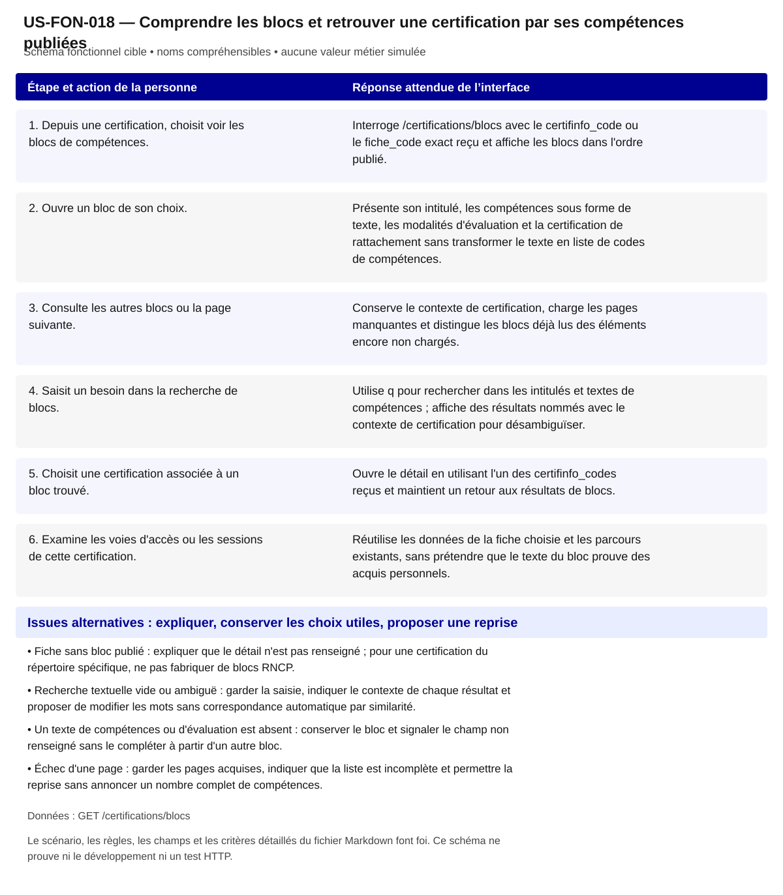

# US-FON-018 — Comprendre les blocs et retrouver une certification par ses compétences publiées

**Rattachement :** E18 · alias historique US-E18. **Lot :** L2/L3.

**Périmètre :** inclus. Les dépendances et les tests à réaliser organisent la réalisation, sans retirer la fonctionnalité.

**Dépendances et passerelles :** [US-FON-017](US-FON-017.md) (E17) ou recherche texte directe.

**État constaté au 2 novembre 2026 :** Contrat et JSON de quatre blocs disponibles ; les filtres certifinfo/fiche, la recherche q, la pagination et les cas sans bloc doivent encore être validés par des GET tracés. L'examen local des textes ne constitue pas une validation du filtrage HTTP ni une preuve d'équivalence OGR.

[Retour au backlog](../04_BACKLOG_USER_STORIES.md) · [Modèle commun](../../00_MODELE_COMMUN_USER_STORIES/MODELE_US_FONCTIONNELLE.md)

## 1. Objectif fonctionnel

Permettre à la personne de comprendre les blocs et retrouver une certification par ses compétences publiées, pour lire ce qu'un bloc certifie et comment il est évalué, puis retrouver les certifications dont le texte publié correspond à mon besoin. Je veux comprendre les blocs certifiés et retrouver des certifications par leur texte.

## 2. User Story

En tant que personne qui explore ses possibilités professionnelles, je souhaite comprendre les blocs et retrouver une certification par ses compétences publiées, afin de lire ce qu'un bloc certifie et comment il est évalué, puis retrouver les certifications dont le texte publié correspond à mon besoin.

## 3. Préconditions

- Les noms et identifiants sélectionnables proviennent des réponses autorisées ; aucun métier, lieu ou résultat n’est choisi implicitement.
- Les appels disposent de leurs paramètres exacts et le contexte de navigation est identifié. Les GET sont protégés par l’intégration prévue au contrat ; aucun secret d’accès n’est embarqué dans le HTML public.
- Les fonctionnalités liées restent accessibles selon les dépendances ci-dessus ; un volet indisponible ne bloque pas toute la fiche.

## 4. Scénario nominal

| Étape | Action utilisateur | Comportement attendu du système |
|---|---|---|
| 1 | Depuis une certification, choisit voir les blocs de compétences. | Interroge /certifications/blocs avec le certifinfo_code ou le fiche_code exact reçu et affiche les blocs dans l'ordre publié. |
| 2 | Ouvre un bloc de son choix. | Présente son intitulé, les compétences sous forme de texte, les modalités d'évaluation et la certification de rattachement sans transformer le texte en liste de codes de compétences. |
| 3 | Consulte les autres blocs ou la page suivante. | Conserve le contexte de certification, charge les pages manquantes et distingue les blocs déjà lus des éléments encore non chargés. |
| 4 | Saisit un besoin dans la recherche de blocs. | Utilise q pour rechercher dans les intitulés et textes de compétences ; affiche des résultats nommés avec le contexte de certification pour désambiguïser. |
| 5 | Choisit une certification associée à un bloc trouvé. | Ouvre le détail en utilisant l'un des certifinfo_codes reçus et maintient un retour aux résultats de blocs. |
| 6 | Examine les voies d'accès ou les sessions de cette certification. | Réutilise les données de la fiche choisie et les parcours existants, sans prétendre que le texte du bloc prouve des acquis personnels. |

## 5. Scénarios alternatifs

- Fiche sans bloc publié : expliquer que le détail n'est pas renseigné ; pour une certification du répertoire spécifique, ne pas fabriquer de blocs RNCP.
- Recherche textuelle vide ou ambiguë : garder la saisie, indiquer le contexte de chaque résultat et proposer de modifier les mots sans correspondance automatique par similarité.
- Un texte de compétences ou d'évaluation est absent : conserver le bloc et signaler le champ non renseigné sans le compléter à partir d'un autre bloc.
- Échec d'une page : garder les pages acquises, indiquer que la liste est incomplète et permettre la reprise sans annoncer un nombre complet de compétences.

**États et erreurs complémentaires à couvrir :** Chargement/erreur partielle, 400/401/404/422/429/503/5xx/réseau ; annuler réponse périmée ; null, 0, secret_stat, clé absente et liste vide distincts ; reprise bornée, aucune donnée de remplacement. Les statuts ci-dessus sont des cas de recette, leur retour effectif dépend de l’endpoint ; ne pas inventer un corps d’erreur serveur.

## 6. Règles de gestion

- competences et modalites_evaluation sont des textes de fiche ; ils ne constituent pas des compétences OGR et ne prouvent aucune équivalence avec le référentiel du métier.
- Le bloc_code, le fiche_code et les certifinfo_codes sont distincts ; seul un Certif Info reçu permet d'ouvrir /certifications/{certifinfo}.
- Respecter rang_bloc et la pagination ; les quatre blocs observés pour la fiche RNCP36101 ne démontrent pas le résultat des filtres pour toutes les certifications.
- Le moteur q recherche les textes publiés, sans score de maîtrise, conseil d'équivalence ou garantie que la personne peut valider le bloc.
- L'absence de blocs publiés n'affirme ni absence de compétences ni impossibilité générale de validation partielle ; celle-ci est une donnée séparée de la certification.

**Règles héritées conservées :** competences/modalites_evaluation sont textes RNCP, pas OGR ; pas de blocs RS ; null/absence bloc publié ne signifie pas aucune compétence.

**Traitements :** `/certifications/blocs?certifinfo=...` ou `fiche=...` ; complément recherche `q` ; competences/modalites_evaluation sont textes RNCP, pas OGR ; pas de blocs RS ; null/absence bloc publié ne signifie pas aucune compétence.

**Règles statistiques :** Afficher source, période/millésime, définition/unité, grain et géographie effective ; aucun score/delta/agrégat inventé, aucune inférence personnelle ; secret_stat non calculable. competences/modalites_evaluation sont textes RNCP, pas OGR ; pas de blocs RS ; null/absence bloc publié ne signifie pas aucune compétence.

**Règles communes :** noms et explications en langage courant ; ROME V3 uniquement ; aucune source métier extérieure aux 21 GET ; aucune moyenne, conversion annuelle/mensuelle, interpolation ou correspondance construite. Les codes restent internes aux requêtes, routes et tests.

Une valeur nulle, absente, `secret_stat`, zéro et une liste vide conservent leur sens distinct. Afficher le lieu réellement mesuré et expliquer le repli par indicateur ; ne pas attribuer un résultat de famille à un seul métier ou un résultat national à une session.

## 7. Données et API

**Source et portée de conception :** RNCP ; grain bloc RNCP ; période référentiel courant. Les métadonnées de chaque réponse/mesure priment toute valeur observée dans un exemple.

### Appel 1 — GET `/certifications/blocs`

**Déclenchement :** À la sélection ou ouverture de la section. Ordre/chaînage : suivre les étapes du scénario, les identifiants reçus et les dépendances liées ; charger les détails à leur ouverture et réutiliser le cache à paramètres strictement identiques.

| Paramètre exact | Emplacement | Obligation du contrat | Type / domaine Swagger | Usage pour cette US |
|---|---|---|---|---|
| `certifinfo` | query | Facultatif Swagger | `string ; défaut API null` | filtre par code ou utiliser fiche |
| `fiche` | query | Facultatif Swagger | `string ; défaut API null` | RNCP... alternatif |
| `q` | query | Facultatif Swagger | `string ; défaut API null ; minLength=2 ; maxLength=100` | recherche texte2–100 facultative |
| `page` | query | Facultatif Swagger | `integer ; défaut API 1 ; minimum=0` | >=1 |

| Chemin JSON exact | Type connu | Niveau de preuve du chemin/type |
|---|---|---|
| `$.items[].bloc_code` | string ou null | Type OpenAPI officiel ; chemin observé |
| `$.items[].rang_bloc` | integer ou null | Type OpenAPI officiel ; chemin observé |
| `$.items[].bloc_libelle` | string ou null | Type OpenAPI officiel ; chemin observé |
| `$.items[].competences` | string ou null | Type OpenAPI officiel ; chemin observé |
| `$.items[].modalites_evaluation` | string ou null | Type OpenAPI officiel ; chemin observé |
| `$.items[].fiche_code` | string ou null | Type OpenAPI officiel ; chemin observé |
| `$.items[].fiche_libelle` | string ou null | Type OpenAPI officiel ; chemin observé |
| `$.items[].niveau_certification_code` | string ou null | Type OpenAPI officiel ; chemin observé |
| `$.items[].certifinfo_codes` | array | Type OpenAPI officiel ; chemin observé |
| `$.items[].rome_codes` | array | Type OpenAPI officiel ; chemin observé |
| `$.items[].source_libelle` | string ou null | Type OpenAPI officiel ; chemin observé |

**Réponses natives utilisées pour vérifier les chemins :** [02_reponses_observees/certifications/response_certificationsblocs.json](../../../02_reponses_observees/certifications/response_certificationsblocs.json).

### Preuves et contrôles restant à produire

**Documenté :** [contrat](../../../01_sources/contrat_interface_2026-10-19.md) ; [OpenAPI officiel](../../../01_sources/openapi/docs_json_interface.json). Dix réponses sur les 21 GET n’ont pas de schéma officiel de réponse ; un type observé ne devient pas un schéma fournisseur.

**Références conservées de la conception :** [02_reponses_observees/certifications/response_certificationsblocs.json](../../../02_reponses_observees/certifications/response_certificationsblocs.json).

**Contrôle local déjà rapporté :** Accordéons de blocs natifs ; recherche textuelle et pagination HTTP non démontrées. [Recette UX existante](../TESTS_UX_EXPLORER.md). Ces résultats sur JSON locaux ne valident pas les appels HTTP.

**Tests à réaliser :** T-E18 : Capturer filtres exacts ; vérifier 4 blocs RNCP36101 et absence de blocs publiés ; recherche texte, pagination.

**Points RCO associés :** Q10 : filtres et couverture des blocs ; tri contractuel/tests/demande fournisseur dans 06 section Q01–Q14. Lire le tri déjà établi dans [Q01–Q14](../06_DECISIONS_ET_POINTS_A_VALIDER.md) avant toute nouvelle demande ; ne pas redemander une réponse démontrée par le contrat.

## 8. Critères d’acceptation

**US-FON-018-CA-01** — **Étant donné** une certification fournit un identifiant Certif Info et des blocs publiés, **Quand** la personne consulte ces blocs, **Alors** le filtre utilise cet identifiant exact et les intitulés sont rendus dans leur ordre avec les textes et évaluations reçus.

**US-FON-018-CA-02** — **Étant donné** un bloc comporte un texte long, **Quand** son détail est ouvert au clavier ou sur mobile, **Alors** le texte est lisible intégralement sans troncature irréversible ni transformation en compétences de référentiel inventées.

**US-FON-018-CA-03** — **Étant donné** un bloc trouvé fournit plusieurs certifinfo_codes, **Quand** la personne choisit une certification associée, **Alors** la bonne fiche est ouverte et le retour retrouve la recherche de blocs.

**US-FON-018-CA-04** — **Étant donné** une certification RS n'a pas de blocs RNCP, **Quand** la section des blocs est consultée, **Alors** l'état adapté est affiché sans créer de blocs ou supprimer une validation partielle déclarée ailleurs.

**US-FON-018-CA-05** — **Étant donné** la recherche q ne retourne aucun bloc, **Quand** les résultats sont affichés, **Alors** la saisie reste modifiable et aucune certification supposée équivalente n'est ajoutée.

**US-FON-018-CA-06** — **Étant donné** la pagination n'est pas entièrement chargée, **Quand** la personne consulte le nombre de blocs, **Alors** l'incomplétude est indiquée et la liste partielle n'est pas présentée comme exhaustive.

**US-FON-018-CA-07** — **Étant donné** un intitulé public et son identifiant technique disponibles, **Quand** le contenu est présenté, **Alors** les noms sont compréhensibles, les sources restent accessibles et aucun code de référentiel n’est imposé à la personne.

**US-FON-018-CA-08** — **Étant donné** une réponse absente, protégée ou en erreur pour un seul volet, **Quand** les autres réponses sont disponibles, **Alors** les volets disponibles restent consultables et l’état manquant est expliqué sans valeur de substitution.

**Trace de conception conservée :** Ne jamais fusionner bloc RNCP et OGR ; Blocs RNCP, texte des compétences et évaluation, navigation vers `certifinfo_codes[]` ; trouver une certification via le texte publié d'un bloc ; Capturer filtres exacts ; vérifier 4 blocs RNCP36101 et absence de blocs publiés ; recherche texte, pagination ; états d'erreur de la ligne vérifiés, aucune preuve HTTP déduite de fixtures. ; Recette citoyenne : aucun identifiant ou sigle de référentiel imposé à l’usager ; nombres et unités inchangés ; explication des limites et des absences ; sources conservées, sans score supplémentaire.

**Recette de rattachement :** `T-E18` ; les critères ci-dessus constituent les cas vérifiables à décliner dans cette recette et la matrice de traçabilité.

## 9. Composants UX/UI

- DSFR : champ de recherche avec aide, liste de résultats, accordéons de blocs, pagination et liens de certification ; états liste, détail, recherche vide, liste partielle, absence de blocs et erreur.
- Pas de graphique nécessaire pour les textes ; titres de bloc et commandes d'ouverture nommés, état développé annoncé, texte repliable accessible et focus conservé lors de la pagination.

**États à rendre accessibles :** initial, saisie/choix, attente annoncée, résultat, résultat partiel, vide, valeur non renseignée/protégée, erreur et reprise. Afficher des messages près des commandes concernées ; conserver les sélections utiles et ignorer les réponses périmées.

**Accessibilité :** libellés permanents, structure des titres, liens explicites, focus visible et logique, navigation intégrale au clavier ; annoncer les changements utiles sans lire chaque frappe. Aucune information portée par la seule couleur, le survol ou une carte. Tableau de données équivalent pour chaque graphique ; source, période, unité, population et lieu effectif accessibles au même endroit.

**Responsive et sobriété :** progression par questions, détails à la demande, réemploi des GET identiques ; repli sans perte de contenu, lecture à 320 px et zoom navigateur 200/400 % à recetter. JavaScript indisponible : afficher le contenu de repli et les limites réelles. Une recette locale ne constitue pas une conformité RGAA complète.

**Bibliothèques :** DSFR installé pour les contrôles et tableaux ; DSFR Chart officiel (`@gouvfr/dsfr-chart` 2.1.1 dans l’intégration actuelle) et DataBox quand une représentation convient. Pas de graphique personnalisé pour remplacer un composant adapté. GenUI n’est pas une dépendance de réalisation décidée ; aucun service ni endpoint supplémentaire n’est supposé.

**Composants et interaction hérités :** Blocs RNCP et recherche textuelle ; Blocs RNCP, texte des compétences et évaluation, navigation vers `certifinfo_codes[]` ; trouver une certification via le texte publié d'un bloc ; Présentation citoyenne : noms plutôt que codes ; pas de version ou de détail interne ; explication du sens des chiffres, des personnes concernées, du lieu et de la période ; sources accessibles.

**SEO / validation conservés :** Proposition à valider D10 : Éléments blocs. Ce statut est une proposition de déploiement, pas une décision produit acquise.

## 10. Maquette fonctionnelle

[Ouvrir le schéma SVG accessible](svg/US-FON-018.svg). Le texte intégral du scénario en section 4 et des alternatives en section 5 fournit son alternative. Il s’agit de la cible fonctionnelle, sans données de démonstration inventées ni déclaration de disponibilité HTTP.
