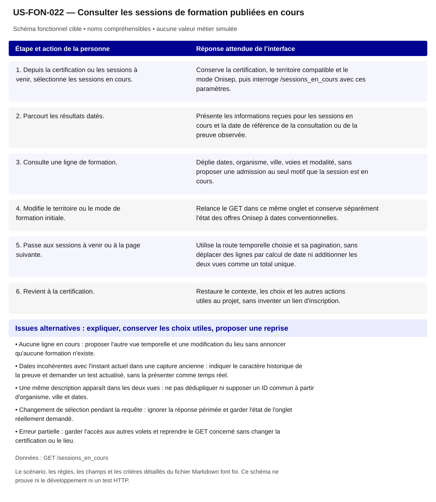

# US-FON-022 — Consulter les sessions de formation publiées en cours

**Rattachement :** E22 · alias historique US-E22. **Lot :** L8.

**Périmètre :** inclus. Les dépendances et les tests à réaliser organisent la réalisation, sans retirer la fonctionnalité.

**Dépendances et passerelles :** [US-FON-017](US-FON-017.md) (E17);[US-FON-009](US-FON-009.md) (E09).

**État constaté au 2 novembre 2026 :** R19 observe huit lignes pour 112561/Occitanie, cohérentes avec en cours à la date du contrôle ; une paire de fixtures R18/R19 ne prouve pas l'intégralité des règles temporelles. Rattachement et regroupement restent soumis à Q11 et aux tests HTTP contrastés.

[Retour au backlog](../04_BACKLOG_USER_STORIES.md) · [Modèle commun](../../00_MODELE_COMMUN_USER_STORIES/MODELE_US_FONCTIONNELLE.md)

## 1. Objectif fonctionnel

Permettre à la personne de consulter les sessions de formation publiées en cours, pour comprendre les formations déjà commencées qui sont publiées pour la certification retenue, sans confondre leur existence avec une possibilité d'entrée immédiate. Je veux consulter les sessions publiées en cours sans présumer d'une admission.

## 2. User Story

En tant que personne qui explore ses possibilités professionnelles, je souhaite consulter les sessions de formation publiées en cours, afin de comprendre les formations déjà commencées qui sont publiées pour la certification retenue, sans confondre leur existence avec une possibilité d'entrée immédiate.

## 3. Préconditions

- Les noms et identifiants sélectionnables proviennent des réponses autorisées ; aucun métier, lieu ou résultat n’est choisi implicitement.
- Les appels disposent de leurs paramètres exacts et le contexte de navigation est identifié. Les GET sont protégés par l’intégration prévue au contrat ; aucun secret d’accès n’est embarqué dans le HTML public.
- Une certification et un zonage région/département/CLPE sont choisis. Aucun code communal n’est réétiqueté sous une autre maille.
- Les fonctionnalités liées restent accessibles selon les dépendances ci-dessus ; un volet indisponible ne bloque pas toute la fiche.

## 4. Scénario nominal

| Étape | Action utilisateur | Comportement attendu du système |
|---|---|---|
| 1 | Depuis la certification ou les sessions à venir, sélectionne les sessions en cours. | Conserve la certification, le territoire compatible et le mode Onisep, puis interroge /sessions_en_cours avec ces paramètres. |
| 2 | Parcourt les résultats datés. | Présente les informations reçues pour les sessions en cours et la date de référence de la consultation ou de la preuve observée. |
| 3 | Consulte une ligne de formation. | Déplie dates, organisme, ville, voies et modalité, sans proposer une admission au seul motif que la session est en cours. |
| 4 | Modifie le territoire ou le mode de formation initiale. | Relance le GET dans ce même onglet et conserve séparément l'état des offres Onisep à dates conventionnelles. |
| 5 | Passe aux sessions à venir ou à la page suivante. | Utilise la route temporelle choisie et sa pagination, sans déplacer des lignes par calcul de date ni additionner les deux vues comme un total unique. |
| 6 | Revient à la certification. | Restaure le contexte, les choix et les autres actions utiles au projet, sans inventer un lien d'inscription. |

## 5. Scénarios alternatifs

- Aucune ligne en cours : proposer l'autre vue temporelle et une modification du lieu sans annoncer qu'aucune formation n'existe.
- Dates incohérentes avec l'instant actuel dans une capture ancienne : indiquer le caractère historique de la preuve et demander un test actualisé, sans la présenter comme temps réel.
- Une même description apparaît dans les deux vues : ne pas dédupliquer ni supposer un ID commun à partir d'organisme, ville et dates.
- Changement de sélection pendant la requête : ignorer la réponse périmée et garder l'état de l'onglet réellement demandé.
- Erreur partielle : garder l'accès aux autres volets et reprendre le GET concerné sans changer la certification ou le lieu.

**États et erreurs complémentaires à couvrir :** Chargement/erreur partielle, 400/401/404/422/429/503/5xx/réseau ; annuler réponse périmée ; null, 0, secret_stat, clé absente et liste vide distincts ; reprise bornée, aucune donnée de remplacement. Les statuts ci-dessus sont des cas de recette, leur retour effectif dépend de l’endpoint ; ne pas inventer un corps d’erreur serveur.

## 6. Règles de gestion

- Une session en cours n'est pas une session ouverte aux admissions ni une place disponible ; aucune conclusion sur une entrée en formation n'est déduite du statut temporel.
- Réutiliser les paramètres et zonages de la route à venir, avec /sessions_en_cours ; ne pas remplacer ce GET par un filtrage local d'une liste à venir.
- Garder total et nb_sessions distincts et ne pas additionner les deux listes temporelles pour produire un nombre de sessions uniques.
- Les modes Onisep et l'absence d'identifiant stable et de certification par ligne conservent les précautions Q11 ; aucune fiche session stable n'est fabriquée.
- La date de collecte d'une fixture et la date d'un futur appel réel sont deux preuves différentes ; une cohérence de dates sur R19 ne valide pas toutes les règles temporelles du serveur.

**Règles héritées conservées :** Session en cours distincte d'une admission ; mêmes limites d'agrégation/Onisep que E21 ; date de référence tracée.

**Traitements :** `/sessions_en_cours` avec même signature ; Session en cours distincte d'une admission ; mêmes limites d'agrégation/Onisep que E21 ; date de référence tracée.

**Règles statistiques :** Afficher source, période/millésime, définition/unité, grain et géographie effective ; aucun score/delta/agrégat inventé, aucune inférence personnelle ; secret_stat non calculable. Session en cours distincte d'une admission ; mêmes limites d'agrégation/Onisep que E21 ; date de référence tracée.

**Règles communes :** noms et explications en langage courant ; ROME V3 uniquement ; aucune source métier extérieure aux 21 GET ; aucune moyenne, conversion annuelle/mensuelle, interpolation ou correspondance construite. Les codes restent internes aux requêtes, routes et tests.

Une valeur nulle, absente, `secret_stat`, zéro et une liste vide conservent leur sens distinct. Afficher le lieu réellement mesuré et expliquer le repli par indicateur ; ne pas attribuer un résultat de famille à un seul métier ou un résultat national à une session.

## 7. Données et API

**Source et portée de conception :** RCO/Onisep selon réponse ; grain session agrégée ; période période courante. Les métadonnées de chaque réponse/mesure priment toute valeur observée dans un exemple.

### Appel 1 — GET `/sessions_en_cours`

**Déclenchement :** À la sélection ou ouverture de la section. Ordre/chaînage : suivre les étapes du scénario, les identifiants reçus et les dépendances liées ; charger les détails à leur ouverture et réutiliser le cache à paramètres strictement identiques.

| Paramètre exact | Emplacement | Obligation du contrat | Type / domaine Swagger | Usage pour cette US |
|---|---|---|---|---|
| `certifinfo` | query | Requis Swagger | `string` | code choisi requis |
| `zonage` | query | Requis Swagger | `string ; valeurs region, departement, clpe` | region/departement/clpe requis |
| `territoire` | query | Requis Swagger | `string` | code requis |
| `onisep` | query | Facultatif Swagger | `string ; valeurs exclure, inclure, seulement ; défaut API "exclure"` | exclure/inclure/seulement, défaut exclure |
| `page` | query | Facultatif Swagger | `integer ; défaut API 1 ; minimum=0` | >=1 |

| Chemin JSON exact | Type connu | Niveau de preuve du chemin/type |
|---|---|---|
| `$.items[].code_insee` | string | Type OpenAPI officiel ; chemin observé |
| `$.items[].date_debut` | string | Type OpenAPI officiel ; chemin observé |
| `$.items[].date_fin` | string | Type OpenAPI officiel ; chemin observé |
| `$.items[].formation_apprentissage` | boolean | Type OpenAPI officiel ; chemin observé |
| `$.items[].formation_continue_conventionnee` | boolean | Type OpenAPI officiel ; chemin observé |
| `$.items[].formation_contrat_pro` | boolean | Type OpenAPI officiel ; chemin observé |
| `$.items[].formation_initiale` | boolean | Type OpenAPI officiel ; chemin observé |
| `$.items[].nb_sessions` | integer | Type OpenAPI officiel ; chemin observé |
| `$.items[].presentiel_distantiel` | integer | Type OpenAPI officiel ; chemin observé |
| `$.items[].raison_sociale` | string | Type OpenAPI officiel ; chemin observé |
| `$.items[].siret_formateur` | string | Type OpenAPI officiel ; chemin observé |
| `$.items[].tag_onisep` | boolean | Type OpenAPI officiel ; chemin observé |
| `$.items[].ville` | string | Type OpenAPI officiel ; chemin observé |

**Réponses natives utilisées pour vérifier les chemins :** [02_reponses_observees/sessions/response_sessions_en_cours.json](../../../02_reponses_observees/sessions/response_sessions_en_cours.json).

### Preuves et contrôles restant à produire

**Documenté :** [contrat](../../../01_sources/contrat_interface_2026-10-19.md) ; [OpenAPI officiel](../../../01_sources/openapi/docs_json_interface.json). Dix réponses sur les 21 GET n’ont pas de schéma officiel de réponse ; un type observé ne devient pas un schéma fournisseur.

**Références conservées de la conception :** [06_controles/VALIDATION_R19_certifications_sessions_en_cours.md](../../../06_controles/VALIDATION_R19_certifications_sessions_en_cours.md); [02_reponses_observees/sessions/response_sessions_en_cours.json](../../../02_reponses_observees/sessions/response_sessions_en_cours.json).

**Contrôle local déjà rapporté :** Bascule sessions en cours testée ; rattachement/garantie Q11 restent ouverts. [Recette UX existante](../TESTS_UX_EXPLORER.md). Ces résultats sur JSON locaux ne valident pas les appels HTTP.

**Tests à réaliser :** T-E22 : Paire d'appels même contexte aux deux routes, date de référence, filtres ; pas de déduplication inter-vues inventée.

**Points RCO associés :** Q11 : règles temporelles et traçabilité ; tri contractuel/tests/demande fournisseur dans 06 section Q01–Q14. Lire le tri déjà établi dans [Q01–Q14](../06_DECISIONS_ET_POINTS_A_VALIDER.md) avant toute nouvelle demande ; ne pas redemander une réponse démontrée par le contrat.

## 8. Critères d’acceptation

**US-FON-022-CA-01** — **Étant donné** les sessions à venir sont consultées pour une certification et un lieu, **Quand** la personne passe à en cours, **Alors** le GET change de route tout en gardant les paramètres courants compatibles.

**US-FON-022-CA-02** — **Étant donné** la route retourne une session commencée, **Quand** la personne ouvre son détail, **Alors** les dates et modalités reçues sont affichées sans admission, disponibilité de places ou inscription supposée.

**US-FON-022-CA-03** — **Étant donné** des données ont été capturées à une date antérieure, **Quand** elles sont rendues dans la maquette locale, **Alors** leur statut de preuve observée reste identifiable et aucune actualisation HTTP n'est affirmée.

**US-FON-022-CA-04** — **Étant donné** des lignes similaires existent dans les deux vues, **Quand** la personne passe d'un onglet à l'autre, **Alors** aucun rapprochement d'identité ni décompte unique inter-vues n'est calculé.

**US-FON-022-CA-05** — **Étant donné** une session n'a pas de Certif Info par ligne, **Quand** la traçabilité est vérifiée, **Alors** la recette garde les paramètres de l'appel et la dépendance Q11 plutôt qu'une preuve de rattachement inventée.

**US-FON-022-CA-06** — **Étant donné** la nouvelle requête échoue, **Quand** l'erreur est présentée, **Alors** la personne peut réessayer ou revenir à la certification sans perdre ses choix.

**US-FON-022-CA-07** — **Étant donné** un intitulé public et son identifiant technique disponibles, **Quand** le contenu est présenté, **Alors** les noms sont compréhensibles, les sources restent accessibles et aucun code de référentiel n’est imposé à la personne.

**US-FON-022-CA-08** — **Étant donné** une réponse absente, protégée ou en erreur pour un seul volet, **Quand** les autres réponses sont disponibles, **Alors** les volets disponibles restent consultables et l’état manquant est expliqué sans valeur de substitution.

**Trace de conception conservée :** Sans affirmation sur places ni inscriptions ; Onglet en cours partageant sélection et composants E21, dates et modalités ; aucune admission déduite du statut temporel ; Paire d'appels même contexte aux deux routes, date de référence, filtres ; pas de déduplication inter-vues inventée ; états d'erreur de la ligne vérifiés, aucune preuve HTTP déduite de fixtures. ; Recette citoyenne : aucun identifiant ou sigle de référentiel imposé à l’usager ; nombres et unités inchangés ; explication des limites et des absences ; sources conservées, sans score supplémentaire.

**Recette de rattachement :** `T-E22` ; les critères ci-dessus constituent les cas vérifiables à décliner dans cette recette et la matrice de traçabilité.

## 9. Composants UX/UI

- DSFR : mêmes filtres, onglets, liste et détail local accessibles que les sessions à venir ; intitulé en cours explicite, dates lisibles et message sur l'absence de garantie d'admission.
- Annoncer le changement d'onglet et le résultat chargé, préserver le focus et les filtres ; états publiés, aucun résultat, preuve historique, liste partielle et erreur distincts sur mobile et desktop.

**États à rendre accessibles :** initial, saisie/choix, attente annoncée, résultat, résultat partiel, vide, valeur non renseignée/protégée, erreur et reprise. Afficher des messages près des commandes concernées ; conserver les sélections utiles et ignorer les réponses périmées.

**Accessibilité :** libellés permanents, structure des titres, liens explicites, focus visible et logique, navigation intégrale au clavier ; annoncer les changements utiles sans lire chaque frappe. Aucune information portée par la seule couleur, le survol ou une carte. Tableau de données équivalent pour chaque graphique ; source, période, unité, population et lieu effectif accessibles au même endroit.

**Responsive et sobriété :** progression par questions, détails à la demande, réemploi des GET identiques ; repli sans perte de contenu, lecture à 320 px et zoom navigateur 200/400 % à recetter. JavaScript indisponible : afficher le contenu de repli et les limites réelles. Une recette locale ne constitue pas une conformité RGAA complète.

**Bibliothèques :** DSFR installé pour les contrôles et tableaux ; DSFR Chart officiel (`@gouvfr/dsfr-chart` 2.1.1 dans l’intégration actuelle) et DataBox quand une représentation convient. Pas de graphique personnalisé pour remplacer un composant adapté. GenUI n’est pas une dépendance de réalisation décidée ; aucun service ni endpoint supplémentaire n’est supposé.

**Composants et interaction hérités :** Sessions en cours ; Onglet en cours partageant sélection et composants E21, dates et modalités ; aucune admission déduite du statut temporel ; Présentation citoyenne : noms plutôt que codes ; pas de version ou de détail interne ; explication du sens des chiffres, des personnes concernées, du lieu et de la période ; sources accessibles.

**SEO / validation conservés :** Proposition à valider D10 : Noindex. Ce statut est une proposition de déploiement, pas une décision produit acquise.

## 10. Maquette fonctionnelle

[Ouvrir le schéma SVG accessible](svg/US-FON-022.svg). Le texte intégral du scénario en section 4 et des alternatives en section 5 fournit son alternative. Il s’agit de la cible fonctionnelle, sans données de démonstration inventées ni déclaration de disponibilité HTTP.
