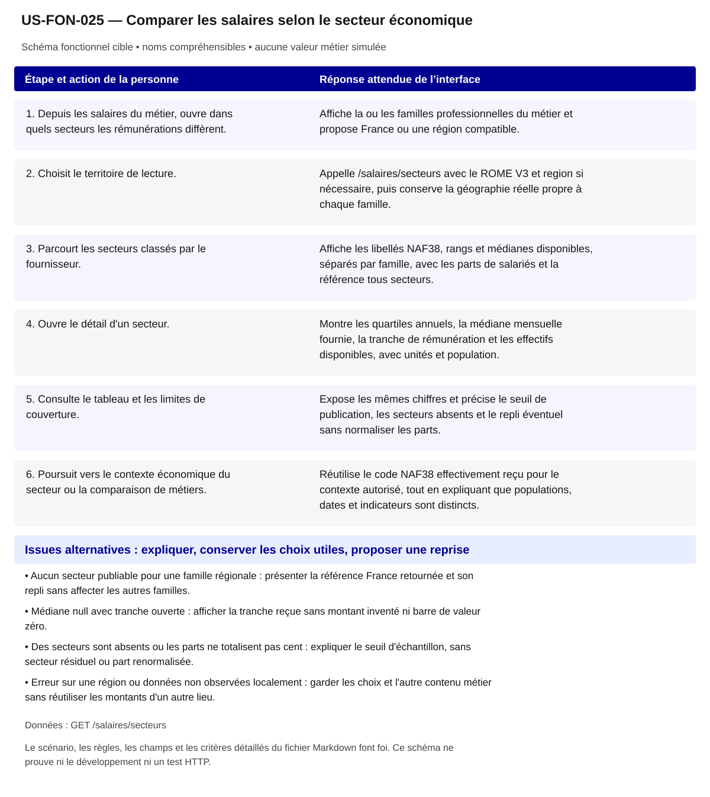

# US-FON-025 — Comparer les salaires selon le secteur économique

**Rattachement :** E25 · alias historique US-E25. **Lot :** L7.

**Périmètre :** inclus. Les dépendances et les tests à réaliser organisent la réalisation, sans retirer la fonctionnalité.

**Dépendances et passerelles :** [US-FON-005](US-FON-005.md) (E05);[US-FON-009](US-FON-009.md) (E09);[US-FON-031](US-FON-031.md) (E31).

**État constaté au 2 novembre 2026 :** Contrat et JSON des salaires sectoriels disponibles ; les variantes France/région, seuil, tranche ouverte et repli d'une seule famille restent à tester par GET. La maquette locale ne prouve pas leur disponibilité HTTP générale et ne remplace pas une valeur manquante.

[Retour au backlog](../04_BACKLOG_USER_STORIES.md) · [Modèle commun](../../00_MODELE_COMMUN_USER_STORIES/MODELE_US_FONCTIONNELLE.md)

## 1. Objectif fonctionnel

Permettre à la personne de comparer les salaires selon le secteur économique, pour repérer comment les rémunérations de la famille professionnelle varient selon le secteur employeur, en comprenant les populations et les limites de publication. Je veux comparer les salaires sectoriels d'une famille professionnelle.

## 2. User Story

En tant que personne qui explore ses possibilités professionnelles, je souhaite comparer les salaires selon le secteur économique, afin de repérer comment les rémunérations de la famille professionnelle varient selon le secteur employeur, en comprenant les populations et les limites de publication.

## 3. Préconditions

- Les noms et identifiants sélectionnables proviennent des réponses autorisées ; aucun métier, lieu ou résultat n’est choisi implicitement.
- Les appels disposent de leurs paramètres exacts et le contexte de navigation est identifié. Les GET sont protégés par l’intégration prévue au contrat ; aucun secret d’accès n’est embarqué dans le HTML public.
- Les fonctionnalités liées restent accessibles selon les dépendances ci-dessus ; un volet indisponible ne bloque pas toute la fiche.

## 4. Scénario nominal

| Étape | Action utilisateur | Comportement attendu du système |
|---|---|---|
| 1 | Depuis les salaires du métier, ouvre dans quels secteurs les rémunérations diffèrent. | Affiche la ou les familles professionnelles du métier et propose France ou une région compatible. |
| 2 | Choisit le territoire de lecture. | Appelle /salaires/secteurs avec le ROME V3 et region si nécessaire, puis conserve la géographie réelle propre à chaque famille. |
| 3 | Parcourt les secteurs classés par le fournisseur. | Affiche les libellés NAF38, rangs et médianes disponibles, séparés par famille, avec les parts de salariés et la référence tous secteurs. |
| 4 | Ouvre le détail d'un secteur. | Montre les quartiles annuels, la médiane mensuelle fournie, la tranche de rémunération et les effectifs disponibles, avec unités et population. |
| 5 | Consulte le tableau et les limites de couverture. | Expose les mêmes chiffres et précise le seuil de publication, les secteurs absents et le repli éventuel sans normaliser les parts. |
| 6 | Poursuit vers le contexte économique du secteur ou la comparaison de métiers. | Réutilise le code NAF38 effectivement reçu pour le contexte autorisé, tout en expliquant que populations, dates et indicateurs sont distincts. |

## 5. Scénarios alternatifs

- Aucun secteur publiable pour une famille régionale : présenter la référence France retournée et son repli sans affecter les autres familles.
- Médiane null avec tranche ouverte : afficher la tranche reçue sans montant inventé ni barre de valeur zéro.
- Des secteurs sont absents ou les parts ne totalisent pas cent : expliquer le seuil d'échantillon, sans secteur résiduel ou part renormalisée.
- Erreur sur une région ou données non observées localement : garder les choix et l'autre contenu métier sans réutiliser les montants d'un autre lieu.

**États et erreurs complémentaires à couvrir :** Chargement/erreur partielle, 400/401/404/422/429/503/5xx/réseau ; annuler réponse périmée ; null, 0, secret_stat, clé absente et liste vide distincts ; reprise bornée, aucune donnée de remplacement. null avec tranche ouverte = afficher tranche, pas salaire inventé. Les statuts ci-dessus sont des cas de recette, leur retour effectif dépend de l’endpoint ; ne pas inventer un corps d’erreur serveur.

## 6. Règles de gestion

- FAP225 croisée avec NAF38, BTS 2023 observée ; population de salariés à temps complet présents toute l'année et méthode identique à la mesure salaires.
- La part est tx_salaries_secteur pour les salariés de 2023, distincte de tx_actifs_secteur des actifs salariés et non-salariés de 2021 ; aucune substitution entre les deux.
- ensemble[] est une référence tous secteurs par famille ; respecter items[].maille/repli, les rangs publiés et le seuil de trente salariés de l'échantillon par secteur.
- Garder les quartiles annuels et la médiane mensuelle séparés, sans division par douze, min/max inventés, écart salarial calculé ou promesse de gain personnel.
- Les secteurs publiés sont partiels et les observations familiales peuvent être partagées par plusieurs métiers ; ne pas additionner les familles ni présenter les parts comme un marché exhaustif.

**Règles héritées conservées :** FAP225 x NAF38, BTS2023 ; ensemble référence tous secteurs, parts sous seuil non exhaustives ; maille/repli par ligne ; mêmes unités/tranche ouverte/seuil que E11.

**Traitements :** `/salaires/secteurs?rome=...&region=...` ; FAP225 x NAF38, BTS2023 ; ensemble référence tous secteurs, parts sous seuil non exhaustives ; maille/repli par ligne ; mêmes unités/tranche ouverte/seuil que E11.

**Règles statistiques :** Afficher source, période/millésime, définition/unité, grain et géographie effective ; aucun score/delta/agrégat inventé, aucune inférence personnelle ; secret_stat non calculable. FAP225 x NAF38, BTS2023 ; ensemble référence tous secteurs, parts sous seuil non exhaustives ; maille/repli par ligne ; mêmes unités/tranche ouverte/seuil que E11.

**Règles communes :** noms et explications en langage courant ; ROME V3 uniquement ; aucune source métier extérieure aux 21 GET ; aucune moyenne, conversion annuelle/mensuelle, interpolation ou correspondance construite. Les codes restent internes aux requêtes, routes et tests.

Une valeur nulle, absente, `secret_stat`, zéro et une liste vide conservent leur sens distinct. Afficher le lieu réellement mesuré et expliquer le repli par indicateur ; ne pas attribuer un résultat de famille à un seul métier ou un résultat national à une session.

## 7. Données et API

**Source et portée de conception :** Source salaires ; grain fap_225 / NAF38 ; période 2023 observé, vérifier réponse. Les métadonnées de chaque réponse/mesure priment toute valeur observée dans un exemple.

### Appel 1 — GET `/salaires/secteurs`

**Déclenchement :** À la sélection ou ouverture de la section. Ordre/chaînage : suivre les étapes du scénario, les identifiants reçus et les dépendances liées ; charger les détails à leur ouverture et réutiliser le cache à paramètres strictement identiques.

| Paramètre exact | Emplacement | Obligation du contrat | Type / domaine Swagger | Usage pour cette US |
|---|---|---|---|---|
| `rome` | query | Facultatif Swagger | `string ; défaut API null` | V3 requis fonctionnellement |
| `region` | query | Facultatif Swagger | `string ; défaut API null` | code région ou omis=France |

| Chemin JSON exact | Type connu | Niveau de preuve du chemin/type |
|---|---|---|
| `$.source_libelle` | chaîne | Types observés seulement ; null seul ne prouve pas le type publié |
| `$.grain` | chaîne | Types observés seulement ; null seul ne prouve pas le type publié |
| `$.millesime` | chaîne | Types observés seulement ; null seul ne prouve pas le type publié |
| `$.total` | entier | Types observés seulement ; null seul ne prouve pas le type publié |
| `$.items[].fap_225_code` | chaîne | Types observés seulement ; null seul ne prouve pas le type publié |
| `$.items[].fap_225_libelle` | chaîne | Types observés seulement ; null seul ne prouve pas le type publié |
| `$.items[].secteur_naf38_code` | chaîne | Types observés seulement ; null seul ne prouve pas le type publié |
| `$.items[].secteur_naf38_libelle` | chaîne | Types observés seulement ; null seul ne prouve pas le type publié |
| `$.items[].tx_salaries_secteur` | nombre | Types observés seulement ; null seul ne prouve pas le type publié |
| `$.items[].salaire_net_annuel_q1` | entier | Types observés seulement ; null seul ne prouve pas le type publié |
| `$.items[].salaire_net_annuel_median` | entier | Types observés seulement ; null seul ne prouve pas le type publié |
| `$.items[].salaire_net_annuel_q3` | entier | Types observés seulement ; null seul ne prouve pas le type publié |
| `$.items[].salaire_net_mensuel_median` | entier | Types observés seulement ; null seul ne prouve pas le type publié |
| `$.items[].tranche_salaire_median_libelle` | chaîne | Types observés seulement ; null seul ne prouve pas le type publié |
| `$.items[].nb_salaries_temps_complet` | entier | Types observés seulement ; null seul ne prouve pas le type publié |
| `$.items[].nb_rome_famille` | entier | Types observés seulement ; null seul ne prouve pas le type publié |
| `$.items[].rang` | entier | Types observés seulement ; null seul ne prouve pas le type publié |
| `$.items[].maille` | chaîne | Types observés seulement ; null seul ne prouve pas le type publié |
| `$.items[].repli` | booléen | Types observés seulement ; null seul ne prouve pas le type publié |
| `$.ensemble[].fap_225_code` | chaîne | Types observés seulement ; null seul ne prouve pas le type publié |
| `$.ensemble[].fap_225_libelle` | chaîne | Types observés seulement ; null seul ne prouve pas le type publié |
| `$.ensemble[].salaire_net_annuel_q1` | entier | Types observés seulement ; null seul ne prouve pas le type publié |
| `$.ensemble[].salaire_net_annuel_median` | entier | Types observés seulement ; null seul ne prouve pas le type publié |
| `$.ensemble[].salaire_net_annuel_q3` | entier | Types observés seulement ; null seul ne prouve pas le type publié |
| `$.ensemble[].salaire_net_mensuel_median` | entier | Types observés seulement ; null seul ne prouve pas le type publié |
| `$.ensemble[].tranche_salaire_median_libelle` | chaîne | Types observés seulement ; null seul ne prouve pas le type publié |
| `$.ensemble[].nb_salaries_temps_complet` | entier | Types observés seulement ; null seul ne prouve pas le type publié |
| `$.ensemble[].maille` | chaîne | Types observés seulement ; null seul ne prouve pas le type publié |
| `$.ensemble[].nb_rome_famille` | entier | Types observés seulement ; null seul ne prouve pas le type publié |

**Réponses natives utilisées pour vérifier les chemins :** [02_reponses_observees/indicateurs/response_salairessecteurs.json](../../../02_reponses_observees/indicateurs/response_salairessecteurs.json).

### Preuves et contrôles restant à produire

**Documenté :** [contrat](../../../01_sources/contrat_interface_2026-10-19.md) ; [OpenAPI officiel](../../../01_sources/openapi/docs_json_interface.json). Dix réponses sur les 21 GET n’ont pas de schéma officiel de réponse ; un type observé ne devient pas un schéma fournisseur.

**Références conservées de la conception :** [02_reponses_observees/indicateurs/response_salairessecteurs.json](../../../02_reponses_observees/indicateurs/response_salairessecteurs.json).

**Contrôle local déjà rapporté :** Graphiques et tableaux de salaires sectoriels présents ; variantes régionales non complètes. [Recette UX existante](../TESTS_UX_EXPLORER.md). Ces résultats sur JSON locaux ne valident pas les appels HTTP.

**Tests à réaliser :** T-E25 : France/région, plusieurs familles, secteurs absents pour seuil, tranche ouverte, repli d'une seule famille.

**Points RCO associés :** Q08 : population, seuil et référence tous secteurs ; tri contractuel/tests/demande fournisseur dans 06 section Q01–Q14. Lire le tri déjà établi dans [Q01–Q14](../06_DECISIONS_ET_POINTS_A_VALIDER.md) avant toute nouvelle demande ; ne pas redemander une réponse démontrée par le contrat.

### Couverture détaillée des 1 mesures rattachées à cette US

Chaque mesure est un sous-scénario de cette US. Ses champs, sa population et ses critères sont conservés même si aucune valeur n’est publiée dans le jeu local.

#### `salaires_secteurs` — Salaires nets annuels par secteur d'activité

**Source API :** GET /salaires/secteurs. Conserver les familles/populations réellement publiées.

**Grain :** `fap_225`. **Mailles du catalogue :** reg, nat. **Millésime observé :** 2023.

**Producteur :** INSEE, Base Tous salariés, fichier salariés open data. **Unité et population :** Euros nets annuels pour Q1/médiane/Q3, euros nets mensuels pour la médiane fournie ; salariés à temps complet ; tx_salaries_secteur en pourcentage des salariés de la famille du territoire.

**Définition source :** Quartiles et médiane du salaire net annuel par famille professionnelle (FAP 225) rattachée au ROME V3 et par secteur d'activité de l'employeur (NAF 38 postes), même population et même méthode que la mesure `salaires`. `tx_salaries_secteur` : part des salariés de la FAP du territoire qui travaillent dans le secteur. Publiés à partir de 30 salariés dans l'échantillon : seuls les principaux secteurs de chaque FAP figurent.

**Champs nécessaires :** `$.items[].fap_225_code`, `$.items[].fap_225_libelle`, `$.items[].secteur_naf38_code`, `$.items[].secteur_naf38_libelle`, `$.items[].tx_salaries_secteur`, `$.items[].salaire_net_annuel_q1`, `$.items[].salaire_net_annuel_median`, `$.items[].salaire_net_annuel_q3`, `$.items[].salaire_net_mensuel_median`, `$.items[].tranche_salaire_median_libelle`, `$.items[].nb_salaries_temps_complet`.

**Présentation attendue :** DSFR Chart DataBox et barres de médianes sectorielles par famille ; tableau DSFR des quartiles annuels et des parts ; référence ensemble affichée séparément, sans graphique de dispersion personnalisé.

- Utiliser /salaires/secteurs, FAP225 croisée avec NAF38, même population et méthode BTS que salaires ; conserver le millésime 2023 observé et les libellés de famille et secteur.
- tx_salaries_secteur décrit les salariés de la FAP dans le secteur en 2023 ; ne jamais le remplacer par tx_actifs_secteur du recensement 2021, qui inclut les non-salariés.
- Seuls les secteurs avec au moins trente salariés de l'échantillon sont publiés ; la somme des parts peut rester inférieure à cent, sans renormalisation ni secteur autre calculé.
- ensemble[] est la référence tous secteurs par FAP ; items[].maille/repli détermine la géographie effective, avec repli France si une famille n'a aucun secteur régional publiable.
- Conserver quartiles annuels, médiane mensuelle, tranche ouverte et rangs du fournisseur ; ne pas calculer un écart salarial, une prime sectorielle ou un score d'attractivité.

**Dépendance / tests :** Catalogue observé : fap_225, 2023, reg/nat. Tests France/région, multiFAP, tranche ouverte, secteurs absents et repli par famille ; Q08 concerne d'abord des tests de règles déjà documentées. Comparateur E28 réutilise ces règles.

**Preuve :** [notice native /mesures](../../../02_reponses_observees/indicateurs/Recrutementregions/response_mesures.json) ; les paramètres exacts figurent dans les appels ci-dessus. La présence au catalogue ne prouve pas une valeur disponible pour tout métier ou lieu.

## 8. Critères d’acceptation

**US-FON-025-CA-01** — **Étant donné** le métier relève de plusieurs familles, **Quand** les salaires sectoriels sont affichés, **Alors** les secteurs et références tous secteurs sont regroupés sous chaque nom de famille sans moyenne commune.

**US-FON-025-CA-02** — **Étant donné** une famille se replie sur la France et l'autre reste régionale, **Quand** la personne consulte les montants, **Alors** le lieu réel est affiché pour chacune et aucune comparaison n'est nommée régionale pour la famille repliée.

**US-FON-025-CA-03** — **Étant donné** la médiane est null avec une tranche ouverte, **Quand** le secteur est présenté dans le graphique et le tableau, **Alors** la tranche est lisible et aucun montant synthétique ou zéro n'est tracé.

**US-FON-025-CA-04** — **Étant donné** les parts des salariés des secteurs publiés totalisent moins de cent, **Quand** la personne lit la répartition, **Alors** les parts restent inchangées et la couverture partielle est expliquée.

**US-FON-025-CA-05** — **Étant donné** les secteurs d'emploi 2021 sont également disponibles, **Quand** la personne passe à ce volet, **Alors** la part des actifs 2021 et la part des salariés 2023 restent distinctes avec leurs populations et dates.

**US-FON-025-CA-06** — **Étant donné** un montant mensuel et des quartiles annuels sont reçus, **Quand** le détail de salaire est ouvert, **Alors** chaque unité et borne est nommée sans conversion ni présentation des quartiles comme minimum et maximum.

**US-FON-025-CA-07** — **Étant donné** une famille a des valeurs régionales et une autre se replie sur la France, **Quand** la personne consulte les salaires par secteur, **Alors** chaque groupe indique sa géographie effective et la comparaison ne les présente pas comme deux valeurs régionales.

**US-FON-025-CA-08** — **Étant donné** les parts des secteurs publiés totalisent moins de cent pour cent, **Quand** le graphique est rendu, **Alors** les parts reçues restent inchangées et la publication partielle liée au seuil est expliquée.

**US-FON-025-CA-09** — **Étant donné** un intitulé public et son identifiant technique disponibles, **Quand** le contenu est présenté, **Alors** les noms sont compréhensibles, les sources restent accessibles et aucun code de référentiel n’est imposé à la personne.

**US-FON-025-CA-10** — **Étant donné** une réponse absente, protégée ou en erreur pour un seul volet, **Quand** les autres réponses sont disponibles, **Alors** les volets disponibles restent consultables et l’état manquant est expliqué sans valeur de substitution.

**Trace de conception conservée :** Nom FAP sur toute comparaison ; Salaires par secteur NAF38 dans chaque FAP225 ; référence `ensemble`, parts de salariés et repli ; affichage mensuel/annuel séparé ; France/région, plusieurs familles, secteurs absents pour seuil, tranche ouverte, repli d'une seule famille ; états d'erreur de la ligne vérifiés, aucune preuve HTTP déduite de fixtures. ; Recette citoyenne : aucun identifiant ou sigle de référentiel imposé à l’usager ; nombres et unités inchangés ; explication des limites et des absences ; sources conservées, sans score supplémentaire.

**Recette de rattachement :** `T-E25` ; les critères ci-dessus constituent les cas vérifiables à décliner dans cette recette et la matrice de traçabilité.

## 9. Composants UX/UI

- DSFR Chart DataBox et barres horizontales de médianes par secteur et famille ; DSFR tableau de quartiles, parts et population, avec référence tous secteurs lisible ; aucune boîte à moustaches personnalisée inventée.
- DSFR : sélection France/région, accès progressif aux détails et au contexte sectoriel ; états disponible, tranche ouverte, secteur absent, repli et erreur différenciés sans couleur seule, sur mobile et au clavier.

**États à rendre accessibles :** initial, saisie/choix, attente annoncée, résultat, résultat partiel, vide, valeur non renseignée/protégée, erreur et reprise. Afficher des messages près des commandes concernées ; conserver les sélections utiles et ignorer les réponses périmées.

**Accessibilité :** libellés permanents, structure des titres, liens explicites, focus visible et logique, navigation intégrale au clavier ; annoncer les changements utiles sans lire chaque frappe. Aucune information portée par la seule couleur, le survol ou une carte. Tableau de données équivalent pour chaque graphique ; source, période, unité, population et lieu effectif accessibles au même endroit.

**Responsive et sobriété :** progression par questions, détails à la demande, réemploi des GET identiques ; repli sans perte de contenu, lecture à 320 px et zoom navigateur 200/400 % à recetter. JavaScript indisponible : afficher le contenu de repli et les limites réelles. Une recette locale ne constitue pas une conformité RGAA complète.

**Bibliothèques :** DSFR installé pour les contrôles et tableaux ; DSFR Chart officiel (`@gouvfr/dsfr-chart` 2.1.1 dans l’intégration actuelle) et DataBox quand une représentation convient. Pas de graphique personnalisé pour remplacer un composant adapté. GenUI n’est pas une dépendance de réalisation décidée ; aucun service ni endpoint supplémentaire n’est supposé.

**Composants et interaction hérités :** Salaires par secteur économique ; Salaires par secteur NAF38 dans chaque FAP225 ; référence `ensemble`, parts de salariés et repli ; affichage mensuel/annuel séparé ; Présentation citoyenne : noms plutôt que codes ; pas de version ou de détail interne ; explication du sens des chiffres, des personnes concernées, du lieu et de la période ; sources accessibles.

**SEO / validation conservés :** Proposition à valider D10 : Section non cœur MVP. Ce statut est une proposition de déploiement, pas une décision produit acquise.

## 10. Maquette fonctionnelle

[Ouvrir le schéma SVG accessible](svg/US-FON-025.svg). Le texte intégral du scénario en section 4 et des alternatives en section 5 fournit son alternative. Il s’agit de la cible fonctionnelle, sans données de démonstration inventées ni déclaration de disponibilité HTTP.
