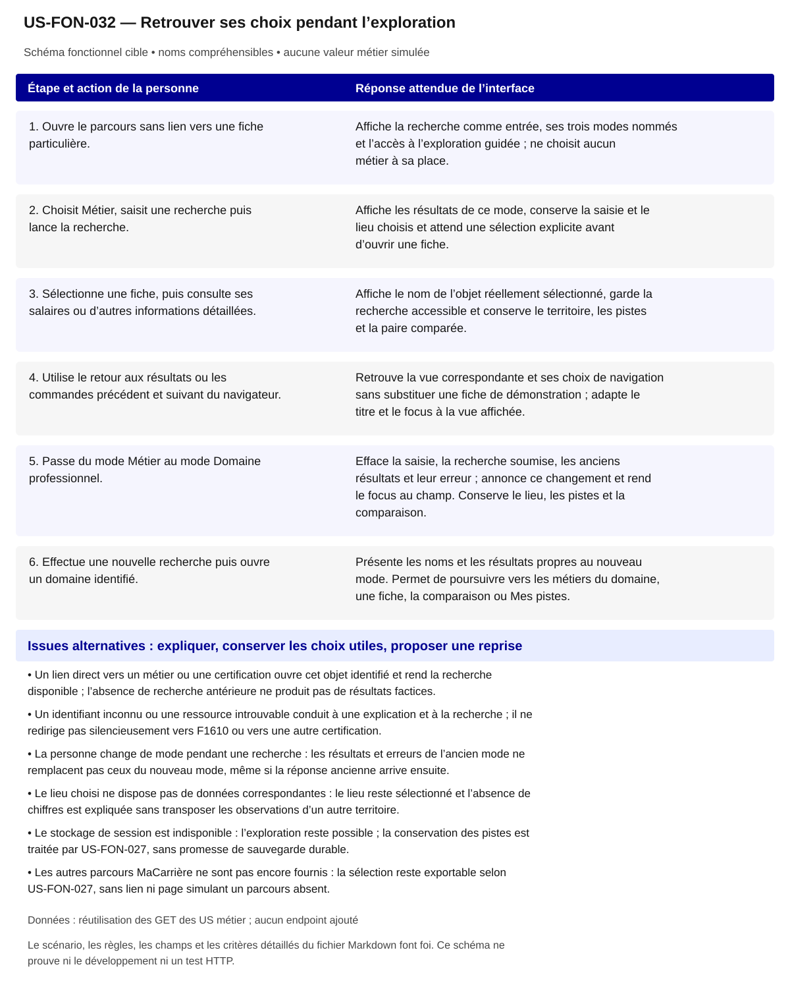

# US-FON-032 — Retrouver ses choix pendant l’exploration

**Rattachement :** exigence transversale des 31 fonctionnalités. **Lot :** Transversal L2/L9 ; intégration L1 et recette L10.

**Périmètre :** inclus. Les dépendances et les tests à réaliser organisent la réalisation, sans retirer la fonctionnalité.

**Dépendances et passerelles :** [US-FON-001](US-FON-001.md) (E01); [US-FON-002](US-FON-002.md) (E02); [US-FON-003](US-FON-003.md) (E03); [US-FON-004](US-FON-004.md) (E04); [US-FON-005](US-FON-005.md) (E05); [US-FON-009](US-FON-009.md) (E09); [US-FON-017](US-FON-017.md) (E17); [US-FON-019](US-FON-019.md) (E19); [US-FON-027](US-FON-027.md) (E27); [US-FON-028](US-FON-028.md) (E28); [US-FON-030](US-FON-030.md) (E30).

**État constaté au 2 novembre 2026 :** Règles UX actuelles actées ; recherche persistante, changement de mode, historique et retours du comparateur testés localement sur les JSON disponibles. Liens et états HTTP réels à tester ; stockage et raccordement de production D08/D10 ouverts. Aucun nouveau test HTTP revendiqué.

[Retour au backlog](../04_BACKLOG_USER_STORIES.md) · [Modèle commun](../../00_MODELE_COMMUN_USER_STORIES/MODELE_US_FONCTIONNELLE.md)

## 1. Objectif fonctionnel

Permettre à la personne de chercher, ouvrir plusieurs fiches et revenir à ses résultats sans perdre le fil. Distinguer les choix conservés pendant la navigation du comportement de conservation au rechargement ou dans les futurs parcours.

## 2. User Story

En tant que personne qui explore plusieurs possibilités professionnelles, je souhaite retrouver ma recherche, mon lieu et les métiers que j’ai choisis lorsque je navigue, afin de poursuivre ma réflexion sans recommencer mes démarches.

## 3. Préconditions

- Le parcours existant propose les trois modes Métier, Diplôme ou titre et Domaine professionnel, ainsi qu’une entrée par les savoir-faire et les conditions de travail.
- Les résultats et les objets sélectionnables disposent d’un identifiant natif et d’un nom provenant des réponses API ; aucun choix n’est déduit de la seule saisie.
- Les fonctions métier de recherche, fiche, territoire, comparaison et pistes restent celles des US-FON-001 à US-FON-031.
- Les états de navigation sont distincts des réponses statistiques : conserver un lieu ne signifie pas disposer de chiffres pour ce lieu.

## 4. Scénario nominal

| Étape | Action utilisateur | Comportement attendu du système |
|---|---|---|
| 1 | Ouvre le parcours sans lien vers une fiche particulière. | Affiche la recherche comme entrée, ses trois modes nommés et l’accès à l’exploration guidée ; ne choisit aucun métier à sa place. |
| 2 | Choisit Métier, saisit une recherche puis lance la recherche. | Affiche les résultats de ce mode, conserve la saisie et le lieu choisis et attend une sélection explicite avant d’ouvrir une fiche. |
| 3 | Sélectionne une fiche, puis consulte ses salaires ou d’autres informations détaillées. | Affiche le nom de l’objet réellement sélectionné, garde la recherche accessible et conserve le territoire, les pistes et la paire comparée. |
| 4 | Utilise le retour aux résultats ou les commandes précédent et suivant du navigateur. | Retrouve la vue correspondante et ses choix de navigation sans substituer une fiche de démonstration ; adapte le titre et le focus à la vue affichée. |
| 5 | Passe du mode Métier au mode Domaine professionnel. | Efface la saisie, la recherche soumise, les anciens résultats et leur erreur ; annonce ce changement et rend le focus au champ. Conserve le lieu, les pistes et la comparaison. |
| 6 | Effectue une nouvelle recherche puis ouvre un domaine identifié. | Présente les noms et les résultats propres au nouveau mode. Permet de poursuivre vers les métiers du domaine, une fiche, la comparaison ou Mes pistes. |

## 5. Scénarios alternatifs

- Un lien direct vers un métier ou une certification ouvre cet objet identifié et rend la recherche disponible ; l’absence de recherche antérieure ne produit pas de résultats factices.
- Un identifiant inconnu ou une ressource introuvable conduit à une explication et à la recherche ; il ne redirige pas silencieusement vers F1610 ou vers une autre certification.
- La personne change de mode pendant une recherche : les résultats et erreurs de l’ancien mode ne remplacent pas ceux du nouveau mode, même si la réponse ancienne arrive ensuite.
- Le lieu choisi ne dispose pas de données correspondantes : le lieu reste sélectionné et l’absence de chiffres est expliquée sans transposer les observations d’un autre territoire.
- Le stockage de session est indisponible : l’exploration reste possible ; la conservation des pistes est traitée par US-FON-027, sans promesse de sauvegarde durable.
- Les autres parcours MaCarrière ne sont pas encore fournis : la sélection reste exportable selon US-FON-027, sans lien ni page simulant un parcours absent.

## 6. Règles de gestion

- La navigation entre fiches dans un même mode conserve la saisie ; le changement de mode déclenche sa remise à zéro annoncée. Cette règle actuelle prime les anciennes formulations générales de conservation de saisie.
- Une ouverture de fiche exige une sélection ou un lien direct identifié. Une saisie, un nom ressemblant ou le premier résultat ne constitue pas une sélection.
- L’état contient séparément le mode, la saisie, la recherche soumise, les résultats, le territoire, les pistes et les deux métiers comparés ; une mise à jour locale ne réinitialise pas les autres choix.
- Un retour depuis le comparateur retrouve la fiche d’origine et conserve les deux métiers comparés ; les identités A et B restent visibles dans tous les volets du comparateur.
- Les identifiants de route et de stockage restent internes ; les titres, liens et commandes montrent les noms des métiers, certifications, domaines et lieux.
- La conservation de session concerne la sélection portable existante. Une persistance de la saisie après fermeture ou sur un autre appareil n’est pas décidée ni promise.
- L’origine commune, la durée de stockage et le raccordement aux autres parcours en production restent à préciser en D08/D10 ; ce point ne réduit pas le périmètre d’exploration.
- Les fragments d’URL, le cache et le stockage ne deviennent pas une source métier : les noms et données affichés restent issus des réponses autorisées.

**Règles communes :** noms et explications en langage courant ; ROME V3 uniquement ; aucune source métier extérieure aux 21 GET ; aucune moyenne, conversion annuelle/mensuelle, interpolation ou correspondance construite. Les codes restent internes aux requêtes, routes et tests.

Une valeur nulle, absente, `secret_stat`, zéro et une liste vide conservent leur sens distinct. Afficher le lieu réellement mesuré et expliquer le repli par indicateur ; ne pas attribuer un résultat de famille à un seul métier ou un résultat national à une session.

## 7. Données et API

Aucun GET supplémentaire. Cette US coordonne les données déjà obtenues par /metiers, /metiers/{rome}, /certifications, /certifications/{certifinfo}, /domaines et /territoires et réutilise les réponses des rubriques concernées. Les champs d’identité sont notamment rome_code/rome_libelle, certifinfo_code/certifinfo_libelle et les codes/libellés de domaine et territoire natifs. Les signatures et filtres exacts restent ceux des US métier ; l’historique ne déclenche aucun endpoint de sauvegarde.

**Preuves et références :** [07_parcours/Explorer/03_TABLE_CONCEPTION.csv](../03_TABLE_CONCEPTION.csv); [07_parcours/Explorer/TESTS_UX_EXPLORER.md](../TESTS_UX_EXPLORER.md); [07_parcours/Explorer/12_maquette_html/documentation/EVOLUTION_STRUCTURE_UX.md](../12_maquette_html/documentation/EVOLUTION_STRUCTURE_UX.md); [07_parcours/Explorer/12_maquette_html/sources/experience_exploration.js](../12_maquette_html/sources/experience_exploration.js); [07_parcours/Explorer/12_maquette_html/controles/resultats/TESTS_UX_CDP_APRES.json](../12_maquette_html/controles/resultats/TESTS_UX_CDP_APRES.json).

**Tests restant nécessaires :**

- Compléter la recette des liens directs inconnus, malformés et des ressources devenues introuvables, en conservant les choix utiles.
- Vérifier manuellement Ctrl+R/F5 après navigation par fragments : ce rechargement natif reste NON TESTÉ, contrairement aux nouveaux chargements complets déjà contrôlés pour la sélection.
- Rejouer précédent/suivant, changement de mode et annulation de réponse périmée après branchement HTTP réel.
- Définir puis tester D08/D10 pour l’environnement de production et le futur passage aux autres parcours, sans assimiler une session de fichier local à un partage interapplications.

## 8. Critères d’acceptation

**US-FON-032-CA-01** — **Étant donné** une ouverture sans lien direct ni recherche antérieure, **Quand** la personne ouvre le parcours, **Alors** la recherche apparaît et aucun métier n’est sélectionné automatiquement.

**US-FON-032-CA-02** — **Étant donné** une recherche Métier soumise et une fiche choisie, **Quand** la personne consulte une rubrique puis retourne aux résultats, **Alors** elle retrouve le mode et la saisie de cette recherche, sans perte de ses pistes ou de son lieu.

**US-FON-032-CA-03** — **Étant donné** une recherche Métier et des pistes déjà gardées, **Quand** la personne choisit Domaine professionnel, **Alors** la saisie, les résultats et l’erreur précédents sont effacés, le changement est annoncé et le focus revient au champ tandis que pistes et lieu sont conservés.

**US-FON-032-CA-04** — **Étant donné** une fiche ouverte depuis un résultat identifié, **Quand** la personne utilise précédent puis suivant, **Alors** les vues correspondent aux entrées d’historique et les titres désignent les objets réellement sélectionnés.

**US-FON-032-CA-05** — **Étant donné** deux métiers choisis dans le comparateur depuis une fiche, **Quand** la personne utilise le retour à cette fiche, **Alors** la fiche d’origine s’ouvre et la paire comparée reste sélectionnée.

**US-FON-032-CA-06** — **Étant donné** un lien direct portant un identifiant valide, **Quand** la personne ouvre ce lien, **Alors** la fiche associée s’affiche par son nom et la recherche reste accessible.

**US-FON-032-CA-07** — **Étant donné** un identifiant de lien inconnu ou une ressource introuvable, **Quand** la personne ouvre le lien, **Alors** un état compréhensible propose de rechercher un autre objet sans afficher une fiche de substitution.

**US-FON-032-CA-08** — **Étant donné** un territoire choisi sans réponse statistique correspondante, **Quand** la personne change de rubrique, **Alors** ce territoire reste sélectionné et aucune valeur d’un autre lieu ne lui est attribuée.

**US-FON-032-CA-09** — **Étant donné** un intitulé public et son identifiant technique disponibles, **Quand** le contenu est présenté, **Alors** les noms sont compréhensibles, les sources restent accessibles et aucun code de référentiel n’est imposé à la personne.

**US-FON-032-CA-10** — **Étant donné** une réponse absente, protégée ou en erreur pour un seul volet, **Quand** les autres réponses sont disponibles, **Alors** les volets disponibles restent consultables et l’état manquant est expliqué sans valeur de substitution.

## 9. Composants UX/UI

- Recherche DSFR avec libellé permanent, choix du mode identifié et action nommée selon l’objet recherché ; version repliable sur mobile pour ne pas masquer le contenu.
- Navigation, liens vers les fiches et historique du navigateur utilisables au clavier ; titres de page et h1 adaptés au nom de l’objet sélectionné.
- Annonce discrète du changement de mode et de l’effacement ; focus rendu au champ, sans annonce à chaque frappe.
- Sommaire par questions et liens de retour explicites ; conservation des volets détaillés, dont mobilités, prospective et salaires sectoriels.
- Comparateur avec identités A/B, deux sélecteurs, inversion et liens vers les deux fiches dans chaque volet.
- Sélecteur de lieu avec validation d’un objet observé et message associé en cas de choix non reconnu.

**États à rendre accessibles :** initial, saisie/choix, attente annoncée, résultat, résultat partiel, vide, valeur non renseignée/protégée, erreur et reprise. Afficher des messages près des commandes concernées ; conserver les sélections utiles et ignorer les réponses périmées.

**Accessibilité :** libellés permanents, structure des titres, liens explicites, focus visible et logique, navigation intégrale au clavier ; annoncer les changements utiles sans lire chaque frappe. Aucune information portée par la seule couleur, le survol ou une carte. Tableau de données équivalent pour chaque graphique ; source, période, unité, population et lieu effectif accessibles au même endroit.

**Responsive et sobriété :** progression par questions, détails à la demande, réemploi des GET identiques ; repli sans perte de contenu, lecture à 320 px et zoom navigateur 200/400 % à recetter. JavaScript indisponible : afficher le contenu de repli et les limites réelles. Une recette locale ne constitue pas une conformité RGAA complète.

**Bibliothèques :** DSFR installé pour les contrôles et tableaux ; DSFR Chart officiel (`@gouvfr/dsfr-chart` 2.1.1 dans l’intégration actuelle) et DataBox quand une représentation convient. Pas de graphique personnalisé pour remplacer un composant adapté. GenUI n’est pas une dépendance de réalisation décidée ; aucun service ni endpoint supplémentaire n’est supposé.

## 10. Maquette fonctionnelle

[Ouvrir le schéma SVG accessible](svg/US-FON-032.svg). Le texte intégral du scénario en section 4 et des alternatives en section 5 fournit son alternative. Il s’agit de la cible fonctionnelle, sans données de démonstration inventées ni déclaration de disponibilité HTTP.
