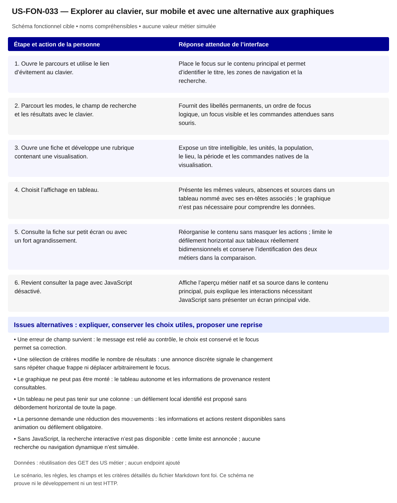

# US-FON-033 — Explorer au clavier, sur mobile et avec une alternative aux graphiques

**Rattachement :** exigence transversale des 31 fonctionnalités. **Lot :** Transversal L2 à L9 ; intégration et recette L10.

**Périmètre :** inclus. Les dépendances et les tests à réaliser organisent la réalisation, sans retirer la fonctionnalité.

**Dépendances et passerelles :** [US-FON-001](US-FON-001.md) (E01); [US-FON-002](US-FON-002.md) (E02); [US-FON-003](US-FON-003.md) (E03); [US-FON-004](US-FON-004.md) (E04); [US-FON-005](US-FON-005.md) (E05); [US-FON-006](US-FON-006.md) (E06); [US-FON-007](US-FON-007.md) (E07); [US-FON-008](US-FON-008.md) (E08); [US-FON-009](US-FON-009.md) (E09); [US-FON-010](US-FON-010.md) (E10); [US-FON-011](US-FON-011.md) (E11); [US-FON-012](US-FON-012.md) (E12); [US-FON-013](US-FON-013.md) (E13); [US-FON-014](US-FON-014.md) (E14); [US-FON-015](US-FON-015.md) (E15); [US-FON-016](US-FON-016.md) (E16); [US-FON-017](US-FON-017.md) (E17); [US-FON-018](US-FON-018.md) (E18); [US-FON-019](US-FON-019.md) (E19); [US-FON-020](US-FON-020.md) (E20); [US-FON-021](US-FON-021.md) (E21); [US-FON-022](US-FON-022.md) (E22); [US-FON-023](US-FON-023.md) (E23); [US-FON-024](US-FON-024.md) (E24); [US-FON-025](US-FON-025.md) (E25); [US-FON-026](US-FON-026.md) (E26); [US-FON-027](US-FON-027.md) (E27); [US-FON-028](US-FON-028.md) (E28); [US-FON-029](US-FON-029.md) (E29); [US-FON-030](US-FON-030.md) (E30); [US-FON-031](US-FON-031.md) (E31).

**État constaté au 2 novembre 2026 :** Clavier ciblé, focus, reflow, réduction des mouvements, échantillons de contraste, tableaux et aperçu sans JavaScript testés localement. Zoom navigateur réel et lecteurs d’écran NON TESTÉS ; audit RGAA complet restant. Les données proviennent des JSON observés ; aucune validation HTTP nouvelle.

[Retour au backlog](../04_BACKLOG_USER_STORIES.md) · [Modèle commun](../../00_MODELE_COMMUN_USER_STORIES/MODELE_US_FONCTIONNELLE.md)

## 1. Objectif fonctionnel

Rendre les fonctionnalités et les données accessibles avec les différents équipements et modes d’accès, sans imposer une lecture visuelle d’un graphique. Maintenir une première information métier lisible si JavaScript est désactivé et annoncer clairement les limites des interactions disponibles.

## 2. User Story

En tant que personne qui utilise un téléphone, le clavier, un agrandissement ou une aide technique, je souhaite lire les informations et agir avec des commandes compréhensibles, afin d’explorer les mêmes possibilités professionnelles de façon autonome.

## 3. Préconditions

- Les 31 fonctionnalités et leurs états sont conservés ; l’adaptation de présentation ne supprime aucune rubrique ou action.
- DSFR constitue le socle de l’interface ; les visualisations pertinentes utilisent les composants officiels DSFR Chart déjà intégrés.
- Les graphiques disposent d’une alternative tabulaire donnant les mêmes valeurs et métadonnées ; la lecture d’une infobulle n’est pas la seule façon d’obtenir une valeur.
- La description métier utilisée dans l’aperçu sans JavaScript provient d’une réponse native et conserve sa source.

## 4. Scénario nominal

| Étape | Action utilisateur | Comportement attendu du système |
|---|---|---|
| 1 | Ouvre le parcours et utilise le lien d’évitement au clavier. | Place le focus sur le contenu principal et permet d’identifier le titre, les zones de navigation et la recherche. |
| 2 | Parcourt les modes, le champ de recherche et les résultats avec le clavier. | Fournit des libellés permanents, un ordre de focus logique, un focus visible et les commandes attendues sans souris. |
| 3 | Ouvre une fiche et développe une rubrique contenant une visualisation. | Expose un titre intelligible, les unités, la population, le lieu, la période et les commandes natives de la visualisation. |
| 4 | Choisit l’affichage en tableau. | Présente les mêmes valeurs, absences et sources dans un tableau nommé avec ses en-têtes associés ; le graphique n’est pas nécessaire pour comprendre les données. |
| 5 | Consulte la fiche sur petit écran ou avec un fort agrandissement. | Réorganise le contenu sans masquer les actions ; limite le défilement horizontal aux tableaux réellement bidimensionnels et conserve l’identification des deux métiers dans la comparaison. |
| 6 | Revient consulter la page avec JavaScript désactivé. | Affiche l’aperçu métier natif et sa source dans le contenu principal, puis explique les interactions nécessitant JavaScript sans présenter un écran principal vide. |

## 5. Scénarios alternatifs

- Une erreur de champ survient : le message est relié au contrôle, le choix est conservé et le focus permet sa correction.
- Une sélection de critères modifie le nombre de résultats : une annonce discrète signale le changement sans répéter chaque frappe ni déplacer arbitrairement le focus.
- Le graphique ne peut pas être monté : le tableau autonome et les informations de provenance restent consultables.
- Un tableau ne peut pas tenir sur une colonne : un défilement local identifié est proposé sans débordement horizontal de toute la page.
- La personne demande une réduction des mouvements : les informations et actions restent disponibles sans animation ou défilement obligatoire.
- Sans JavaScript, la recherche interactive n’est pas disponible : cette limite est annoncée ; aucune recherche ou navigation dynamique n’est simulée.

## 6. Règles de gestion

- Chaque vue possède un titre principal cohérent, une langue française déclarée et des commandes HTML sémantiques ; les noms des commandes décrivent leur action.
- Une information ne dépend ni de la seule couleur, ni du seul survol, ni d’une animation. Les sources, unités et bases statistiques restent lisibles hors infobulle.
- Les accordéons, onglets, sélecteurs et dialogues exposent leur nom, leur rôle et leur état et conservent un parcours clavier cohérent.
- Les actualisations locales préservent le focus de l’action, notamment après retrait de piste ou de critère, changement de filtre et inversion du comparateur.
- L’alternative tabulaire conserve exactement zéro, valeur négative, secret et absence ; elle ne complète pas les données omises du graphique.
- La présentation mobile du comparateur conserve le nom de A et B pour chaque critère ; une simplification de mise en page ne retire pas un volet fonctionnel.
- Le montage progressif des graphiques évite de créer toutes les visualisations à l’ouverture ; les tableaux et informations nécessaires restent accessibles.
- L’usage de DSFR et DSFR Chart ainsi que les tests automatisés ne constituent pas une attestation RGAA ; la conformité finale dépend de la recette de l’application intégrée.

**Règles communes :** noms et explications en langage courant ; ROME V3 uniquement ; aucune source métier extérieure aux 21 GET ; aucune moyenne, conversion annuelle/mensuelle, interpolation ou correspondance construite. Les codes restent internes aux requêtes, routes et tests.

Une valeur nulle, absente, `secret_stat`, zéro et une liste vide conservent leur sens distinct. Afficher le lieu réellement mesuré et expliquer le repli par indicateur ; ne pas attribuer un résultat de famille à un seul métier ou un résultat national à une session.

## 7. Données et API

Aucun GET supplémentaire. L’alternative et le graphique consomment les mêmes réponses et les mêmes champs des 21 GET autorisés. Les adaptations de format, d’ordre de lecture et de code géographique sont techniques et contrôlées ; elles n’ajoutent ni indicateur ni valeur. L’aperçu sans JavaScript reprend la description métier native déjà disponible.

**Preuves et références :** [07_parcours/Explorer/TESTS_UX_EXPLORER.md](../TESTS_UX_EXPLORER.md); [07_parcours/Explorer/11_INTEGRATION_DSFR_CHART.md](../11_INTEGRATION_DSFR_CHART.md); [07_parcours/Explorer/11_ux_ui/CONCEPTION_UX_UI.md](../11_ux_ui/CONCEPTION_UX_UI.md); [07_parcours/00_REFERENTIEL_COMMUN_DATAVISUALISATION/06_REGLES_STATISTIQUES_RGAA.md](../../00_REFERENTIEL_COMMUN_DATAVISUALISATION/06_REGLES_STATISTIQUES_RGAA.md); [07_parcours/Explorer/12_maquette_html/controles/resultats/TESTS_UX_CDP_APRES.json](../12_maquette_html/controles/resultats/TESTS_UX_CDP_APRES.json); [07_parcours/Explorer/12_maquette_html/controles/resultats/CONTROLE_MOBILE.json](../12_maquette_html/controles/resultats/CONTROLE_MOBILE.json).

**Tests restant nécessaires :**

- Vérifier le vrai zoom navigateur 200/400 pour cent : le grossissement CDP et le reflow déjà contrôlés ne le remplacent pas.
- Réaliser les parcours avec lecteurs d’écran et compléter la recette clavier des composants et dialogues non couverts.
- Compléter les contrastes de tous les états : les six échantillons contrôlés par format, au minimum 5,34:1, ne couvrent pas tout le service.
- Tester une panne de montage du graphique avec conservation effective du tableau autonome.
- Effectuer l’audit RGAA de l’application de production ; ne pas transformer les contrôles locaux en certification.

## 8. Critères d’acceptation

**US-FON-033-CA-01** — **Étant donné** une page ouverte au clavier, **Quand** la personne active le lien d’évitement, **Alors** le contenu principal reçoit le focus et la personne peut poursuivre dans un ordre de lecture cohérent.

**US-FON-033-CA-02** — **Étant donné** le guide sans critères précochés, **Quand** la personne choisit puis retire un savoir-faire avec le clavier, **Alors** le choix, le compteur et l’annonce restent synchronisés et le focus ne disparaît pas.

**US-FON-033-CA-03** — **Étant donné** un graphique contenant des valeurs publiées et une valeur indisponible, **Quand** la personne active le tableau, **Alors** les mêmes valeurs et absences sont lisibles avec leurs libellés, unité, population, période et source.

**US-FON-033-CA-04** — **Étant donné** une visualisation dont le montage échoue, **Quand** la personne consulte la rubrique, **Alors** le tableau autonome et la provenance demeurent disponibles sans valeur de remplacement.

**US-FON-033-CA-05** — **Étant donné** une consultation à largeur de reflow 320 pixels, **Quand** la personne parcourt une fiche et le comparateur, **Alors** la page ne déborde pas horizontalement et les éventuels défilements locaux de tableaux sont identifiables.

**US-FON-033-CA-06** — **Étant donné** une préférence de réduction des mouvements, **Quand** la personne ouvre les panneaux et utilise les commandes, **Alors** aucune animation n’est nécessaire pour lire ou atteindre le contenu.

**US-FON-033-CA-07** — **Étant donné** JavaScript désactivé, **Quand** la personne ouvre le document, **Alors** un aperçu métier lisible avec sa source apparaît dans le contenu principal et les limites interactives sont explicites.

**US-FON-033-CA-08** — **Étant donné** une navigation avec lecteur d’écran ou un zoom navigateur de 200 ou 400 pour cent, **Quand** la recette manuelle est exécutée sur l’interface intégrée, **Alors** les résultats sont consignés et toute limite non vérifiée reste annoncée comme non testée.

**US-FON-033-CA-09** — **Étant donné** un intitulé public et son identifiant technique disponibles, **Quand** le contenu est présenté, **Alors** les noms sont compréhensibles, les sources restent accessibles et aucun code de référentiel n’est imposé à la personne.

**US-FON-033-CA-10** — **Étant donné** une réponse absente, protégée ou en erreur pour un seul volet, **Quand** les autres réponses sont disponibles, **Alors** les volets disponibles restent consultables et l’état manquant est expliqué sans valeur de substitution.

## 9. Composants UX/UI

- Lien d’évitement, landmarks, h1 unique, liens et boutons DSFR sémantiques ; focus visible et non masqué.
- Champs avec labels permanents, aides et erreurs associées ; groupes de choix nommés et statut annoncé discrètement.
- Accordéons, onglets et dialogues avec gestion du clavier, du focus et des états développés ou sélectionnés.
- DataBox avec BarChart, LineChart, MapChart ou TableChart officiels selon les US ; tableau autonome nommé, en-têtes et libellés complets.
- Cibles de commande adaptées au tactile ; les boutons de retrait des critères sont actuellement mesurés à 44 × 44 pixels.
- Une colonne sur mobile, comparaison lisible par critère, défilement local des tables, recherche repliable pour libérer la lecture.
- Réduction des mouvements, contrastes vérifiés sur les états intégrés et absence d’information transmise uniquement par la couleur.
- Bloc sans JavaScript dans le contenu principal existant ; description métier native, source et explication des limites.

**États à rendre accessibles :** initial, saisie/choix, attente annoncée, résultat, résultat partiel, vide, valeur non renseignée/protégée, erreur et reprise. Afficher des messages près des commandes concernées ; conserver les sélections utiles et ignorer les réponses périmées.

**Accessibilité :** libellés permanents, structure des titres, liens explicites, focus visible et logique, navigation intégrale au clavier ; annoncer les changements utiles sans lire chaque frappe. Aucune information portée par la seule couleur, le survol ou une carte. Tableau de données équivalent pour chaque graphique ; source, période, unité, population et lieu effectif accessibles au même endroit.

**Responsive et sobriété :** progression par questions, détails à la demande, réemploi des GET identiques ; repli sans perte de contenu, lecture à 320 px et zoom navigateur 200/400 % à recetter. JavaScript indisponible : afficher le contenu de repli et les limites réelles. Une recette locale ne constitue pas une conformité RGAA complète.

**Bibliothèques :** DSFR installé pour les contrôles et tableaux ; DSFR Chart officiel (`@gouvfr/dsfr-chart` 2.1.1 dans l’intégration actuelle) et DataBox quand une représentation convient. Pas de graphique personnalisé pour remplacer un composant adapté. GenUI n’est pas une dépendance de réalisation décidée ; aucun service ni endpoint supplémentaire n’est supposé.

## 10. Maquette fonctionnelle

[Ouvrir le schéma SVG accessible](svg/US-FON-033.svg). Le texte intégral du scénario en section 4 et des alternatives en section 5 fournit son alternative. Il s’agit de la cible fonctionnelle, sans données de démonstration inventées ni déclaration de disponibilité HTTP.
