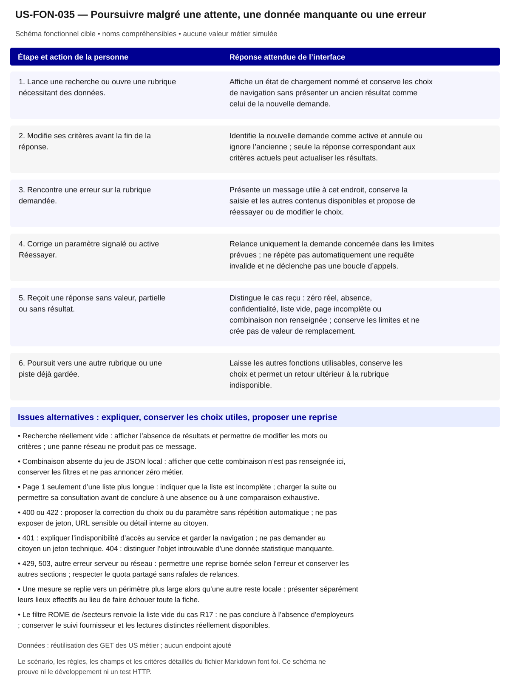

# US-FON-035 — Poursuivre malgré une attente, une donnée manquante ou une erreur

**Rattachement :** exigence transversale des 31 fonctionnalités. **Lot :** Transversal L1 à L9 ; intégration HTTP L1 et recette L10.

**Périmètre :** inclus. Les dépendances et les tests à réaliser organisent la réalisation, sans retirer la fonctionnalité.

**Dépendances et passerelles :** [US-FON-001](US-FON-001.md) (E01); [US-FON-002](US-FON-002.md) (E02); [US-FON-003](US-FON-003.md) (E03); [US-FON-004](US-FON-004.md) (E04); [US-FON-005](US-FON-005.md) (E05); [US-FON-006](US-FON-006.md) (E06); [US-FON-007](US-FON-007.md) (E07); [US-FON-008](US-FON-008.md) (E08); [US-FON-009](US-FON-009.md) (E09); [US-FON-010](US-FON-010.md) (E10); [US-FON-011](US-FON-011.md) (E11); [US-FON-012](US-FON-012.md) (E12); [US-FON-013](US-FON-013.md) (E13); [US-FON-014](US-FON-014.md) (E14); [US-FON-015](US-FON-015.md) (E15); [US-FON-016](US-FON-016.md) (E16); [US-FON-017](US-FON-017.md) (E17); [US-FON-018](US-FON-018.md) (E18); [US-FON-019](US-FON-019.md) (E19); [US-FON-020](US-FON-020.md) (E20); [US-FON-021](US-FON-021.md) (E21); [US-FON-022](US-FON-022.md) (E22); [US-FON-023](US-FON-023.md) (E23); [US-FON-024](US-FON-024.md) (E24); [US-FON-025](US-FON-025.md) (E25); [US-FON-026](US-FON-026.md) (E26); [US-FON-027](US-FON-027.md) (E27); [US-FON-028](US-FON-028.md) (E28); [US-FON-029](US-FON-029.md) (E29); [US-FON-030](US-FON-030.md) (E30); [US-FON-031](US-FON-031.md) (E31).

**État constaté au 2 novembre 2026 :** Attente, erreur de recherche, absence et protection contre réponse périmée testées dans le fournisseur local ; variantes statistiques et fidélité des JSON contrôlées hors ligne. Authentification, erreurs réseau réelles, reprise et quota HTTP restent à valider dans l’environnement Q01. Aucun test statique ni simulation n’est présenté comme preuve HTTP.

[Retour au backlog](../04_BACKLOG_USER_STORIES.md) · [Modèle commun](../../00_MODELE_COMMUN_USER_STORIES/MODELE_US_FONCTIONNELLE.md)

## 1. Objectif fonctionnel

Maintenir un parcours compréhensible lorsqu’une réponse tarde, manque ou échoue, sans perdre les choix de la personne ni substituer une autre donnée. Éviter qu’une ancienne réponse, une page partielle ou une combinaison non renseignée produise une conclusion fausse.

## 2. User Story

En tant que personne qui explore des métiers, je souhaite savoir ce qui se passe quand une recherche ou une rubrique ne répond pas, afin de corriger mes choix, réessayer ou continuer sans perdre mon travail.

## 3. Préconditions

- Chaque demande est reliée à son objet et à ses paramètres exacts : mode, recherche, identifiant métier ou certification, lieu et filtres concernés.
- L’état des données est distinct de celui du transport et de celui de la navigation ; les pistes, le territoire et les choix A/B ne sont pas effacés par une erreur de rubrique.
- Les 21 GET, leurs paramètres, leur pagination et leurs erreurs documentées sont les seuls appels métier autorisés.
- Le fournisseur local de JSON et les contrôles peuvent simuler attente et erreur pour vérifier l’interface ; ces simulations ne valident pas le fonctionnement HTTP du fournisseur.

## 4. Scénario nominal

| Étape | Action utilisateur | Comportement attendu du système |
|---|---|---|
| 1 | Lance une recherche ou ouvre une rubrique nécessitant des données. | Affiche un état de chargement nommé et conserve les choix de navigation sans présenter un ancien résultat comme celui de la nouvelle demande. |
| 2 | Modifie ses critères avant la fin de la réponse. | Identifie la nouvelle demande comme active et annule ou ignore l’ancienne ; seule la réponse correspondant aux critères actuels peut actualiser les résultats. |
| 3 | Rencontre une erreur sur la rubrique demandée. | Présente un message utile à cet endroit, conserve la saisie et les autres contenus disponibles et propose de réessayer ou de modifier le choix. |
| 4 | Corrige un paramètre signalé ou active Réessayer. | Relance uniquement la demande concernée dans les limites prévues ; ne répète pas automatiquement une requête invalide et ne déclenche pas une boucle d’appels. |
| 5 | Reçoit une réponse sans valeur, partielle ou sans résultat. | Distingue le cas reçu : zéro réel, absence, confidentialité, liste vide, page incomplète ou combinaison non renseignée ; conserve les limites et ne crée pas de valeur de remplacement. |
| 6 | Poursuit vers une autre rubrique ou une piste déjà gardée. | Laisse les autres fonctions utilisables, conserve les choix et permet un retour ultérieur à la rubrique indisponible. |

## 5. Scénarios alternatifs

- Recherche réellement vide : afficher l’absence de résultats et permettre de modifier les mots ou critères ; une panne réseau ne produit pas ce message.
- Combinaison absente du jeu de JSON local : afficher que cette combinaison n’est pas renseignée ici, conserver les filtres et ne pas annoncer zéro métier.
- Page 1 seulement d’une liste plus longue : indiquer que la liste est incomplète ; charger la suite ou permettre sa consultation avant de conclure à une absence ou à une comparaison exhaustive.
- 400 ou 422 : proposer la correction du choix ou du paramètre sans répétition automatique ; ne pas exposer de jeton, URL sensible ou détail interne au citoyen.
- 401 : expliquer l’indisponibilité d’accès au service et garder la navigation ; ne pas demander au citoyen un jeton technique. 404 : distinguer l’objet introuvable d’une donnée statistique manquante.
- 429, 503, autre erreur serveur ou réseau : permettre une reprise bornée selon l’erreur et conserver les autres sections ; respecter le quota partagé sans rafales de relances.
- Une mesure se replie vers un périmètre plus large alors qu’une autre reste locale : présenter séparément leurs lieux effectifs au lieu de faire échouer toute la fiche.
- Le filtre ROME de /secteurs renvoie la liste vide du cas R17 : ne pas conclure à l’absence d’employeurs ; conserver le suivi fournisseur et les lectures distinctes réellement disponibles.

## 6. Règles de gestion

- Une réponse périmée ne modifie ni les résultats ni les messages d’erreur de la demande active, y compris après changement de mode.
- Les erreurs sont gérées par recherche ou rubrique ; une panne de mobilité, certification ou salaire ne masque pas les autres informations déjà disponibles.
- Une réponse n’est réutilisée que pour les mêmes paramètres et une provenance compatible. Les chiffres d’un autre métier ou lieu ne constituent jamais une solution de remplacement.
- Si des données antérieures sont conservées pendant une actualisation, leur contexte et leur statut restent explicites ; elles ne sont pas présentées comme la nouvelle réponse.
- null, champ absent, zéro, secret_stat, liste vide, non applicable et erreur sont distincts ; les valeurs non numériques n’entrent pas dans les graphiques comme des zéros.
- Une réponse paginée conserve items, total, page_size, page et last_page lorsqu’ils sont documentés. Une liste partielle ne permet pas une conclusion négative sur une compétence ou une association.
- Les GET peuvent être repris de façon bornée selon leur erreur ; 400/422 exigent une correction. Le quota contractuel de 40 requêtes par seconde et par jeton concerne le service partagé.
- L’authentification et le jeton restent techniques et non publics. Le choix d’hébergement et de passage serveur est à finaliser dans D10, sans nouveau service de données métier.
- Les preuves de test gardent le niveau réel : simulation locale, JSON observé, contrôle hors ligne et requête HTTP tracée sont des catégories différentes.
- Une dépendance RCO ou une variante non testée reste dans le périmètre avec son suivi ; elle n’autorise ni suppression de fonctionnalité ni création de données.

**Règles communes :** noms et explications en langage courant ; ROME V3 uniquement ; aucune source métier extérieure aux 21 GET ; aucune moyenne, conversion annuelle/mensuelle, interpolation ou correspondance construite. Les codes restent internes aux requêtes, routes et tests.

Une valeur nulle, absente, `secret_stat`, zéro et une liste vide conservent leur sens distinct. Afficher le lieu réellement mesuré et expliquer le repli par indicateur ; ne pas attribuer un résultat de famille à un seul métier ou un résultat national à une session.

## 7. Données et API

Aucun GET supplémentaire. Cette US encadre les 21 GET déjà affectés aux fonctions métier : paramètres exacts, identifiant de demande, pagination, contrôle des états et réutilisation à contexte égal. Les réponses /indicateurs conservent leur maille_reelle et leur repli par mesure ; les autres routes utilisent leur propre enveloppe documentée. Les tests de transport devront conserver requête, environnement, statut et corps expurgés, sans publier le jeton.

**Preuves et références :** [AGENTS.md](../../../AGENTS.md); [07_parcours/Explorer/02_SPECIFICATIONS_API.md](../02_SPECIFICATIONS_API.md); [07_parcours/Explorer/06_DECISIONS_ET_POINTS_A_VALIDER.md](../06_DECISIONS_ET_POINTS_A_VALIDER.md); [07_parcours/Explorer/10_DECISIONS_A_ARBITRER.md](../10_DECISIONS_A_ARBITRER.md); [07_parcours/Explorer/TESTS_UX_EXPLORER.md](../TESTS_UX_EXPLORER.md); [07_parcours/Explorer/12_maquette_html/sources/experience_exploration.js](../12_maquette_html/sources/experience_exploration.js); [07_parcours/Explorer/12_maquette_html/controles/resultats/TESTS_UX_CDP_APRES.json](../12_maquette_html/controles/resultats/TESTS_UX_CDP_APRES.json); [07_parcours/Explorer/BACKLOG_EXPLORER_RESTANT.md](../BACKLOG_EXPLORER_RESTANT.md).

**Tests restant nécessaires :**

- Brancher et tracer les GET dans l’environnement Q01 ; vérifier les erreurs HTTP réelles et le quota sans déduire leur comportement des simulations locales.
- Tester les demandes successives, annulations et réponses tardives sur réseau réel, y compris après changement de mode et de territoire.
- Collecter un vrai zéro serveur en recherche par savoir-faire, les pages manquantes et les combinaisons compétences/domaines/contextes non observées.
- Tester reprise bornée, échec d’une seule section et refus d’accès sans perte des pistes ou de la paire comparée.
- Compléter les variantes sous secret, tranches ouvertes, replis et listes vides ; les assertions d’état ne remplacent pas leurs preuves de données natives.
- Clore Q14/R17 par un test fournisseur tracé et ne qualifier Q05 d’anomalie qu’après reproduction d’une projection conforme.

## 8. Critères d’acceptation

**US-FON-035-CA-01** — **Étant donné** une recherche encore en cours, **Quand** la personne lance une autre recherche ou change de mode, **Alors** la réponse tardive de la première demande ne remplace pas les résultats ou erreurs de la demande active.

**US-FON-035-CA-02** — **Étant donné** une rubrique en erreur et des pistes déjà gardées, **Quand** la personne revient à la fiche ou à Mes pistes, **Alors** les autres contenus et les choix conservés restent utilisables.

**US-FON-035-CA-03** — **Étant donné** une réponse réseau en échec, **Quand** le système présente son état, **Alors** un message d’erreur avec une action appropriée apparaît et aucun état zéro résultat n’est déduit.

**US-FON-035-CA-04** — **Étant donné** une requête rejetée pour paramètre invalide, **Quand** la personne consulte le message, **Alors** le choix à corriger est identifiable, la saisie utile est conservée et aucune boucle de relance automatique n’est exécutée.

**US-FON-035-CA-05** — **Étant donné** une liste paginée incomplète, **Quand** la personne consulte les compétences ou leur comparaison, **Alors** la limite est visible et aucune absence ni exhaustivité n’est conclue avant l’obtention des pages nécessaires.

**US-FON-035-CA-06** — **Étant donné** une combinaison de critères sans réponse observée dans la maquette, **Quand** la personne lance cette combinaison, **Alors** le système annonce une combinaison non renseignée, conserve les filtres et ne prétend pas qu’aucun métier n’existe.

**US-FON-035-CA-07** — **Étant donné** des réponses contenant respectivement zéro, null et secret_stat, **Quand** la personne consulte les valeurs et leur tableau, **Alors** zéro reste numérique, null reste indisponible et la confidentialité est expliquée sans remplacement ou calcul.

**US-FON-035-CA-08** — **Étant donné** une erreur transitoire donnant lieu à une reprise, **Quand** la personne active Réessayer, **Alors** seule la demande concernée est relancée selon une politique bornée et les données d’un autre métier ou lieu ne sont pas utilisées.

**US-FON-035-CA-09** — **Étant donné** un intitulé public et son identifiant technique disponibles, **Quand** le contenu est présenté, **Alors** les noms sont compréhensibles, les sources restent accessibles et aucun code de référentiel n’est imposé à la personne.

**US-FON-035-CA-10** — **Étant donné** une réponse absente, protégée ou en erreur pour un seul volet, **Quand** les autres réponses sont disponibles, **Alors** les volets disponibles restent consultables et l’état manquant est expliqué sans valeur de substitution.

## 9. Composants UX/UI

- Chargement textuel localisé et annoncé, sans bloquer inutilement toute la page ni effacer les filtres.
- Alerte DSFR contextualisée, action Réessayer pour l’erreur compatible ou retour au champ pour une correction.
- Messages distincts : aucun résultat, combinaison non renseignée, valeur indisponible, confidentialité, liste incomplète et service momentanément indisponible.
- Focus conservé sur les interactions locales ; correction associée au champ et résultats annoncés sans déplacement arbitraire.
- DataBox et tableaux conservant leur contexte quand une autre section échoue ; absence statistique hors graphique mais explicitée dans l’alternative.
- Sources et limites consultables sans exposer au public les traces techniques, jetons ou détails de l’environnement.

**États à rendre accessibles :** initial, saisie/choix, attente annoncée, résultat, résultat partiel, vide, valeur non renseignée/protégée, erreur et reprise. Afficher des messages près des commandes concernées ; conserver les sélections utiles et ignorer les réponses périmées.

**Accessibilité :** libellés permanents, structure des titres, liens explicites, focus visible et logique, navigation intégrale au clavier ; annoncer les changements utiles sans lire chaque frappe. Aucune information portée par la seule couleur, le survol ou une carte. Tableau de données équivalent pour chaque graphique ; source, période, unité, population et lieu effectif accessibles au même endroit.

**Responsive et sobriété :** progression par questions, détails à la demande, réemploi des GET identiques ; repli sans perte de contenu, lecture à 320 px et zoom navigateur 200/400 % à recetter. JavaScript indisponible : afficher le contenu de repli et les limites réelles. Une recette locale ne constitue pas une conformité RGAA complète.

**Bibliothèques :** DSFR installé pour les contrôles et tableaux ; DSFR Chart officiel (`@gouvfr/dsfr-chart` 2.1.1 dans l’intégration actuelle) et DataBox quand une représentation convient. Pas de graphique personnalisé pour remplacer un composant adapté. GenUI n’est pas une dépendance de réalisation décidée ; aucun service ni endpoint supplémentaire n’est supposé.

## 10. Maquette fonctionnelle

[Ouvrir le schéma SVG accessible](svg/US-FON-035.svg). Le texte intégral du scénario en section 4 et des alternatives en section 5 fournit son alternative. Il s’agit de la cible fonctionnelle, sans données de démonstration inventées ni déclaration de disponibilité HTTP.
