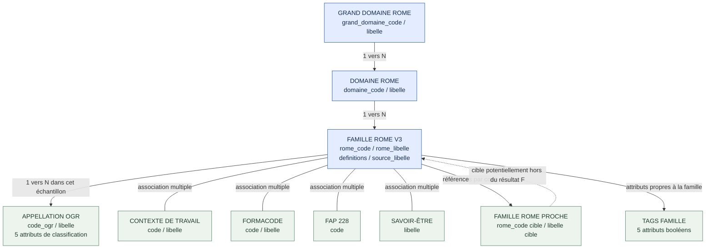
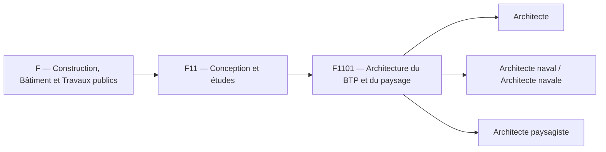
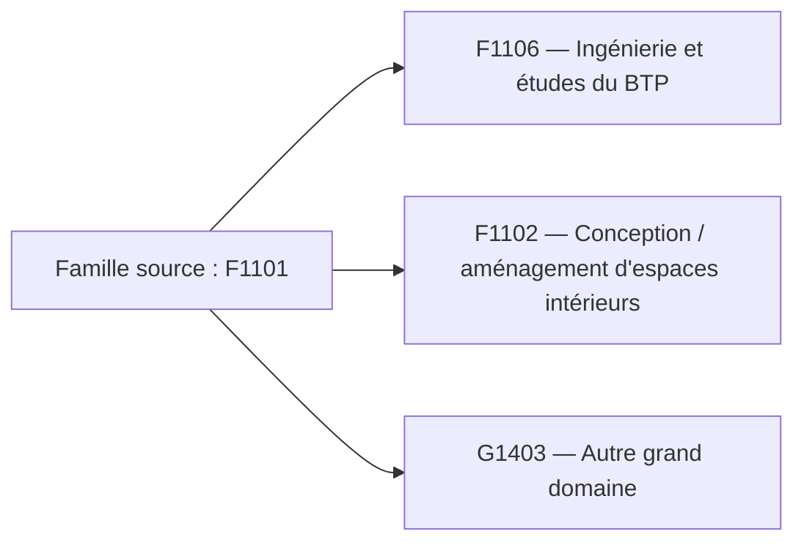

# MaCarrière — API DGEFP–RCO : modèle de données du GET de recherche métiers

> **Documentation de référence — UI / développement / métiers**  
> **Périmètre étudié :** réponse JSON du GET de recherche métiers, interrogé avec le grand domaine ROME `F` (« Construction, Bâtiment et Travaux publics »).  
> **Référentiel de restitution :** familles **ROME V3** ; les appellations OGR ne sont pas des fiches ROME autonomes.  
> **Source examinée :** `response_1794569975604.json` (échantillon fourni le 13/11/2026).  
> **Statut :** structure et statistiques vérifiées sur le JSON fourni ; capacités de filtrage *côté serveur* et règles de calcul des agrégats **à confirmer dans Swagger / auprès de RCO**.

## 1. Objet et règles de lecture

Ce document décrit :

1. La **structure exacte de la réponse JSON** et ses types observés.
2. Le **modèle relationnel logique reconstitué** à partir de cette réponse.
3. Les **relations codes/libellés**, les cardinalités et les contrôles de cohérence.
4. La distinction essentielle entre **famille ROME V3** et **appellation OGR**.
5. Les **opérations de sélection possibles sur un JSON déjà reçu**, sans présumer que l'API RCO accepte les mêmes filtres en entrée.
6. Les conséquences pour la construction de l'interface Explorer et les questions ouvertes pour RCO.

**Convention de preuve :** « observé » signifie vérifié sur les 38 objets du fichier ; « modèle logique » signifie relation déduite de la structure, **pas** table physique attestée dans l'entrepôt RCO ; « à confirmer » désigne un comportement ou une règle non établis par le seul JSON.

## 2. Vue d'ensemble de la réponse

La racine est un **objet** comportant les cinq champs suivants :

| Champ racine | Type observé | Valeur dans l'échantillon | Signification |
|---|---|---:|---|
| `items` | `object[]` | 38 objets | Familles ROME retournées |
| `total` | `integer` | 38 | Total annoncé par la réponse |
| `page_size` | `integer` | 100 | Taille de page annoncée |
| `page` | `integer` | 1 | Page courante |
| `last_page` | `integer` | 1 | Dernière page annoncée |

Les **38 objets `items[]` ont tous les mêmes 23 propriétés au premier niveau** ; aucune de ces propriétés n'est à `null` dans l'échantillon. Cela **ne garantit pas** que ces champs seront obligatoires ou toujours renseignés pour d'autres requêtes.

### 2.1 Schéma minimal de la réponse (types TypeScript)

```ts
// Modèle observé dans la réponse F ; ne remplace pas le contrat OpenAPI.
type ReponseRechercheMetiers = {
  items: FamilleRome[];
  total: number;
  page_size: number;
  page: number;
  last_page: number;
};

type AppellationDetail = {
  code_ogr: string;
  libelle: string;
  transition_eco: string; // catégorie textuelle, pas un booléen
  transition_num: boolean;
  transition_demo: boolean;
  emploi_reglemente: boolean;
  emploi_cadre: boolean;
};

type FamilleRome = {
  appellations: string[];
  appellations_details: AppellationDetail[];
  contexte_travail_codes: string[];
  contexte_travail_libelles: string[];
  definitions: string[];
  domaine_code: string;
  domaine_libelle: string;
  fap228_codes: string[];
  formacode_codes: string[];
  formacode_libelles: string[];
  grand_domaine_code: string;
  grand_domaine_libelle: string;
  metiers_proches_codes: string[];
  metiers_proches_libelles: string[];
  rome_code: string;
  rome_libelle: string;
  savoir_etre_libelles: string[];
  source_libelle: string;
  tag_emploi_cadre: boolean;
  tag_emploi_reglemente: boolean;
  tag_transition_demographique: boolean;
  tag_transition_ecologique: boolean;
  tag_transition_numerique: boolean;
};
```

## 3. Modèle relationnel reconstitué — Mermaid

> **Important :** représentation logique déduite du JSON. Elle ne décrit pas les tables physiques ou clés étrangères effectivement créées dans l'entrepôt RCO.



### 3.1 Lecture des relations

- Le grand domaine `F` regroupe plusieurs **domaines ROME** (par exemple `F11`).
- Chaque domaine regroupe plusieurs **familles ROME V3** (par exemple `F1101`). La **famille est l'unité principale retournée par `items[]`**.
- Chaque famille regroupe des **appellations** ; chaque objet de `appellations_details[]` possède un `code_ogr`, un `libelle` et des attributs propres.
- Les **contextes de travail, Formacodes, FAP et savoir-être** sont associés à la famille, non à une appellation individuelle dans cette réponse.
- Les **métiers proches** sont des références à d'autres familles ROME ; certaines sont absentes du lot reçu.
- Les **tags famille** sont les cinq booléens `tag_*` directement portés par la famille, à ne pas confondre avec les propriétés `appellations_details[]`.

### 3.2 Hiérarchie ROME, exemple réel



**Attention :** ce schéma illustre le rattachement de plusieurs appellations à une **même famille** et non la création de nouvelles familles ROME.

## 4. Dictionnaire des 23 champs de `items[]`

| Groupe | Champ exact | Type | Nature / lecture |
|---|---|---|---|
| Identité famille | `rome_code` | `string` | Code famille ROME V3, ex. `F1101` |
| Identité famille | `rome_libelle` | `string` | Libellé de la famille |
| Hiérarchie | `grand_domaine_code` | `string` | Code de grand domaine, ex. `F` |
| Hiérarchie | `grand_domaine_libelle` | `string` | Libellé du grand domaine |
| Hiérarchie | `domaine_code` | `string` | Code domaine, ex. `F11` |
| Hiérarchie | `domaine_libelle` | `string` | Libellé domaine |
| Appellations | `appellations` | `string[]` | Libellés d'appellations |
| Appellations | `appellations_details` | `object[]` | Détails OGR et attributs par appellation |
| Contextes | `contexte_travail_codes` | `string[]` | Codes de contexte |
| Contextes | `contexte_travail_libelles` | `string[]` | Libellés correspondants |
| Définition | `definitions` | `string[]` | Descriptions textuelles ; un élément dans cet échantillon |
| FAP | `fap228_codes` | `string[]` | Codes FAP ; **pas de libellés** dans la réponse |
| Formation | `formacode_codes` | `string[]` | Codes Formacode associés |
| Formation | `formacode_libelles` | `string[]` | Libellés Formacode associés |
| Proximité | `metiers_proches_codes` | `string[]` | Codes des familles ROME proches |
| Proximité | `metiers_proches_libelles` | `string[]` | Libellés associés |
| Savoir-être | `savoir_etre_libelles` | `string[]` | Valeurs textuelles ; **pas de codes** dans la réponse |
| Provenance | `source_libelle` | `string` | Texte de provenance annoncé |
| Tags famille | `tag_emploi_cadre` | `boolean` | Indicateur au niveau famille |
| Tags famille | `tag_emploi_reglemente` | `boolean` | Indicateur au niveau famille |
| Tags famille | `tag_transition_demographique` | `boolean` | Indicateur au niveau famille |
| Tags famille | `tag_transition_ecologique` | `boolean` | Indicateur au niveau famille |
| Tags famille | `tag_transition_numerique` | `boolean` | Indicateur au niveau famille |

### 4.1 Sous-objet `appellations_details[]`

| Champ exact | Type | Exemple observé / commentaire |
|---|---|---|
| `code_ogr` | `string` | `011110` ; **conserver les zéros initiaux** |
| `libelle` | `string` | `Architecte` |
| `transition_eco` | `string` | Catégorie de transition écologique, cf. valeurs ci-dessous |
| `transition_num` | `boolean` | `true` / `false` |
| `transition_demo` | `boolean` | `true` / `false` |
| `emploi_reglemente` | `boolean` | `true` / `false` |
| `emploi_cadre` | `boolean` | `true` / `false` |

**Valeurs distinctes réellement observées pour `transition_eco` :**

- `Emploi stratégique pour la Transition écologique`
- `Emploi Blanc`
- `Emploi Brun`
- `Emploi Vert`

**Ne pas** convertir ce champ en booléen. Son sens métier exact et les règles d'agrégation vers `tag_transition_ecologique` sont à valider avec RCO.

## 5. Volumétrie et cardinalités observées

| Élément | Total | Minimum par famille | Maximum par famille |
|---|---:|---:|---:|
| Familles ROME V3 dans `items` | **38** | — | — |
| Appellations `appellations[]` | 1 241 entrées | 7 | 134 |
| Objets `appellations_details[]` | 1 241 objets | 7 | 134 |
| Contextes de travail | 556 associations | 7 | 34 |
| Formacodes | 307 associations | 2 | 24 |
| Métiers proches | 580 références | 7 | 42 |
| Savoir-être | 189 associations | 3 | 10 |

**Valeurs uniques dans l'échantillon :** 1 104 codes OGR, 76 codes de contexte, 219 codes Formacode, 191 codes de famille cités comme métiers proches et 15 libellés de savoir-être. Les 1 241 entrées d'appellations **ne sont pas** 1 241 identifiants OGR distincts.

### 5.1 Distribution des familles par domaine

| Domaine | Libellé renvoyé | Familles |
|---|---|---:|
| `F11` | Conception et études | 8 |
| `F12` | Conduite et encadrement de chantier - travaux | 4 |
| `F13` | Engins de chantier | 2 |
| `F14` | Extraction | 2 |
| `F15` | Montage de structures | 3 |
| `F16` | Second oeuvre | 13 |
| `F17` | Travaux et gros oeuvre | 6 |
| **Total** | | **38** |

## 6. Correspondances entre codes et libellés

Trois associations sont fournies sous forme de **tableaux parallèles**. Dans chacune des 38 familles, les listes appariées ont exactement la même longueur :

| Tableau de codes | Tableau de libellés | Associations contrôlées | Décalages de taille |
|---|---|---:|---:|
| `contexte_travail_codes` | `contexte_travail_libelles` | 556 | 0 |
| `formacode_codes` | `formacode_libelles` | 307 | 0 |
| `metiers_proches_codes` | `metiers_proches_libelles` | 580 | 0 |

Dans l'échantillon, **un même code ne reçoit pas plusieurs libellés différents** pour ces trois couples. Cela ne prouve pas une unicité globale dans le référentiel.

### 6.1 Exemple réel de correspondance par index

La famille `F1101` contient :

```json
{
  "contexte_travail_codes": ["403093", "300779"],
  "contexte_travail_libelles": ["En bureau d'études", "Déplacements professionnels"]
}
```

Cet extrait est **réduit aux deux premiers éléments** pour faciliter la lecture ; les deux tableaux sont plus longs dans le JSON d'origine.

### 6.2 Normalisation possible côté application — NON native à l'API

```ts
function apparierCodesLibelles(codes: string[], libelles: string[]) {
  if (codes.length !== libelles.length) {
    throw new Error('Incohérence codes/libellés dans la réponse API');
  }
  return codes.map((code, index) => ({ code, libelle: libelles[index] }));
}
```

**Règle de développement :** vérifier les longueurs avant de zipper, ne pas trier les deux tableaux séparément, conserver les codes en `string` et préserver les valeurs originales pour la traçabilité.

## 7. Famille ROME vs appellation OGR : deux granularités distinctes

| Notion | Famille ROME V3 | Appellation OGR |
|---|---|---|
| Identifiant | `rome_code` | `code_ogr` |
| Libellé | `rome_libelle` | `libelle` |
| Fonction dans ce GET | **Un objet `items[]`** | Un élément dans `appellations_details[]` |
| Tags cadre / réglementé | `tag_emploi_*` | `emploi_*` |
| Tags transitions | `tag_transition_*` | `transition_*` |
| Contextes, Formacodes, savoir-être | Associés à la famille | **Non détaillés par appellation dans ce GET** |

Un `code_ogr` peut avoir plusieurs variantes de libellé dans le résultat : par exemple `011110` apparaît pour « Architecte » et « Architecte habilité » dans `F1101`. Dans le périmètre `F`, les 1 104 codes OGR distincts sont chacun rattachés à **une seule famille observée**, mais cela ne prouve pas une contrainte d'unicité du référentiel complet.

### 7.1 Divergences entre les attributs famille et appellation

Sur les 38 familles, on observe les situations suivantes : une **appellation possède l'attribut**, alors que le **tag de famille correspondant est `false`**.

| Attribut | Familles concernées | Interprétation |
|---|---|---|
| Cadre | `F1103`, `F1104`, `F1401` | Au moins une appellation `emploi_cadre=true` malgré `tag_emploi_cadre=false` |
| Réglementé | `F1702` | Au moins une appellation `emploi_reglemente=true` malgré `tag_emploi_reglemente=false` |
| Transition numérique | `F1104`, `F1605` | Au moins une appellation `transition_num=true` malgré `tag_transition_numerique=false` |
| Transition démographique | Aucune observée | Aucun écart de ce type dans cet échantillon |
| Transition écologique | **Non directement comparable** | Le champ appellation est une catégorie, pas un booléen ; la règle de correspondance est inconnue |

**Correction méthodologique importante :** on ne peut pas considérer toutes les catégories de `transition_eco` comme équivalentes à `true`. Le fait de trouver « Emploi Blanc », « Emploi Brun » ou « Emploi stratégique… » ne suffit pas à reconstruire le tag booléen famille. La règle d'agrégation est **à demander à RCO**.

**Décision d'architecture recommandée :** conserver les tags famille **tels que retournés** et les attributs appellations **tels que retournés**. Si une règle de regroupement métier est définie, la documenter et la tester ; ne pas l'inférer silencieusement.

## 8. Métiers proches : relations transversales

Les champs `metiers_proches_codes[]` et `metiers_proches_libelles[]` constituent **580 références orientées** de la famille source vers une famille cible.

- **214 références** ciblent une des 38 familles déjà présentes dans le résultat `F`.
- **366 références** ciblent une famille **non présente dans le résultat `F`**.
- « Absente du résultat `F` » ne signifie **pas** « inexistante dans le référentiel ».



**Précaution :** le JSON indique la présence d'un lien « proche », mais ne fournit **ni score**, **ni intensité**, **ni justification**, **ni garantie de réciprocité** de cette relation. Ne pas le transformer en « probabilité de reconversion » ou en classement de proximité.

## 9. Sélections possibles à partir du JSON reçu

> **Ce tableau concerne les traitements applicatifs sur `items[]`.** Il **ne prouve pas** que ces conditions peuvent être envoyées comme paramètres dans le GET RCO.

| Donnée | Traitement possible sur la réponse | Unité conservée dans les résultats | Réserve |
|---|---|---|---|
| `grand_domaine_code` | Égalité | Famille ROME | Ici constant à `F` |
| `domaine_code` | Égalité, ensemble de valeurs | Famille ROME | Hiérarchie |
| `rome_code` | Égalité, ensemble de valeurs | Famille ROME | Identifiant |
| `rome_libelle` | Recherche textuelle | Famille ROME | Normalisation de texte à définir |
| `appellations` | Recherche de sous-chaîne / token | Famille ROME trouvée via une appellation | Ne pas prétendre que l'appellation est une famille |
| `appellations_details.code_ogr` | Présence d'un code | Famille ROME | Déduplication selon besoin |
| `contexte_travail_codes` | Contient un ou plusieurs codes (ET/OU) | Famille ROME | Présence ≠ exclusivité |
| `formacode_codes` | Contient un ou plusieurs codes | Famille ROME | Association, pas certification |
| `fap228_codes` | Contient un code FAP | Famille ROME | Pas de libellé FAP ici |
| `savoir_etre_libelles` | Contient un ou plusieurs libellés | Famille ROME | Champ sans identifiant |
| `metiers_proches_codes` | Contient une famille cible | Famille ROME source | Lien de proximité uniquement |
| `tag_*` | Sélection `true` / `false` | Famille ROME | Règle d'agrégation inconnue |
| `appellations_details.emploi_*` | Au moins une appellation correspond | Famille ROME avec appellation trouvée | **Ne pas** confondre avec tag famille |
| `appellations_details.transition_eco` | Sélection par catégorie exacte | Famille ROME avec appellation trouvée | Quatre catégories observées |

### 9.1 Principe de composition technique

```ts
// Exemple : filtrage local, APRÈS obtention de la réponse API.
const resultat = reponse.items.filter((famille) =>
  famille.domaine_code === 'F11' &&
  famille.contexte_travail_codes.includes('403093')
);
```

Cet exemple sélectionne les **familles ROME** du domaine `F11` associées au contexte codé `403093` (« En bureau d'études »). Il **ne dit rien** sur la possibilité de passer ces champs dans la requête HTTP du GET.

### 9.2 Règles de prudence indispensables

1. **Présence d'un contexte ≠ exclusivité.** « Travail en journée » associé à une famille ne veut pas dire « uniquement en journée ».
2. **Absence d'un contexte ≠ impossibilité.** Si « Possibilité de télétravail » n'apparaît pas, on ne peut pas en déduire « télétravail impossible ».
3. **Une propriété d'appellation ne vaut pas automatiquement pour toutes les appellations d'une famille.** Préserver l'origine du résultat (famille ou appellation).
4. **Conserver l'unité d'affichage ROME V3.** Un filtre sur les appellations permet de retrouver des familles, et éventuellement de montrer l'appellation qui a déclenché la correspondance.
5. **Ne pas calculer de niveau de qualification, de salaire, de diplôme requis, de difficulté d'accès ou de potentiel de recrutement** à partir de champs qui ne portent pas ces informations.
6. **Ne pas assimiler un Formacode à une session de formation ni à une certification.** Les croisements avec les GET de certifications et de sessions sont un autre travail.

## 10. Implications de mise en œuvre pour les équipes

### 10.1 UI / UX — ce qui peut être représenté sans inventer de données

- Affichage hiérarchique **Grand domaine → Domaine → Famille ROME V3**.
- Recherche par libellé de **famille** ou par **appellation**, en expliquant le lien entre les deux.
- Exploration des **contextes de travail associés** aux familles ; intitulés issus de `contexte_travail_libelles`.
- Affichage des **savoir-être**, des **Formacodes associés** et des **familles proches**, sans surinterpréter les relations.
- Pour un critère d'appellation, possibilité d'afficher **« correspondance trouvée dans l'appellation X »** en conservant la famille ROME comme résultat principal.

**Hors de portée de ce JSON seul :** rémunérations, offres en temps réel, tensions de recrutement, volumes territoriaux, niveaux de formation requis, certifications précises, sessions ouvertes et scores de compatibilité. Ils exigeraient d'autres réponses ou règles documentées.

### 10.2 Développement — règles techniques

- Utiliser les **codes comme clés de référence**, toujours en chaîne de caractères (`code_ogr` peut commencer par zéro).
- Vérifier les tableaux parallèles et rapprocher code/libellé **à index identique** ; ne jamais trier l'un sans l'autre.
- Ne pas dédupliquer les appellations par texte si l'objectif est d'assurer la traçabilité OGR ; expliciter la stratégie de déduplication.
- Préserver les `tag_*` famille distincts des attributs OGR.
- Traiter les `metiers_proches_codes` comme des **références potentiellement non résolues** dans le jeu courant.
- Anticiper les réponses paginées (`page`, `page_size`, `total`, `last_page`) ; ne pas supposer que les résultats de futures recherches tiendront sur une seule page.
- Ajouter la traçabilité de la requête et des paramètres d'appel aux tests : le fichier fourni ne contient que la **réponse**.

### 10.3 Métier / data — décisions à expliciter

- Les résultats MaCarrière sont-ils **toujours des familles ROME V3** dans Explorer ? (Hypothèse de conception actuelle : oui.)
- Quelles règles permettent de qualifier une famille de « cadre », « réglementée » ou concernée par une transition ?
- Une recherche par appellation doit-elle afficher le libellé OGR correspondant tout en gardant la famille comme unité de navigation ?
- Les contextes de travail sont-ils descriptifs, facultatifs, exhaustifs ? Comment interpréter leur absence ?
- Comment présenter les **métiers proches** sans les transformer artificiellement en suggestions classées ?

## 11. Questions à adresser à RCO / points non démontrés

| Sujet | Question précise | Enjeu |
|---|---|---|
| Contrat GET recherche | Quels paramètres de filtre sont réellement exposés par Swagger, avec quelles valeurs, combinaisons et règles ? | Séparer filtrage serveur/client |
| Pagination | Les recherches multi-domaines renvoient-elles systématiquement toutes les familles attendues si l'on parcourt toutes les pages ? | Exhaustivité |
| Granularité OGR | Quel est le statut exact de `code_ogr` et des variantes de `libelle` ? | Identité / déduplication |
| Agrégats de tags | Comment les `tag_*` famille sont-ils calculés au regard des attributs appellations ? | Cohérence |
| Transition écologique | Quelle correspondance métier entre `transition_eco` (4 catégories) et `tag_transition_ecologique` ? | Ne pas fabriquer un booléen faux |
| Contextes | Les codes sont-ils exhaustifs, et l'absence a-t-elle une signification ? | Filtrage fiable |
| Savoir-être | Existe-t-il une version codifiée de `savoir_etre_libelles` via un autre GET ? | Clés stables |
| FAP | Où récupérer les libellés et la nomenclature complète des `fap228_codes` ? | Restitution |
| Proximité ROME | Quelle est la définition exacte de `metiers_proches` et la relation est-elle orientée/réciproque ? | Exploration / mobilité |
| Version référentiel | Quelles données sont ramenées du ROME 4.0 au parent V3 ? La règle est-elle homogène par champ ? | Stabilité du modèle V3 |

## 12. Contrôles de qualité effectués sur le fichier

| Contrôle | Résultat sur l'échantillon |
|---|---|
| JSON parsable | Oui |
| Structure racine | `items`, `total`, `page_size`, `page`, `last_page` |
| Nombre d'objets | 38, cohérent avec `total=38` |
| Uniformité des clés `items[]` | 23 clés identiques dans les 38 familles |
| Valeurs `null` au premier niveau | 0 |
| Couples code/libellé de contexte | Longueur alignée dans 38/38 familles |
| Couples code/libellé Formacode | Longueur alignée dans 38/38 familles |
| Couples code/libellé métiers proches | Longueur alignée dans 38/38 familles |
| Plusieurs libellés différents pour un même code dans ces couples | Aucun cas observé |
| Variantes de libellés OGR | Oui : 1 241 lignes d'appellations, 1 104 codes distincts |
| Références vers familles hors résultat F | Oui : 366 références sur 580 |
| Règles de calcul des tags | **Non déterminables** à partir de cette seule réponse |
| Filtres natifs du GET | **Non déterminables** à partir de cette seule réponse |

## 13. Synthèse décisionnelle

**Le modèle de réponse est structuré autour de la famille ROME V3.** Cette famille est reliée à une classification hiérarchique, à des appellations OGR détaillées, à des contextes, aux Formacodes, FAP, savoir-être et à des relations vers des familles proches. Les propriétés au niveau **famille** et au niveau **appellation** doivent rester distinctes.

**Pour l'UI :** on peut préparer des facettes et parcours à partir des champs présents, sous réserve de ne pas attribuer une propriété d'appellation à toute la famille, ni de transformer une absence de contexte en négation.

**Pour les développeurs :** le JSON autorise des traitements en mémoire, mais **ne décrit pas les paramètres de filtrage acceptés par le GET**. Cette dernière capacité doit être vérifiée dans la spécification Swagger de l'API DGEFP–RCO avant d'engager l'implémentation.

**Pour les métiers :** les règles de qualification des tags et le sens précis des relations « proches » ou « contextes de travail » restent à confirmer avec RCO.

---

**Document basé exclusivement sur le JSON de réponse fourni.** Les exemples TypeScript et les diagrammes Mermaid constituent des représentations et propositions de normalisation ; ils ne sont pas des extraits attestés du contrat OpenAPI ni une description des tables physiques de RCO.
